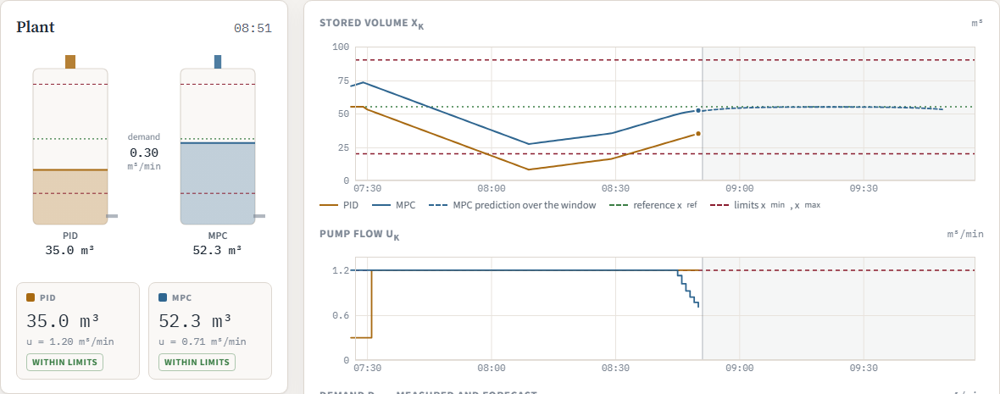
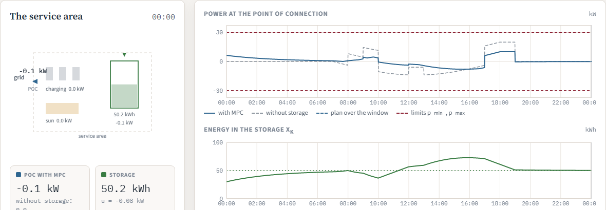
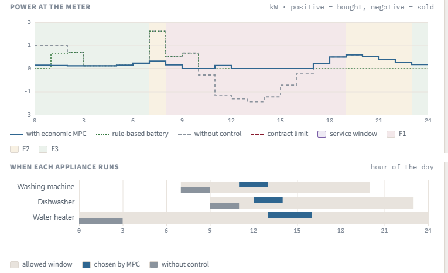
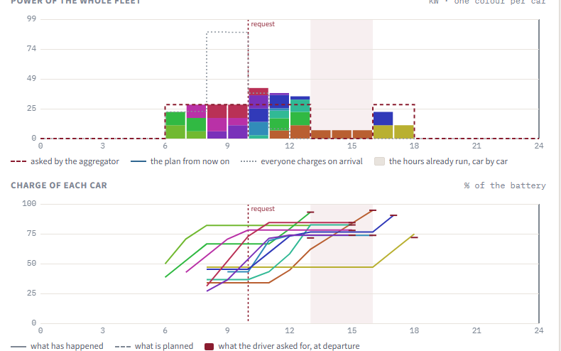
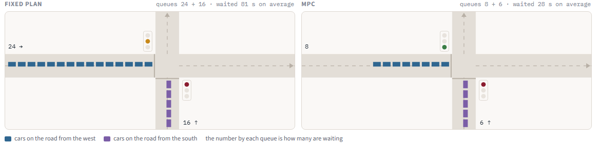

<!--
HOW TO ADD A LESSON: copy the block below, paste it ABOVE the previous lesson if you prefer
newest-first, or BELOW it for oldest-first (this page is oldest-first), and fill it in.

## Lesson N (dd/mm/2026): Title {#lesson-N}

[MPC]{.part .part-mpc}   <- or [RL]{.part .part-rl} / [ID]{.part .part-id} / [Intro]{.part .part-gen}

Summary of the lesson.

- [Blackboard notes](LINK)
- Study ...
-->

::: {.news}
**Recordings.** The lessons of this edition are not recorded. The recordings of the previous edition of the course remain available, and cover most of the same topics: you can find them on the [previous course website](https://sites.google.com/diag.uniroma1.it/liberati/home/teaching).
:::

::: {.news}
**Course notes.** [Model Predictive Control — course notes, part I](files/notes/mpc-notes-part1.pdf){target="_blank" rel="noopener"} (PDF): the MPC part of the course so far, from the receding horizon to the theory of optimality, feasibility and stability and to the case studies, with the references for a deeper study at the end of each chapter, the same as in this diary. Version of 27 October 2026, to be completed after the lesson on task scheduling.
:::

## Lesson 1 (23/09/2026): Introduction to the course and to MPC {#lesson-1}

[Intro]{.part .part-gen} [MPC]{.part .part-mpc}

We discussed the course logistics, study materials and the exam. We then gave a high-level overview of the whole course: process control via Model Predictive Control (MPC) and Reinforcement Learning (RL), both seen as ways to approximate the ideal infinite-horizon constrained optimal control problem, and process identification, i.e., how to obtain from data the models and state estimates that controllers need.

In the second part we started the technical content: the receding horizon principle and the MPC pseudo-code, nominal MPC and its three main properties (optimality, recursive feasibility, stability), the classes of optimization problems behind MPC (continuous versus mixed-integer programming), and robust and probabilistic MPC.

- [Blackboard notes](files/notes/lesson-01-notes.pdf){target="_blank" rel="noopener"}
- Read sections 1.1 and 1.2 of [[Rawlings_2017]](references.qmd#ref-Rawlings_2017) or chapter 1 of [[Cannon_2016]](references.qmd#ref-Cannon_2016) (the book can be found online).
- Read [my slides on MPC](https://uniroma1it-my.sharepoint.com/:b:/g/personal/francesco_liberati_uniroma1_it/EbhJGNS5gNpGl6JGGy4YG48BLH0pOe2zZtmWtVCxawJ12g?e=7OBpWC) up to slide 25.
- Read slides 1–26 of [Prof. Bemporad's presentation on linear MPC](http://cse.lab.imtlucca.it/~bemporad/teaching/mpc/imt/1-linear_mpc.pdf).

## Lesson 2 (24/09/2026): MPC in practice and the first MPC problem {#lesson-2}

[MPC]{.part .part-mpc}

We compared centralized and decentralized/distributed MPC, and we went through the advantages and disadvantages of MPC: on the one hand an optimization-based, constrained-control technique whose goals map directly into the objective function and that is simple to explain to industry, on the other hand its computational cost (the solution time must be much smaller than the sampling time) and the need for a model of the system. We then described briefly the application examples that we will study during the course, such as the optimization of the energy flows of a building and the coordinated charging of electric vehicles, and we discussed hard versus soft constraints.

In the second part we introduced the two time indices used throughout the course, the absolute time $k$ at which the MPC problem is solved and the relative time $i$ inside the prediction window, and we used them to write our first complete MPC problem: the regulation of the water volume of a tank, with box constraints on state and control, the dynamics of the system as equality constraints and a target function that trades off the state cost against the control effort. We closed with an introduction to state space models of dynamical systems, in continuous and discrete time, linear and nonlinear.

- [Blackboard notes](files/notes/lesson-02-notes.pdf){target="_blank" rel="noopener"}
- Study only [my slides on MPC](https://uniroma1it-my.sharepoint.com/:b:/g/personal/francesco_liberati_uniroma1_it/EbhJGNS5gNpGl6JGGy4YG48BLH0pOe2zZtmWtVCxawJ12g?e=7OBpWC) up to slide 25.
- Play with the [Tank Control Lab](files/sim/tank-lab.html){target="_blank" rel="noopener"}: the tank of this lesson, controlled at the same time by a PID and by the constrained MPC we wrote on the blackboard, with the prediction window drawn as it moves. The quadratic program is built and solved at every sampling time while the simulation runs.

  [{.lab-fig}](files/sim/tank-lab.html){target="_blank" rel="noopener"}

## Lesson 3 (28/09/2026): State space models and the general MPC problem {#lesson-3}

[MPC]{.part .part-mpc}

We began with a modelling exercise, in three steps: write the physical equations that describe the system, choose the state variables together with the input and the output, and rewrite everything in state space form. We did it in full for a mass connected to a spring and a damper and pushed by a force, where Newton's law gives a linear, single-input single-output model with two states, position and velocity. A pendulum driven by a torque and an RLC circuit served as the examples of a nonlinear and of a linear model.

In the second part we wrote the general formulation of the problem $\mathcal{P}_k$ that MPC solves at every sampling time: minimize the sum of the stage costs over the prediction window plus a terminal cost, subject to the dynamics of the system, the measured state as initial condition, admissible states and controls, and a terminal constraint. We then went through its ingredients one at a time. The horizon $N$ buys performance at the price of computation time. The stage cost $\ell$ encodes the control goal, and for regulation problems it is quadratic, $\ell(x,u) = x^\top Q x + u^\top R u$ with $R$ positive definite and $Q$ positive definite or, when only some states are penalized, positive semi-definite. The terminal cost $V_f$ has a strong effect on how far MPC lands from the optimum. The terminal set $\mathcal{X}_f$ has to be chosen carefully, because it is what guarantees recursive feasibility. The model, and the sets of admissible states and controls, come from the application.

We closed on two points. The first control of the optimal sequence is a function of the measured state, $u^{*}_{0|k} = \kappa(x_k)$: MPC is a feedback technique, not an open-loop plan computed once. And behind the whole construction there is the ideal problem we would like to solve, the infinite-horizon constrained optimal control problem, which specialized to a linear model and a quadratic cost gives the constrained LQR problem — the subject of the next lesson.

- [Blackboard notes](files/notes/lesson-03-notes.pdf){target="_blank" rel="noopener"}
- Study [[Cannon_2016]](references.qmd#ref-Cannon_2016) section 2.1, "Problem Description" (pp. 13–15): the same problem, the same notation we use in class.
- Read [[Rawlings_2017]](references.qmd#ref-Rawlings_2017) section 2.2, "Model Predictive Control" (pp. 91–106), for the general formulation with stage cost, terminal cost and terminal set.
- For the modelling part, [[Rawlings_2017]](references.qmd#ref-Rawlings_2017) section 1.2, "Models and Modeling" (pp. 1–10).

## Lesson 4 (30/09/2026): Why MPC is optimal: dual mode control and the value function {#lesson-4}

[MPC]{.part .part-mpc}

Working under three assumptions — a known and perfect model, a measurable state and no disturbances — we went back to the ideal problem behind everything, the infinite-horizon constrained problem, and to the reason it cannot be solved as it stands: infinitely many variables and constraints. Specializing it to a quadratic stage cost and a linear model gives the infinite-horizon constrained LQR, which is still out of reach because of the constraints.

We then solved the problem that *can* be solved, the unconstrained one. Its solution is a feedback law $u^{*}_k = K x_k$ with the gain obtained from the Riccati equation, and we computed the cost that goes with it: propagating $x^{*}_k = (A+BK)^k x_0$ and $u^{*}_k = K(A+BK)^k x_0$ through the objective collapses an infinite sum into a single quadratic form, $J^{*}(x_0) = x_0^\top W x_0$, with $W$ from the Lyapunov equation. This is the quantity that will do all the work in the rest of the lesson.

Back to the constrained problem, and to Bellman's principle of optimality. Under controllability and with the origin strictly feasible, an optimal solution exists and its cost is finite, so the state and the control must go to zero and the constraints can only be active in an initial phase. Therefore, after some finite time $N$, the unconstrained law $u = Kx$ becomes feasible — and by the principle of optimality, applied to the tail problem that starts at $x^{*}_{N}$, it is not merely feasible there but optimal. This is dual mode control: free moves in the first $N$ steps, the LQR gain afterwards.

The consequence is the point of the whole lesson. The infinite tail can be replaced by its cost, $x_N^\top W x_N$, so the intractable problem becomes a finite-horizon problem with $N$ variables and a terminal cost — and the two have the same solution, $u^{*N}_k = u^{*\infty}_k$ for $k = 0,\dots,N-1$, provided $N$ is large enough. That terminal cost is the value function $V(x)$, the cost of controlling the system optimally from $x$ onwards, which for the LQR problem is exactly $x^\top W x$. Solving that finite problem again at every sampling time is MPC, and this is the sense in which MPC is optimal. The same value function is what dynamic programming computes, which is where reinforcement learning will come in.

- [Blackboard notes](files/notes/lesson-04-notes.pdf){target="_blank" rel="noopener"}
- Study [[Cannon_2016]](references.qmd#ref-Cannon_2016) section 2.2, "The Unconstrained Optimum" (pp. 15–18): the cost under a linear feedback law, the Lyapunov equation for $W$ and the Riccati equation for the optimal gain, in the notation we used on the blackboard.
- Study [[Cannon_2016]](references.qmd#ref-Cannon_2016) section 2.3, "The Dual-Mode Prediction Paradigm" (pp. 18–21). Theorem 2.2 is the formal version of the result of this lesson: there is a finite horizon, depending on the current state, beyond which the truncated problem returns the first $N$ controls of the infinite-horizon constrained optimum, with the same cost.
- For the same material reached by dynamic programming, which is the road we will take again with reinforcement learning, [[Rawlings_2017]](references.qmd#ref-Rawlings_2017) sections 1.3.3 and 1.3.4 (pp. 18–23), and section 2.3, "Dynamic Programming Solution" (pp. 107–112), for the value function.
- Studying the proofs of these results is optional.

## Lesson 5 (01/10/2026): Conclusions on optimality and dual mode control; introduction to the first case study {#lesson-5}

[MPC]{.part .part-mpc}

We closed the argument started last time. The infinite-horizon constrained problem and the finite-horizon problem with a terminal cost are equivalent when that terminal cost is the value function $V(x)$ — the cost of controlling the system optimally from $x$ onwards, which is infinite when the problem started at $x$ is not feasible at all. Comparing the two cost decompositions, before and after the junction at time $N$, shows that nothing is lost by truncating.

The practical difficulty is that $V(x)$ is not known in general. The exception is the unconstrained LQR problem, where it is exactly $x^\top W x$ — which is why, in LQR-type MPC, we take $V_f(x) = x^\top W x$ and a horizon $N$ large enough, and we recover the solution of the problem we could not solve.

With those ingredients in place we looked at what happens from one sampling time to the next. Under nominal conditions — perfect model, no noise, no disturbances — re-solving at $k+1$ returns the plan we already had, $u^{*}_{0|k+1} = u^{*}_{1|k}$: the controller confirms itself. Reality breaks exactly these assumptions, and that is why the plan is rebuilt at every step rather than computed once. We also wrote the cost actually paid by the MPC controller in closed loop, the sum of the stage costs along the trajectory it generates, and compared it with $V(x_0)$: the difference is the optimality gap, and it is zero in ideal conditions.

The second half opened the first case study, the control of an electric vehicle charging area. Vehicles arrive wanting to recharge as fast as possible, so even a few of them produce a large power flow at the point of connection, which means expensive hardware and a heavier bill under capacity-based tariffs. The controller therefore has two goals: serve the users and keep the power at the point of connection as close to zero as possible, using an energy storage system. We set up the problem — the storage power as control variable, the stored energy as state, the power at the point of connection as controlled variable, the vehicle demand and the renewable generation as disturbances with a known forecast — fixed the consumer sign convention, wrote the objective with the weight on the state reference deliberately small, and wrote the global constraint that ties everything together, the power balance at the point of connection.

- [Blackboard notes](files/notes/lesson-05-notes.pdf){target="_blank" rel="noopener"}
- Re-read [[Cannon_2016]](references.qmd#ref-Cannon_2016) section 2.3, "The Dual-Mode Prediction Paradigm" (pp. 18–21), now that the argument is complete: the terminal penalty there is exactly the cost-to-go we discussed.
- [[Rawlings_2017]](references.qmd#ref-Rawlings_2017) section 2.3, "Dynamic Programming Solution" (pp. 107–112), for the value function and the relation between the finite and the infinite horizon problem.
- The case study continues in the next lesson; there is nothing to read for it yet.

## Lesson 6 (05/10/2026): The service area controller: final formulation and code {#lesson-6}

[MPC]{.part .part-mpc}

We finished the formulation of the charging area problem and then went through the code that solves it. The controller acts on one variable, the power of the storage system, and watches another, the power at the point of connection, which is tied to the first by the balance $p^{poc}_i = p^{pev}_i + u_i - p^{res}_i$. Both the charging demand and the renewable generation are treated as known disturbances over the prediction window. The objective weighs the square of the power at the point of connection against the deviation of the stored energy from its reference, with a terminal term on the last predicted state, and the constraints are the bounds on the storage power, on the stored energy and on the power at the point of connection.

Then the code, in two files on purpose. `main.jl` is the application: it holds the parameters, builds the profiles of demand and generation, and runs the receding horizon loop — measure the state, call the optimizer, apply the first control only, simulate one step of the plant, repeat. `MPC_iteration.jl` is the controller: it builds the optimization problem in [JuMP](https://jump.dev), the modelling language we use to write optimization problems the way we write them on the blackboard, and hands it to a solver. Changing solver is one line — the code runs on [HiGHS](https://highs.dev), which is open source and part of the course setup, and on Gurobi with an academic licence — and the model itself does not change. That separation between how the problem is written and how it is solved is the reason we use a modelling language at all.

In the last part we refined the model of the storage. Charging and discharging have efficiencies, so a fraction of the energy is lost on the way in and more power has to be drawn on the way out, and the two cases are described by different expressions. Writing them together requires $\max\{0, p\}$ and $\min\{0, p\}$, which are not linear: the dynamics of the storage stops being a linear equation. The way out is to split the storage power into a charging power and a discharging power, both non-negative, with the convention $p^{ess} = p^{ch} - p^{dis}$, and then to forbid the two from being positive at the same time. That is a logical constraint, and it is written with one Boolean indicator variable per event, $\delta^{ch}$ and $\delta^{dis}$, tied to their powers and constrained by $\delta^{ch} + \delta^{dis} \le 1$. The price is leaving continuous programming for mixed-integer linear programming, and in exchange a mixed-integer linear problem remains far more tractable than a nonlinear one. The mathematical link between each indicator and its power is what we write in the next lesson, which closes the example.

- [Blackboard notes](files/notes/lesson-06-notes.pdf){target="_blank" rel="noopener"}
- [Service Area Lab](files/sim/service-area-lab.html): the same controller running over a full day in your browser, against the same area operated without storage. The peak at the point of connection, which is what the capacity tariff is paid on, halves. The lab uses the lossless storage and the continuous formulation, the one we wrote before introducing the efficiencies.

  [{.lab-fig}](files/sim/service-area-lab.html){target="_blank" rel="noopener"}

  [*Where this runs for real.* A charging site whose storage lets it deliver more power than its connection can draw is a product on the market, sold as the answer to a grid connection that would take years to upgrade. The [ADS-TEC ChargePost](https://ads-tec-com.mynewsdesk.com/pressreleases/ads-tec-energy-and-elanga-bring-ultra-fast-charging-to-penske-dealership-in-australia-3442231){target="_blank" rel="noopener"} is a charger with the battery inside: a grid input of 22 to 87 kW supports an output up to 300 kW, and one was installed at a dealership in Brighton, Australia, in place of a 150 kW charger that the connection could not feed (a manufacturer's announcement, so read the numbers as such). [TotalEnergies at Heiloo](https://www.mobilityplaza.org/news/totalenergies-overcomes-grid-limitations-for-ev-charging-in-the-netherlands){target="_blank" rel="noopener"} charges at up to 320 kW on a connection sized for ordinary consumption, charging its battery slowly and releasing it quickly. What the controller of the lab adds to those products is the part that is not in the hardware: deciding *when* to charge the buffer, given a forecast and a tariff.]{.lab-real}
- [The Julia code of the lesson](files/code/service-area-code.qmd): `main.jl` and `MPC_iteration.jl`, with the formulation they implement. The files themselves: [main.jl](files/code/main.jl) and [MPC_iteration.jl](files/code/MPC_iteration.jl).
- Install Julia, JuMP and HiGHS following the [software setup](setup.qmd) page if you have not done it yet, and run the code yourself: changing the weights and the horizon and watching what happens is the exercise.

## Lesson 7 (07/10/2026): End of the service area example; recursive feasibility {#lesson-7}

[MPC]{.part .part-mpc}

We closed the formulation left open last time. The charging and discharging powers are two non-negative variables whose difference is the storage power, and each has its own indicator: $\delta^{ch} = 1$ exactly when the storage is charging, $\delta^{dis} = 1$ when it is discharging, and the two cannot be one at the same time, which is the constraint $\delta^{ch} + \delta^{dis} \le 1$. The link between an indicator and its power is the central point. The full equivalence is not needed: it is enough to impose that a zero indicator forces a zero power, and that is written as $p^{ch}_{i|k} \le M \delta^{ch}_{i|k}$ with a constant $M$ large enough to be harmless when the indicator is one — and the natural choice is the maximum charging power itself, which keeps the formulation tight. This is the relaxed indicator constraint, and the optimizer takes care of the rest, because a solution that would set an indicator to one without need is never cheaper.

With the efficiencies in place the dynamics of the storage becomes linear again, $x_{i+1|k} = x_{i|k} + \eta^{ch} T p^{ch}_{i|k} - (1/\eta^{dis}) T p^{dis}_{i|k}$, and we wrote the complete problem: objective, power balance at the point of connection, definition of the two powers, indicator constraints, mutual exclusivity, dynamics with losses, measured initial state, and the box constraints on everything. We also separated two things that are easy to confuse: the **control model**, which lives inside the MPC problem and is the controller's belief about the plant, and the **simulation model**, which replaces the real system when we test in the loop.

The second half opened the central property of the rest of the course. An MPC algorithm is **recursively feasible** when, if the problem admits a solution at one time, it admits one at every time after that — feasible once, feasible forever. The natural object is the feasible set, the set of states from which the problem has a solution at all, and the property we need from it is **invariance**: a set is invariant for an autonomous system when every state inside it maps inside it, and it is **controlled invariant** when for every state inside it there exists at least one admissible control that keeps the next state inside. Recursive feasibility is precisely the statement that the MPC control law makes the feasible set controlled invariant. Proving it for a given problem is done constructively: at time $k+1$ one builds a tentative solution out of the tail of the optimal sequence found at $k$, and shows that it satisfies every constraint — which is why a terminal set with the right invariance property appears in the formulation.

- [Blackboard notes](files/notes/lesson-07-notes.pdf){target="_blank" rel="noopener"}
- Study [[Cannon_2016]](references.qmd#ref-Cannon_2016) sections 2.4, "Invariant Sets" (pp. 21–24), and 2.5, "Controlled Invariant Sets and Recursive Feasibility" (pp. 24–29). These are the sections of the course on today's material: the definitions of invariant and maximal invariant set, the controlled invariant set, and the result that the feasible sets grow with the horizon.
- [[Rawlings_2017]](references.qmd#ref-Rawlings_2017) section 2.4.2, "Stabilizing Conditions" (pp. 114–120), for the assumptions on the terminal set in their standard form, and section 2.6, "Is a Terminal Constraint Set Necessary?" (pp. 144–147), for what happens without one.
- On writing logical conditions as constraints — indicator variables, big-M, mutually exclusive events — [[Hax_1977]](references.qmd#ref-Hax_1977) chapter 9, and [[Borrelli_2017]](references.qmd#ref-Borrelli_2017) for the same ideas inside an MPC problem.

## Lesson 8 (08/10/2026): Proving recursive feasibility; stability, first definitions {#lesson-8}

[MPC]{.part .part-mpc}

We proved recursive feasibility, under the nominal assumption that the controller uses a perfect model of the plant, so that the state we find at the next step is exactly the one the controller predicted. The proof is constructive and the construction is the natural one: at time $k+1$, take the tail of the sequence that was optimal at time $k$, which is still available and still satisfies the constraints over the steps it covers, and append one more control at the end to fill the window again. Two things then need checking. The appended terminal control must be admissible, and the state it produces from the terminal state of the previous solution must land in the terminal set, so that the new candidate satisfies the terminal constraint as well.

Both are guaranteed at once if the terminal set and the terminal control law are chosen so that the law makes the set **controlled positively invariant** for the controlled system: from every state in the terminal set there exists an admissible control that keeps the next state inside it. Then the tentative sequence is feasible, so the problem at $k+1$ has at least one solution, and recursive feasibility is equivalent to saying that the MPC law makes the feasible set controlled invariant. There is a design trade-off in the choice: a larger terminal set means a larger feasible set and a lower optimal cost, because constraints can only make the cost worse, so one looks for the largest terminal set admitting such a law. Two examples we wrote down: the terminal control that does nothing, and the linear law $u_f = Kx$, which is the one that connects back to the dual-mode construction.

The second half began stability. Stability is a property of the equilibrium points of a dynamical system, not of the system as a whole, and a system may have none, one, several or infinitely many — the pendulum we drew has two *families* of them, the hanging one and the upright one, each repeated at every full turn, so infinitely many points but only two distinct behaviours. Adding a feedback law turns the controlled system into an autonomous one, and that creates two distinct problems: stabilization, which is making an unstable equilibrium stable, and checking that an equilibrium which was stable has not been made unstable by the controller. Taking the equilibrium at the origin without loss of generality, we gave the definition of stability in the $\varepsilon$–$\delta$ form, with the reading that small initial perturbations produce trajectories that remain forever close, and then asymptotic stability as stability plus attractiveness, with its region of attraction. Both are local concepts.

- [Blackboard notes](files/notes/lesson-08-notes.pdf){target="_blank" rel="noopener"}
- Study [[Cannon_2016]](references.qmd#ref-Cannon_2016) section 2.5, "Controlled Invariant Sets and Recursive Feasibility" (pp. 24–29): the proof of today, in the same form, with the nested feasible sets.
- [[Cannon_2016]](references.qmd#ref-Cannon_2016) section 2.6, "Stability and Convergence" (pp. 29–32), which is where the second half of the lesson is heading.
- For the definitions of stability, [[Rawlings_2017]](references.qmd#ref-Rawlings_2017) appendix B, section B.2, "Stability and Asymptotic Stability" (pp. 696–700). Section B.3, "Lyapunov Stability Theory" (pp. 700–709), is the material of the next lesson.

## Lesson 9 (12/10/2026): Stability of MPC: Lyapunov theory {#lesson-9}

[MPC]{.part .part-mpc}

We started from the definition given at the end of last lesson and asked the practical question: given a system, how do we check that an equilibrium is stable? For a linear system $x_{k+1} = Ax_k$ the answer is complete and well known. The solution is $x_k = A^k x_0$, so everything depends on the eigenvalues of $A$: the origin is asymptotically stable if and only if they all lie strictly inside the unit circle; it is unstable as soon as one of them lies outside; and the borderline case, eigenvalues on the circle, gives simple stability when they are simple, while repeated eigenvalues on the circle need a separate check.

That criterion is not enough for us, for two reasons. The model $f(x_k,u_k)$ of the plant may be nonlinear, and — more to the point — **MPC is a nonlinear controller even for a linear plant**: the control applied is $u^{*}_{0|k} = \kappa_N(x_k)$, the first element of the solution of an optimization problem, and $\kappa_N$ is in general a nonlinear function of the state. The closed loop is therefore the autonomous nonlinear system $x_{k+1} = f(x_k, \kappa_N(x_k)) = \tilde f(x_k)$, and we need a stability criterion for nonlinear systems. That criterion is Lyapunov's.

Most of the lesson was spent building its vocabulary. A scalar function of the state $V(x)$ is *positive definite* when $V(0) = 0$ and $V(x) > 0$ for every other $x$; negative definite, semi-positive definite and semi-negative definite are defined in the same way, and $V$ is semi-negative definite exactly when $-V$ is semi-positive definite. The quadratic forms $V(x) = x^\top P x$ are the standard example, and such a form is positive definite precisely when all the eigenvalues of $P$ are positive — but not every candidate works, as the example $2\sin^2(x_1) + 3x_2^2$ shows, since it vanishes away from the origin. All these definitions have a *local* version, around the equilibrium rather than on the whole space, and that is the version we will actually use. We also drew the level sets $\Omega_c = \{x : V(x) = c\}$, which are the geometric object on which the proofs that follow are based.

Then the two theorems, both sufficient conditions. The equilibrium is **stable** if we can find a $V$ that is (at least locally) positive definite around it and whose increment along the trajectories of the system, $\Delta V(x) = V(f(x)) - V(x)$, is semi-negative definite; it is **asymptotically stable** if the increment is strictly negative. The increment is computed along the trajectories, not in an arbitrary direction, and the intuition is the one we drew: if $V$ is positive and strictly decreasing step after step, then $V \to 0$ and with it $x_k \to 0$, while the level sets of $V$ trap the trajectory inside ever smaller regions. A function we try is a *candidate* Lyapunov function; one that satisfies both conditions is a Lyapunov function. Finding one is an art — the first condition is easy, the second is the difficult one — and failing to find one proves nothing.

The last part applied all this to MPC. We assume the system has an equilibrium at the origin, $f(0,0) = 0$, that we are regulating the state to zero, that the stage cost $\ell(x,u)$ is a positive definite function of $(x,u)$ and that the terminal cost $V_f(x)$ is a positive definite function of $x$ — assumptions that any sensible regulation cost satisfies. The question is whether the closed loop $\tilde f$ is stable at the origin, and it is a real question: the MPC law changes the system, so the equilibrium itself could move. That is where we stopped, with the first thing to verify — is $x^{eq} = 0$ still an equilibrium of $\tilde f$? — written on the board for next time.

- [Blackboard notes](files/notes/lesson-09-notes.pdf){target="_blank" rel="noopener"}
- Study [[Cannon_2016]](references.qmd#ref-Cannon_2016) section 2.6, "Stability and Convergence" (pp. 29–32): the Lyapunov argument applied to MPC, with the cost of the MPC problem used as the Lyapunov function. This is where the lesson is going.
- [[Rawlings_2017]](references.qmd#ref-Rawlings_2017) appendix B, section B.3, "Lyapunov Stability Theory" (pp. 700–709), for everything we did today in its general form: Lyapunov functions, the two theorems, and the local versions of the definitions. Section B.1, "Introduction" (pp. 691–696), has the examples.
- [[Rawlings_2017]](references.qmd#ref-Rawlings_2017) section 2.4.2, "Stabilizing Conditions" (pp. 114–120), for the assumptions on $\ell$ and $V_f$ in the form we wrote them today.

## Lesson 10 (14/10/2026): Stability of MPC: the optimal cost as Lyapunov function {#lesson-10}

[MPC]{.part .part-mpc}

We used the Lyapunov theorem of last lesson on the MPC closed loop. Before starting, one remark on the second condition: asking that $\Delta V(x)$ be semi-negative definite is the same as asking that $\Delta V(x) \le -h(x)$ for some non-negative $h$, and writing it in this second form is what makes the proof work, because it says *how much* $V$ has to decrease at each step.

The first question was whether the origin survives the controller. The closed loop is $x_{k+1} = f(x_k, \kappa_N(x_k)) = \tilde f(x_k)$, so the origin is an equilibrium of $\tilde f$ only if $f(0, \kappa_N(0)) = 0$, that is only if $\kappa_N(0) = 0$. It is: starting from $x_k = 0$, the sequence of all zeros is feasible, keeps the state at zero and costs nothing, and since the stage cost and the terminal cost are positive definite no other sequence can cost less. The optimizer therefore returns zero and the controller does not move the equilibrium.

Then the candidate Lyapunov function, and this is the idea of the whole construction: take the **optimal cost of the MPC problem**, $V^{*}_N(x_k) = V_N(x_k, \mathbf{u}^{*}_k)$, the value the optimizer returns at every step. It is a function of the state alone, and the controller computes it at every step in any case, so it costs nothing to evaluate. The first condition is immediate with the assumptions we made: $V^{*}(0) = 0$ by the argument above, and $V^{*}(x) > 0$ for every $x \neq 0$ because the first stage cost alone, $\ell(x_k, u^{*}_{0|k})$, is already strictly positive.

The second condition is the real work. We want $\Delta V^{*}(x_k) = V^{*}(x_{k+1}) - V^{*}(x_k) \le 0$, and $V^{*}(x_{k+1})$ is the result of another optimization, which we do not know. The way around it is a bound: the optimal cost at $k+1$ is never larger than the cost of **any** feasible sequence at $k+1$, so if we exhibit one candidate sequence $\tilde{\mathbf{u}}_{k+1}$ whose cost is already below $V^{*}(x_k)$, we are done. The candidate is the one we already know from recursive feasibility — the tail of the optimal sequence of time $k$, $\{u^{*}_{1|k}, \dots, u^{*}_{N-1|k}\}$, completed with the terminal control $\kappa_f(x^{*}_{N|k})$ — and under the nominal assumption $x_{k+1} = x^{*}_{1|k}$ it is feasible.

Writing both costs term by term, everything in the middle cancels, and what is left is
$$
V(x_{k+1}, \tilde{\mathbf{u}}_{k+1}) - V^{*}(x_k) = \underbrace{-\,\ell(x_k, u^{*}_{0|k})}_{\le\,0} + \Big[ \ell(x^{*}_{N|k}, \kappa_f(x^{*}_{N|k})) + V_f\big(f(x^{*}_{N|k}, \kappa_f(x^{*}_{N|k}))\big) - V_f(x^{*}_{N|k}) \Big].
$$
The first term is the price paid at the current step and is never positive: it is the decrease obtained at no cost. So the whole difference is non-positive as soon as the bracket is, and the bracket is a condition on the **terminal ingredients only**:
$$
V_f\big(f(x, \kappa_f(x))\big) - V_f(x) \;\le\; -\,\ell(x, \kappa_f(x)).
$$
In words: the terminal cost must itself be a Lyapunov function for the system driven by the terminal control law, decreasing by at least the stage cost at every step. Stability of MPC is therefore not something one hopes for, it is something one obtains by choosing $V_f$ and $\kappa_f$ properly — the tuning of the controller is what makes the proof go through. Whether that inequality can actually be satisfied, and in which cases, is the question we left open and that we answer next time.

- [Blackboard notes](files/notes/lesson-10-notes.pdf){target="_blank" rel="noopener"}
- Study [[Cannon_2016]](references.qmd#ref-Cannon_2016) section 2.6, "Stability and Convergence" (pp. 29–32): the proof of today in the same form, with the optimal cost as Lyapunov function and the condition on the terminal cost.
- [[Rawlings_2017]](references.qmd#ref-Rawlings_2017) section 2.4.2, "Stabilizing Conditions" (pp. 114–120): the same assumptions on $\ell$, $V_f$, $\kappa_f$ and the terminal set, stated once and used throughout their book.
- [[Rawlings_2017]](references.qmd#ref-Rawlings_2017) appendix B, section B.3, "Lyapunov Stability Theory" (pp. 700–709), for the theorem we are applying, in particular the form $\Delta V \le -h(x)$ we used today.

## Lesson 11 (15/10/2026): The role of the MPC ingredients; economic MPC and the building case study {#lesson-11}

[MPC]{.part .part-mpc}

The first half was a recap, with the complete formulation on the board, of what each ingredient of an MPC problem is really for.

The **horizon** $N$ influences two things that pull in opposite directions. Optimality: as $N$ grows the MPC problem approaches the infinite-horizon constrained problem, which is the best we could do and which we cannot solve in general; a short horizon ignores the tail. Computational complexity: the number of variables and constraints of each iteration grows with $N$, and so does the solution time. Choosing $N$ is choosing a point between these two.

The **terminal cost** $V_f$ matters for both properties we have studied. For optimality, if $V_f$ is the value function of the infinite-horizon problem — the cost of controlling the system optimally from a given state onwards — then MPC is exactly optimal, which is Bellman's principle again and the reason the finite horizon costs us nothing in that ideal case; in general $V(x)$ cannot be computed, and *learning* it is one of the places where reinforcement learning will enter the course. For stability, $V_f$ has to satisfy the inequality of last lesson, and here is the practical reading of it: if we already know any feedback law $u = c(x)$ that stabilizes the origin, and we have a Lyapunov function $W$ proving it with a decrease of at least the stage cost, then taking $V_f \equiv W$ and $\kappa_f \equiv c$ makes the MPC controller stabilizing — the proof of last lesson becomes exactly the property of $W$.

The **terminal set** $X_f$ is the ingredient tied to recursive feasibility: the tentative sequence built at $k+1$ is feasible provided the terminal control keeps the terminal state inside $X_f$, that is provided $\kappa_f$ makes $X_f$ controlled invariant. Note that $X_f \subset X$ is an artificial constraint, added for the proof and not by the application, and it costs performance: ideally one wants $X_f$ as large as possible, the limit case being $X_f \equiv X$.

The second half changed point of view. In the **classic** regulation or tracking MPC the route is: identify the control goals, translate them into reference values for the state and the output, and then build a cost that penalizes the distance from those references — a cost that is positive definite by construction, which is what gave us all the theory so far. In **economic MPC** the cost function represents the goals *directly*, typically money, and there is no reference to track: we write the economic objective, solve, and apply the first control. The price is that the assumptions behind the theory are properties of the cost that an economic cost need not have, so stability and optimality become harder to study.

We then started the case study we will carry on next time: the energy management of a building. The system has photovoltaic panels, non-plannable loads, plannable loads, an energy storage system and a charging station for electric vehicles, all behind one meter at the point of delivery. The first goal is to minimize the electricity bill, computed with a time-of-use volumetric tariff with one price for the energy consumed and another, lower, for the energy injected into the grid. We fixed the nomenclature — powers in kW for the panels, the loads, the storage, the vehicles and the point of delivery; energies in kWh for the storage and the vehicles, which are the state variables — and the modelling assumptions: generation and non-plannable loads are known over the window, the storage and the charging powers are the control variables, and the plannable loads come in two kinds, those that can be shifted in time, where the decision is *when* to start them inside an allowed interval, and those whose power can be modulated, which we skip. Finally the first constraints: the power balance at the point of delivery, and the storage written with separate charging and discharging powers, their indicator variables, the indicator constraints with the maximum powers as big-M, and the mutual exclusivity $\delta^{ch} + \delta^{dis} \le 1$ — the same construction we used for the service area, now inside an economic problem.

- [Blackboard notes](files/notes/lesson-11-notes.pdf){target="_blank" rel="noopener"}
- Re-read [[Cannon_2016]](references.qmd#ref-Cannon_2016) section 2.3, "The Dual-Mode Prediction Paradigm" (pp. 18–21), and sections 2.4–2.6 (pp. 21–32) with today's question in mind: what each of $N$, $V_f$ and $X_f$ is doing in the formulation.
- [[Rawlings_2017]](references.qmd#ref-Rawlings_2017) section 2.6, "Is a Terminal Constraint Set $X_f$ Necessary?" (pp. 144–147), on the cost of the artificial terminal constraint and on what survives without it.
- [[Rawlings_2017]](references.qmd#ref-Rawlings_2017) section 2.8, "Economic Model Predictive Control" (pp. 153–160), for today's second half: how the economic problem differs from the tracking one, and which assumptions replace the positive definite cost.
- For the mixed-integer part of the building model, the same references as the service area: [[Hax_1977]](references.qmd#ref-Hax_1977) chapter 9 for indicator variables and big-M, and [[Borrelli_2017]](references.qmd#ref-Borrelli_2017) for the same constructions inside an MPC problem.

## Lesson 12 (19/10/2026): The building case study: shiftable loads, the bill, battery ageing {#lesson-12}

[MPC]{.part .part-mpc}

We wrote the model of the building, piece by piece, starting from the plannable loads. Each appliance comes with what the user asks of it — the earliest start $S_\ell$, the deadline $F_\ell$, the duration $N_\ell$ — and with its own power profile $P_\ell$, the sequence of powers that the job needs once it has started. Load shifting means one decision per appliance: *when* to start it. That decision is written with a binary variable, $s_{i|k,\ell} = 1$ meaning that load $\ell$ starts at the beginning of interval $i$ of the window at time $k$, and it is worth keeping the two time indices straight, because $S_\ell$ and $F_\ell$ are absolute times while $i|k$ is relative to the current window.

Two things follow. The appliance must be started exactly once, which is the equality $\sum_{i=S_\ell}^{F_\ell - N_\ell} s_{i|k,\ell} = 1$ — note the upper limit, the last instant at which the job still finishes before the deadline. And its power at any time is the profile placed where the start variable says, $P^{pl}_{i|k,\ell} = \sum_j s_{j|k,\ell}\, P_\ell(i-j+1)$, a convolution of the profile with the one-hot sequence of start variables; summing over the appliances gives the total plannable power $P^{pl}_{i|k}$ that enters the balance at the meter.

The second half priced what crosses the meter. The tariff is time-of-use: $c^{in}$ is what a kWh costs when the house consumes it, $c^{out}$ what it is paid when the house injects it into the grid, and the two differ. The difficulty is that the same variable $P_{i|k}$ is a cost when positive and a revenue when negative, so we split it into two non-negative variables, $P_{i|k} = P^{in}_{i|k} - P^{out}_{i|k}$, and we forbid them from being positive at the same time with the usual pair of indicators: $P^{in}_{i|k} \le P^{max}\delta^{in}_{i|k}$, $P^{out}_{i|k} \le |P^{min}|\delta^{out}_{i|k}$ and $\delta^{in}_{i|k} + \delta^{out}_{i|k} \le 1$. The bill over the window is then linear, $J^{cost} = \sum_i T\,(P^{in}_{i|k} c^{in}_{i|k} - P^{out}_{i|k} c^{out}_{i|k})$: an economic cost, with no reference to track.

Last, the hidden cost of using the battery. A storage system has a price and a finite number of full cycles; with $COST^{ess}$ and the energy it will move in its whole life, $E^{life} = 2\,x^{ess,max}\cdot cycles$, the ratio $c^{dep} = COST^{ess}/E^{life}$ is what one kWh through the battery costs in terms of life consumed — a small number, a few cents. Charging and discharging both consume life, so the term is $J^{depr} = \sum_i c^{dep}\,(P^{ch}_{i|k} + P^{dis}_{i|k})\,T$, which is $c^{dep}|P^{ess}|$ written without an absolute value, thanks to the split into two non-negative powers. The objective of the controller is then the weighted sum $J = \alpha_1 J^{cost} + \alpha_2 J^{reg} + \alpha_3 J^{depr}$, with $J^{reg}$ the deviation of the stored energy from its reference. We closed on an observation from the simulations: run like this, the battery tends to end the day empty. Why that happens, and what has to be added to the cost to stop it, is the question for next time.

- [Blackboard notes](files/notes/lesson-12-notes.pdf){target="_blank" rel="noopener"}
- Re-read [[Rawlings_2017]](references.qmd#ref-Rawlings_2017) section 2.8, "Economic Model Predictive Control" (pp. 153–160): today's cost is exactly of that kind, and the section says what survives of the theory when the cost stops being positive definite.
- [Building Energy Lab](files/sim/building-lab.html): the problem of these lessons, running in your browser on a detached house with photovoltaic panels, a battery and five appliances under a time-of-use tariff. You choose which appliances have to run and inside which hours; the controller chooses the start times and the battery profile. The page solves the same mixed-integer problem we are writing, with the start variables and the indicators, and compares the bill against an uncontrolled house and a rule-based battery.

  [{.lab-fig}](files/sim/building-lab.html){target="_blank" rel="noopener"}

  [*Where this runs for real.* Predictive control of buildings has been measured on real plants, mostly offices, where heating and cooling are the large flexible load. [Blum et al., 2022](https://eta-publications.lbl.gov/publications/field-demonstration-and){target="_blank" rel="noopener"} installed MPC on the heating and ventilation of an office in Berkeley and ran it for two months against the control already in place, with about 40% less energy for the same comfort; the paper is worth reading for its second result, that collecting the data and connecting the controller to the plant cost as much effort as the modelling. A later [field demonstration](https://eta.lbl.gov/publications/commercial-building-hvac-demand){target="_blank" rel="noopener"} by the same laboratory drove a large office against four dynamic price profiles over four seasons: the economic objective of the lab, on a real plant. In a house the same problem is sold in pieces, the home battery that charges on the cheap band and the water heater that waits for the photovoltaic; what a controller adds is doing both at once, against one bill.]{.lab-real}
- On writing today's logical conditions as constraints — one start per appliance, mutually exclusive import and export, big-M indicators — [[Hax_1977]](references.qmd#ref-Hax_1977) chapter 9, and [[Borrelli_2017]](references.qmd#ref-Borrelli_2017) for the same constructions inside an MPC problem.

## Lesson 13 (21/10/2026): End of the building case study; tuning and the Pareto frontier; large-scale charging {#lesson-13}

[MPC]{.part .part-mpc}

We began by answering the question left open last time: why does the battery end the day empty? Because the controller sees only the window. Inside it, selling the stored energy is a profit, and what happens afterwards does not exist, so the optimizer empties the storage before the horizon ends. The fix is to look at the **total value** over the window: the value of the state we start from, plus the profits minus the costs of the trading we plan, plus the value of the state we leave behind. The first term does not depend on the decision variables, so maximizing the total value is the same as minimizing $J^{cost} - V(x_{N|k})$, where $V(x_{N|k})$ is the price we put on the energy still in the battery at the end of the window. The simple choice is $V(x_{N|k}) = c^{average}\,x_{N|k}$, the average purchase price, and this coefficient could be chosen adaptively during the day — one of the places where reinforcement learning will come back later in the course. This is the terminal cost of the theory, seen from the application side.

Then the parts of the building we did not model, listed explicitly as the simplifications they are. On the battery: we only used the stored energy, while a real battery management system also tracks the state of charge in percent, the state of health, which depends on temperature and usage and is what cell balancing protects, and the state of power, the power the battery can actually deliver in the near future — the quantity that matters most on a vehicle. On the building: the whole thermal part, wall and room temperatures driven by the outside temperature and by the heating and cooling, humidity and air quality, natural and forced ventilation, which would add comfort terms to the objective and constraints of their own. And the building information model, the identity card of the building, from which the parameters of all these models can be updated in real time as the building changes.

The last piece of the case study was the **tuning**. The objective is a weighted sum of several goals, $J = \alpha_1 J^{cost} + \alpha_2 J^{reg} + \alpha_3 J^{track} + \alpha_4$ terminal term, and the weights are what makes a multi-objective problem into a single-objective one. Scaling all of them by the same factor changes nothing, so they can be normalized to sum to one, and only their ratios matter. Drawing the achievable pairs $(J_1, J_2)$ gives the **Pareto frontier**, the curve of the solutions that cannot be improved in one objective without worsening the other. Each choice of weights selects one point on it; a rule-based controller sits well above it; a better algorithm pushes the whole frontier down. Choosing the weights is therefore a design decision about trade-offs, not a mathematical one — and it, too, can be learned.

The second half opened the next case study: **large-scale charging of electric vehicles**, seen by an aggregator. The context first. Electricity is traded on wholesale energy markets, between generation companies, retailers who resell to final customers, and the company running the market; next to them are the ancillary or flexibility markets, where the transmission system operator and the distribution system operator buy what they need to keep frequency and voltage at their reference values, $50$ Hz and the nominal voltage of the grid they run. The providers of that flexibility are large consumers, or aggregators of many small ones managed as a single entity, which is the only way to reach the minimum bidding size — of the order of a megawatt for a given window. A fleet of vehicles charging is exactly such an aggregation: the control goal becomes making the **total** charging power of the fleet track a reference profile agreed with the market, while each user still gets the charge they asked for.

We then started the model. For each vehicle, a charging and a discharging power, both non-negative, with their difference the power exchanged, the two indicators and the mutual exclusion constraint we already know; the stored energy with the usual efficiencies. The new ingredient is that a charger cannot deliver an arbitrarily small power: either it is off, or it works between a minimum and a maximum. That is a **semi-continuous variable**, and it is written with the same indicator trick, $\delta^{ch}_{i|k,p} P^{ch,min}_p \le P^{ch}_{i|k,p} \le \delta^{ch}_{i|k,p} P^{max}_p$ — one indicator, two inequalities, and the variable is forced either to zero or into its admissible band. The user preferences enter as the final time $F_p$ at which the vehicle leaves and the state of charge $x^{ref}_p$ it must have reached by then.

- [Blackboard notes](files/notes/lesson-13-notes.pdf){target="_blank" rel="noopener"}
- For the terminal value of the stored energy, read it as the terminal cost of the theory: [[Cannon_2016]](references.qmd#ref-Cannon_2016) section 2.3, "The Dual-Mode Prediction Paradigm" (pp. 18–21), and the stability role of $V_f$ in section 2.6 (pp. 29–32).
- [[Rawlings_2017]](references.qmd#ref-Rawlings_2017) section 2.8, "Economic Model Predictive Control" (pp. 153–160), which is the frame of the whole case study.
- On several objectives at once: [[Boyd_2004]](references.qmd#ref-Boyd_2004) section 4.7, "Vector optimization" (pp. 174–187) — 4.7.3 for Pareto optimal points and 4.7.4 for scalarization, which is exactly the weighted sum we write and the reason the weights can be normalized.
- On semi-continuous variables and the other logical conditions of today: [[Hax_1977]](references.qmd#ref-Hax_1977) chapter 9, and [[Borrelli_2017]](references.qmd#ref-Borrelli_2017) for the same constructions inside an MPC problem.
- [Building Energy Lab](files/sim/building-lab.html): two experiments belong to this lesson. Turn off *value the energy left in the battery* and watch the storage end the day empty, exactly the behaviour we explained today, then turn it back on. And ask the house for a flexibility service — stay under a power cap for three evening hours, or follow a power curve at midday — with a fee for delivering it and a penalty for failing: the controller moves appliances and battery to earn it, while the uncontrolled house collects the fee and then pays the penalty back.
- For the market context of the aggregator — who buys flexibility and why: [[Kirschen_2019]](references.qmd#ref-Kirschen_2019), chapter 3 on markets for electrical energy and chapter 6 on power system operation, where the services the system operators buy are described. Background reading, not exam material.

## Lesson 14 (22/10/2026): End of the aggregator example; MPC for traffic control {#lesson-14}

[MPC]{.part .part-mpc}

We closed the aggregator problem with what the users want. Each driver states a final charging time $F_p$ and a desired state of charge $x^{ref}_p$. If the vehicle leaves inside the prediction window, $F_p \le k+N$, that is a constraint, $x_{F_p|k,p} \ge x^{ref}_p$; if it leaves after the window there is no instant at which to impose it, so the request enters the cost instead, as a term $\sum_{p:\,F_p > k+N} (x_{N|k,p} - x^{ref}_p)^2$ that pushes the state of charge towards what was asked. The objective of the aggregator is then the tracking of the profile agreed with the market plus that term: $J = \sum_i (P_{i|k} - P^{ref}_{i|k})^2 + \sum_{p} (x_{F_p,p} - x^{ref}_p)^2$.

Then the point that matters for the algorithm, and not only for the users: those deadline constraints can be impossible. A vehicle may arrive too empty, or stay too little, for any admissible power to reach $x^{ref}_p$, and a hard constraint would simply make the problem infeasible, leaving the controller with nothing to apply. So we **relax** them: one non-negative variable $\varepsilon_p$ per vehicle, the constraint becomes $x_{F_p,p} \ge x^{ref}_p - \varepsilon_p$, and the violation is paid for in the cost, $J^{\varepsilon} = \sum_p \varepsilon_p$ — or $\sum_p \varepsilon_p^2$, which is better for fairness, because squaring prefers many small disappointments to one large one. The complete objective is the weighted sum $J = d_1 J^{reg,P} + d_2 J^{reg,x} + d_3 J^{\varepsilon}$, and the weight $d_3$ is the interesting one: small, and the controller sacrifices a user to follow the grid; large, and it violates a request only when the request cannot be satisfied at all.

The second half opened the traffic case study, one intersection to begin with. Two goals, and they belong to different people: minimizing the queues is what the traffic manager wants, minimizing the waiting times is what the drivers want. The control variables are the colours of each traffic light $J$: three binaries $g_{i|k,J}, y_{i|k,J}, r_{i|k,J}$, one per colour, with $g + y + r = 1$ because exactly one colour is on at a time. What makes the formulation interesting is that the admissible *transitions* must be written as linear constraints: green cannot be followed by red, so $g_{i|k,J} = 1 \Rightarrow r_{i+1|k,J} = 0$, which becomes $r_{i+1|k,J} \le 1 - g_{i|k,J}$, and similarly for yellow after red and green after yellow. The same inequalities, written between the first step of the window and the colour actually displayed at $k-1$, are the rate-of-change constraints that tie the plan to reality.

Safety adds the minimum duration of yellow. We carry a timer $t^y_{i|k,J}$ that counts how long yellow has been on, $t^y_{i+1|k,J} = (t^y_{i|k,J} + T)\,y_{i|k,J}$ — a product of a variable and a binary, which has to be linearized — and we forbid red while the timer is below the minimum with $r_{i+1|k,J} \le t^y_{i|k,J}/t^{y,min}$. At the level of the whole intersection, the lights that conflict cannot be green, or yellow, at the same time: $\sum_{J} (g_{i|k,J} + y_{i|k,J}) \le 1$.

What is left is the model of what we are trying to minimize, and here there are two roads. The **aggregate model** keeps one state per light, the number of vehicles waiting, $m_{i+1|k,J} = m_{i|k,J} + v^{in}_{i|k} T - v^{out}_{i|k} T\, g_{i|k,J}$, with $m_{0|k,J}$ measured by a camera and $m \ge 0$ imposed as an approximation; average waiting times then follow from Little's law. The **detailed model** keeps position, speed and acceleration of every single vehicle, where the acceleration is a model of the driver for human-driven cars and a command for self-driving ones, and a binary $\delta_{i|k,v}$ says whether the vehicle is still in the queue, so that the waiting time grows as $w_{i+1|k,v} = (w_{i|k,v} + T)\,\delta_{i|k,v}$ and the queue length is the sum of the indicators. The cost is then either $J^m = \sum_i \sum_J m_{i|k,J}^2$ on the queues, or a term on the waiting times, where the choice made in the lesson is to minimize the *maximum* waiting time over the whole intersection, which is the quantity a driver perceives. We finish the example next time.

- [Blackboard notes](files/notes/lesson-14-notes.pdf){target="_blank" rel="noopener"}
- [PEV Aggregator Lab](files/sim/aggregator-lab.html): the first half of today, running in your browser. A fleet of vehicles with their arrivals, departures and requests, a profile agreed with the grid, and one slider that moves $d_3$ — from "follow the grid whatever the drivers asked" to "serve every driver and follow the grid with what is left". The relaxation $\varepsilon_p$ is what keeps the problem solvable when you ask for the impossible.

  [{.lab-fig}](files/sim/aggregator-lab.html){target="_blank" rel="noopener"}

  [*Where this runs for real.* An aggregator that sells the flexibility of small resources is a licensed market role, and in Italy it has a rulebook: Terna's [UVAM pilot](https://www.terna.it/it/sistema-elettrico/progetti-pilota-delibera-arera-300-2017-reel){target="_blank" rel="noopener"}, opened by ARERA resolution 300/2017, lets an operator pool loads, storage and electric vehicles and bid them into the balancing market, provided the aggregate offers at least 1 MW; the payment has the two parts the lab simplifies into one, a fee for being available and a fee for the energy actually moved when called ([a 2019 review](https://www.elettricitafutura.it/public/editor/Position_Paper/2019/Progetto%20pilota%20UVAM.pdf){target="_blank" rel="noopener"} counted 27 operators and 156 units). In Sweden, [Vattenfall](https://group.vattenfall.com/press-and-media/newsroom/2026/large-scale-pilot-in-sweden-explores-new-role-for-electric-vehicles/){target="_blank" rel="noopener"} is moving about 200 bidirectional chargers from trial to operation, aggregated by software into the energy and flexibility markets: the V2G box of the lab, at the scale of a utility.]{.lab-real}
- Study [[Rawlings_2017]](references.qmd#ref-Rawlings_2017) section 2.8, "Economic Model Predictive Control" (pp. 153–160), and [[Boyd_2004]](references.qmd#ref-Boyd_2004) section 4.7 (pp. 174–187) for the weighted sum of objectives, which is again how the three terms are put together.
- On today's logical constraints — colour transitions, mutual exclusion, the product of a variable and a binary to be linearized — [[Hax_1977]](references.qmd#ref-Hax_1977) chapter 9 and [[Borrelli_2017]](references.qmd#ref-Borrelli_2017).
- For the traffic application itself, [[Liberati_2025a]](references.qmd#ref-Liberati_2025a): the same intersection, with the detailed model and vehicles that may be automated. Background reading, not exam material.

## Lesson 15 (26/10/2026): End of traffic control; task scheduling in an assembly line {#lesson-15}

[MPC]{.part .part-mpc}

The objective of the intersection has two halves. On the queues, $J^m = \sum_i \sum_J (m_{i|k,J})^2$: the square does not only make the queues short, it keeps them *balanced*, because for a given total it prefers two queues of five to one of ten. On the waiting times the goal we chose is to minimize the **largest** waiting time at the intersection, and that is not a sum, so it needs a trick we will use again: introduce one more variable $\bar w_{i|k} \ge 0$, impose $w_{i|k,v} \le \bar w_{i|k}$ for every vehicle present, and put $\bar w_{i|k}$ in the cost, $J^w = \sum_i (\bar w_{i|k})^2$. The upper bound is pushed down until it sits on the largest waiting time; minimizing the bound is minimizing the maximum. It is the same move as writing $\|v\|_\infty = \max_J |v_J|$ with an epigraph variable.

Then the two pieces of formulation that were still open. The yellow has a minimum duration, which in words is: if the light is yellow and its timer has not reached the minimum, the next step cannot be red. In symbols the condition multiplies two facts, so it is written as $r_{i+1|k,J} \le \lfloor t^y_{i|k,J}/t^{y,min}_J \rfloor + (1 - y_{i|k,J})$: the first term is zero exactly while the timer is short of the minimum, and the second makes the whole constraint irrelevant when the light is not yellow. And the timer itself, $t^y_{i+1|k,J} = (t^y_{i|k,J} + T)\,y_{i|k,J}$, is a **product of a real variable and a binary**, which is not linear. The general construction, which recurs in every mixed-integer formulation of this kind: to write $p = q\,b$ with $q \in [\underline q, \bar q]$ and $b \in \{0,1\}$, impose $\underline q\, b \le p \le \bar q\, b$, which forces $p = 0$ when $b = 0$, together with $q - M(1-b) \le p \le q + M(1-b)$, which forces $p = q$ when $b = 1$ and says nothing when $b = 0$. Two pairs of inequalities, no products. We closed with the architecture of the controller — measurements of queues, waiting times and timers in, colours out — and with the remark that a city is many intersections tied by coupling constraints, which is where centralized and distributed MPC come back.

The second half started the last case study of this part: **task scheduling in an assembly line**. The vocabulary first: the *job* is building a vehicle, the *tasks* are the elementary operations that make it up, the *workstations* are the places or machines where a task can be executed, and tasks need *resources* — tools, people, energy. Of the possible goals, from cost to quality to scrap, we take the one that matters here: minimize the total completion time of the job, the **makespan**, with the result read on a Gantt chart. The orders of magnitude are what makes it interesting: ten thousand tasks over sixty days.

The model follows the same pattern as the previous examples. The sets are the tasks $\mathcal{T}$, the workstations $\mathcal{W}$ and, for each task, the subset $\mathcal{W}_t$ of workstations that can execute it; each task carries its earliest start $S_t$, its deadline $F_t$, an estimate $d_t$ of how many steps it needs, and the resources $R^{\#}_{t,r}$ of each type it consumes. The decision variable is one binary per task, workstation and time, $e_{i|k,t,w} = 1$ meaning "run task $t$ at time $i|k$ on workstation $w$", and the first constraint is that a task runs on at most one workstation at a time, $\sum_{w \in \mathcal{W}_t} e_{i|k,t,w} \le 1$. Summing over the workstations gives $e_{i|k,t}$, which simply says whether the task is running. The state is the *time left to complete the task*, $d_{i|k,t}$, and its dynamics decrements it by one unit for every step actually worked, $d_{i+1|k,t} = d_{i|k,t} - sum_{w} e_{i|k,t,w}$|k,t} = d_{i|k,t} - \sum_{w} e_{i|k,t,w}$, one step less for every step actually worked. The deadline is then $d_{F_t,t} = 0$ for every task whose deadline falls inside the window. We stopped at the **precedence constraints**, the ones that make a schedule a schedule: finish-to-start, finish-to-finish, start-to-start, start-to-finish, with the first one — task $t_2$ cannot run until $t_1$ is finished — to be written as an inequality next time.

- [Blackboard notes](files/notes/lesson-15-notes.pdf){target="_blank" rel="noopener"}
- [Traffic Light Lab](files/sim/traffic-lab.html): the intersection of today, running in your browser. Two one-way roads, the same cars arriving at the same instants on both sides of the screen, the fixed plan on the left and the MPC on the right, with the queues and the waiting times compared as the day goes on. The colours obey the transition constraints and the safety constraint on the minimum duration of the yellow that we wrote today, and the cost is the one of the lesson: the squares of the queues plus a term on the road kept waiting.

  [{.lab-fig}](files/sim/traffic-lab.html){target="_blank" rel="noopener"}

  [*Where this runs for real.* Signal control of this kind runs in cities, and the three systems below differ in exactly the way the lesson distinguishes. [Surtrac](https://www.ri.cmu.edu/pub_files/2013/1/13-0315.pdf){target="_blank" rel="noopener"}, in Pittsburgh, re-plans every intersection on a rolling horizon about once a second and sends its neighbours the flow it is about to release, which is decentralized MPC under another name; the pilot on nine intersections in East Liberty reported travel times, stops and waiting times down by more than a quarter ([US DOT evaluation](https://www.itskrs.its.dot.gov/2013-b00822){target="_blank" rel="noopener"}). [TUC](https://research-collection.ethz.ch/bitstream/handle/20.500.11850/277686/2/Aboudolas_EtAl_TRC_2010.pdf){target="_blank" rel="noopener"}, from the Technical University of Crete, is network-wide signal control written on a store-and-forward model and solved as a quadratic program on a rolling horizon, tested in the field in Glasgow and then in Chania, Munich and Southampton. [UTOPIA](https://trid.trb.org/View/494482){target="_blank" rel="noopener"}, born in Turin at the Fiat Research Centre, has been running in the city since the nineteen-eighties and is now in tens of European cities: adaptive, hierarchical and decentralized like the architecture we drew. [SCOOT and SCATS](https://www.scats.nsw.gov.au/){target="_blank" rel="noopener"}, the two most widely installed adaptive systems, work in a third way: they adjust cycle, split and offset by small increments as the measured flows change, without optimizing a cost over a horizon.]{.lab-real}
- On the two linearizations of today — the product of a real variable and a binary, the big-M that switches a constraint off, and the epigraph variable that turns a maximum into a minimization — [[Hax_1977]](references.qmd#ref-Hax_1977) chapter 9, [[Borrelli_2017]](references.qmd#ref-Borrelli_2017), and [[Boyd_2004]](references.qmd#ref-Boyd_2004) section 4.1.3 for the epigraph form.
- For the scheduling application, [[Liberati_2025b]](references.qmd#ref-Liberati_2025b), where this same formulation is solved on the assembly of a launcher with a heuristic inside the MPC. Background reading, not exam material.
