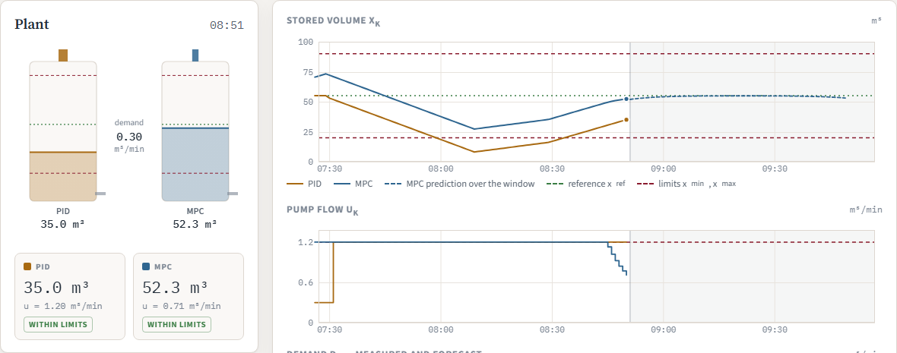
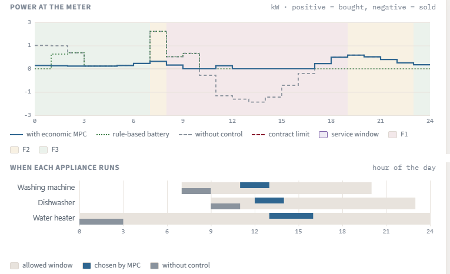
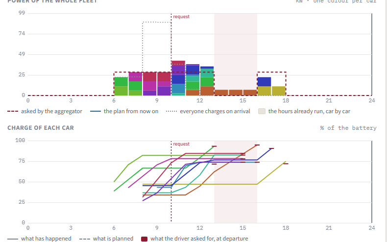
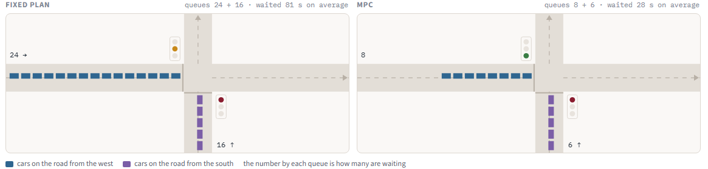
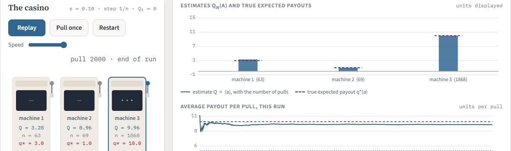
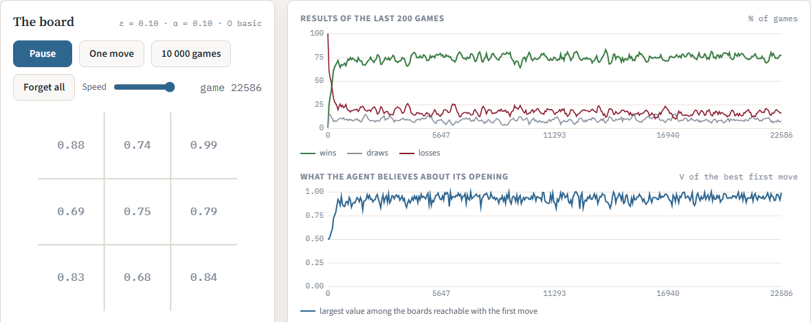
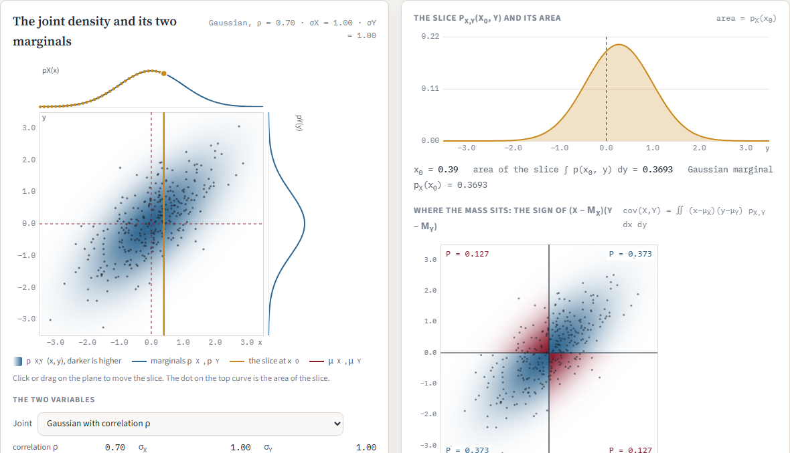

<!--
HOW TO ADD A LESSON: copy the block below, paste it ABOVE the previous lesson if you prefer
newest-first, or BELOW it for oldest-first (this page is oldest-first), and fill it in.

## Lesson N (dd/mm/2026): Title {#lesson-N}

[MPC]{.part .part-mpc}   <- or [RL]{.part .part-rl} / [ID]{.part .part-id} / [Intro]{.part .part-gen}

Summary of the lesson.

- [Blackboard notes](LINK)
- Study ...
-->

::: {.news}
**Recordings.** The lessons of this edition are not recorded. The recordings of the previous edition of the course remain available, and cover most of the same topics: you can find them on the [previous course website](https://sites.google.com/diag.uniroma1.it/liberati/home/teaching).
:::

## Lesson 1 (23/09/2026): Introduction to the course and to MPC {#lesson-1}

[Intro]{.part .part-gen} [MPC]{.part .part-mpc}

We discussed the course logistics, study materials and the exam. We then gave a high-level overview of the whole course: process control via Model Predictive Control (MPC) and Reinforcement Learning (RL), both seen as ways to approximate the ideal infinite-horizon constrained optimal control problem, and process identification, i.e., how to obtain from data the models and state estimates that controllers need.

In the second part we started the technical content: the receding horizon principle and the MPC pseudo-code, nominal MPC and its three main properties (optimality, recursive feasibility, stability), the classes of optimization problems behind MPC (continuous versus mixed-integer programming), and robust and probabilistic MPC.

- [Blackboard notes](files/notes/lesson-01-notes.pdf){target="_blank" rel="noopener"}
- Read sections 1.1 and 1.2 of [[Rawlings_2017]](references.qmd#ref-Rawlings_2017) or chapter 1 of [[Cannon_2016]](references.qmd#ref-Cannon_2016) (the book can be found online).
- Read [my slides on MPC](https://uniroma1it-my.sharepoint.com/:b:/g/personal/francesco_liberati_uniroma1_it/EbhJGNS5gNpGl6JGGy4YG48BLH0pOe2zZtmWtVCxawJ12g?e=7OBpWC) up to slide 25.
- Read slides 1–26 of [Prof. Bemporad's presentation on linear MPC](http://cse.lab.imtlucca.it/~bemporad/teaching/mpc/imt/1-linear_mpc.pdf).

## Lesson 2 (24/09/2026): MPC in practice and the first MPC problem {#lesson-2}

[MPC]{.part .part-mpc}

We compared centralized and decentralized/distributed MPC, and we went through the advantages and disadvantages of MPC: on the one hand an optimization-based, constrained-control technique whose goals map directly into the objective function and that is simple to explain to industry, on the other hand its computational cost (the solution time must be much smaller than the sampling time) and the need for a model of the system. We then described briefly the application examples that we will study during the course, such as the optimization of the energy flows of a building and the coordinated charging of electric vehicles, and we discussed hard versus soft constraints.

In the second part we introduced the two time indices used throughout the course, the absolute time $k$ at which the MPC problem is solved and the relative time $i$ inside the prediction window, and we used them to write our first complete MPC problem: the regulation of the water volume of a tank, with box constraints on state and control, the dynamics of the system as equality constraints and a target function that trades off the state cost against the control effort. We closed with an introduction to state space models of dynamical systems, in continuous and discrete time, linear and nonlinear.

- [Blackboard notes](files/notes/lesson-02-notes.pdf){target="_blank" rel="noopener"}
- Study only [my slides on MPC](https://uniroma1it-my.sharepoint.com/:b:/g/personal/francesco_liberati_uniroma1_it/EbhJGNS5gNpGl6JGGy4YG48BLH0pOe2zZtmWtVCxawJ12g?e=7OBpWC) up to slide 25.
- Play with the [Tank Control Lab](files/sim/tank-lab.html){target="_blank" rel="noopener"}: the tank of this lesson, controlled at the same time by a PID and by the constrained MPC we wrote on the blackboard, with the prediction window drawn as it moves. The quadratic program is built and solved at every sampling time while the simulation runs.

  [{.lab-fig}](files/sim/tank-lab.html){target="_blank" rel="noopener"}

## Lesson 3 (28/09/2026): State space models and the general MPC problem {#lesson-3}

[MPC]{.part .part-mpc}

We began with a modelling exercise, in three steps: write the physical equations that describe the system, choose the state variables together with the input and the output, and rewrite everything in state space form. We did it in full for a mass connected to a spring and a damper and pushed by a force, where Newton's law gives a linear, single-input single-output model with two states, position and velocity. A pendulum driven by a torque and an RLC circuit served as the examples of a nonlinear and of a linear model.

In the second part we wrote the general formulation of the problem $\mathcal{P}_k$ that MPC solves at every sampling time: minimize the sum of the stage costs over the prediction window plus a terminal cost, subject to the dynamics of the system, the measured state as initial condition, admissible states and controls, and a terminal constraint. We then went through its ingredients one at a time. The horizon $N$ buys performance at the price of computation time. The stage cost $\ell$ encodes the control goal, and for regulation problems it is quadratic, $\ell(x,u) = x^\top Q x + u^\top R u$ with $R$ positive definite and $Q$ positive definite or, when only some states are penalized, positive semi-definite. The terminal cost $V_f$ has a strong effect on how far MPC lands from the optimum. The terminal set $\mathcal{X}_f$ has to be chosen carefully, because it is what guarantees recursive feasibility. The model, and the sets of admissible states and controls, come from the application.

We closed on two points. The first control of the optimal sequence is a function of the measured state, $u^{*}_{0|k} = \kappa(x_k)$: MPC is a feedback technique, not an open-loop plan computed once. And behind the whole construction there is the ideal problem we would like to solve, the infinite-horizon constrained optimal control problem, which specialized to a linear model and a quadratic cost gives the constrained LQR problem — the subject of the next lesson.

- [Blackboard notes](files/notes/lesson-03-notes.pdf){target="_blank" rel="noopener"}
- Study [[Cannon_2016]](references.qmd#ref-Cannon_2016) section 2.1, "Problem Description" (pp. 13–15): the same problem, the same notation we use in class.
- Read [[Rawlings_2017]](references.qmd#ref-Rawlings_2017) section 2.2, "Model Predictive Control" (pp. 91–106), for the general formulation with stage cost, terminal cost and terminal set.
- For the modelling part, [[Rawlings_2017]](references.qmd#ref-Rawlings_2017) section 1.2, "Models and Modeling" (pp. 1–10).

## Lesson 4 (30/09/2026): Why MPC is optimal: dual mode control and the value function {#lesson-4}

[MPC]{.part .part-mpc}

Working under three assumptions — a known and perfect model, a measurable state and no disturbances — we went back to the ideal problem behind everything, the infinite-horizon constrained problem, and to the reason it cannot be solved as it stands: infinitely many variables and constraints. Specializing it to a quadratic stage cost and a linear model gives the infinite-horizon constrained LQR, which is still out of reach because of the constraints.

We then solved the problem that *can* be solved, the unconstrained one. Its solution is a feedback law $u^{*}_k = K x_k$ with the gain obtained from the Riccati equation, and we computed the cost that goes with it: propagating $x^{*}_k = (A+BK)^k x_0$ and $u^{*}_k = K(A+BK)^k x_0$ through the objective collapses an infinite sum into a single quadratic form, $J^{*}(x_0) = x_0^\top W x_0$, with $W$ from the Lyapunov equation. This is the quantity that will do all the work in the rest of the lesson.

Back to the constrained problem, and to Bellman's principle of optimality. Under controllability and with the origin strictly feasible, an optimal solution exists and its cost is finite, so the state and the control must go to zero and the constraints can only be active in an initial phase. Therefore, after some finite time $N$, the unconstrained law $u = Kx$ becomes feasible — and by the principle of optimality, applied to the tail problem that starts at $x^{*}_{N}$, it is not merely feasible there but optimal. This is dual mode control: free moves in the first $N$ steps, the LQR gain afterwards.

The consequence is the point of the whole lesson. The infinite tail can be replaced by its cost, $x_N^\top W x_N$, so the intractable problem becomes a finite-horizon problem with $N$ variables and a terminal cost — and the two have the same solution, $u^{*N}_k = u^{*\infty}_k$ for $k = 0,\dots,N-1$, provided $N$ is large enough. That terminal cost is the value function $V(x)$, the cost of controlling the system optimally from $x$ onwards, which for the LQR problem is exactly $x^\top W x$. Solving that finite problem again at every sampling time is MPC, and this is the sense in which MPC is optimal. The same value function is what dynamic programming computes, which is where reinforcement learning will come in.

- [Blackboard notes](files/notes/lesson-04-notes.pdf){target="_blank" rel="noopener"}
- Study [[Cannon_2016]](references.qmd#ref-Cannon_2016) section 2.2, "The Unconstrained Optimum" (pp. 15–18): the cost under a linear feedback law, the Lyapunov equation for $W$ and the Riccati equation for the optimal gain, in the notation we used on the blackboard.
- Study [[Cannon_2016]](references.qmd#ref-Cannon_2016) section 2.3, "The Dual-Mode Prediction Paradigm" (pp. 18–21). Theorem 2.2 is the formal version of the result of this lesson: there is a finite horizon, depending on the current state, beyond which the truncated problem returns the first $N$ controls of the infinite-horizon constrained optimum, with the same cost.
- For the same material reached by dynamic programming, which is the road we will take again with reinforcement learning, [[Rawlings_2017]](references.qmd#ref-Rawlings_2017) sections 1.3.3 and 1.3.4 (pp. 18–23), and section 2.3, "Dynamic Programming Solution" (pp. 107–112), for the value function.
- Studying the proofs of these results is optional.

## Lesson 5 (01/10/2026): Conclusions on optimality and dual mode control; introduction to the first case study {#lesson-5}

[MPC]{.part .part-mpc}

We closed the argument started last time. The infinite-horizon constrained problem and the finite-horizon problem with a terminal cost are equivalent when that terminal cost is the value function $V(x)$ — the cost of controlling the system optimally from $x$ onwards, which is infinite when the problem started at $x$ is not feasible at all. Comparing the two cost decompositions, before and after the junction at time $N$, shows that nothing is lost by truncating.

The practical difficulty is that $V(x)$ is not known in general. The exception is the unconstrained LQR problem, where it is exactly $x^\top W x$ — which is why, in LQR-type MPC, we take $V_f(x) = x^\top W x$ and a horizon $N$ large enough, and we recover the solution of the problem we could not solve.

With those ingredients in place we looked at what happens from one sampling time to the next. Under nominal conditions — perfect model, no noise, no disturbances — re-solving at $k+1$ returns the plan we already had, $u^{*}_{0|k+1} = u^{*}_{1|k}$: the controller confirms itself. Reality breaks exactly these assumptions, and that is why the plan is rebuilt at every step rather than computed once. We also wrote the cost actually paid by the MPC controller in closed loop, the sum of the stage costs along the trajectory it generates, and compared it with $V(x_0)$: the difference is the optimality gap, and it is zero in ideal conditions.

The second half opened the first case study, the control of an electric vehicle charging area. Vehicles arrive wanting to recharge as fast as possible, so even a few of them produce a large power flow at the point of connection, which means expensive hardware and a heavier bill under capacity-based tariffs. The controller therefore has two goals: serve the users and keep the power at the point of connection as close to zero as possible, using an energy storage system. We set up the problem — the storage power as control variable, the stored energy as state, the power at the point of connection as controlled variable, the vehicle demand and the renewable generation as disturbances with a known forecast — fixed the consumer sign convention, wrote the objective with the weight on the state reference deliberately small, and wrote the global constraint that ties everything together, the power balance at the point of connection.

- [Blackboard notes](files/notes/lesson-05-notes.pdf){target="_blank" rel="noopener"}
- Re-read [[Cannon_2016]](references.qmd#ref-Cannon_2016) section 2.3, "The Dual-Mode Prediction Paradigm" (pp. 18–21), now that the argument is complete: the terminal penalty there is exactly the cost-to-go we discussed.
- [[Rawlings_2017]](references.qmd#ref-Rawlings_2017) section 2.3, "Dynamic Programming Solution" (pp. 107–112), for the value function and the relation between the finite and the infinite horizon problem.
- The case study continues in the next lesson; there is nothing to read for it yet.

## Lesson 6 (05/10/2026): The service area controller: final formulation and code {#lesson-6}

[MPC]{.part .part-mpc}

We finished the formulation of the charging area problem and then went through the code that solves it. The controller acts on one variable, the power of the storage system, and watches another, the power at the point of connection, which is tied to the first by the balance $p^{poc}_i = p^{pev}_i + u_i - p^{res}_i$. Both the charging demand and the renewable generation are treated as known disturbances over the prediction window. The objective weighs the square of the power at the point of connection against the deviation of the stored energy from its reference, with a terminal term on the last predicted state, and the constraints are the bounds on the storage power, on the stored energy and on the power at the point of connection.

Then the code, in two files on purpose. `main.jl` is the application: it holds the parameters, builds the profiles of demand and generation, and runs the receding horizon loop — measure the state, call the optimizer, apply the first control only, simulate one step of the plant, repeat. `MPC_iteration.jl` is the controller: it builds the optimization problem in [JuMP](https://jump.dev), the modelling language we use to write optimization problems the way we write them on the blackboard, and hands it to a solver. Changing solver is one line — the code runs on [HiGHS](https://highs.dev), which is open source and part of the course setup, and on Gurobi with an academic licence — and the model itself does not change. That separation between how the problem is written and how it is solved is the reason we use a modelling language at all.

In the last part we refined the model of the storage. Charging and discharging have efficiencies, so a fraction of the energy is lost on the way in and more power has to be drawn on the way out, and the two cases are described by different expressions. Writing them together requires $\max\{0, p\}$ and $\min\{0, p\}$, which are not linear: the dynamics of the storage stops being a linear equation. The way out is to split the storage power into a charging power and a discharging power, both non-negative, with the convention $p^{ess} = p^{ch} - p^{dis}$, and then to forbid the two from being positive at the same time. That is a logical constraint, and it is written with one Boolean indicator variable per event, $\delta^{ch}$ and $\delta^{dis}$, tied to their powers and constrained by $\delta^{ch} + \delta^{dis} \le 1$. The price is leaving continuous programming for mixed-integer linear programming, and in exchange a mixed-integer linear problem remains far more tractable than a nonlinear one. The mathematical link between each indicator and its power is what we write in the next lesson, which closes the example.

- [Blackboard notes](files/notes/lesson-06-notes.pdf){target="_blank" rel="noopener"}
- [Service Area Lab](files/sim/service-area-lab.html): the same controller running over a full day in your browser, against the same area operated without storage. The peak at the point of connection, which is what the capacity tariff is paid on, halves. The lab uses the lossless storage and the continuous formulation, the one we wrote before introducing the efficiencies.

  [{.lab-fig}](files/sim/service-area-lab.html){target="_blank" rel="noopener"}

  [*Where this runs for real.* A charging site whose storage lets it deliver more power than its connection can draw is a product on the market, sold as the answer to a grid connection that would take years to upgrade. The [ADS-TEC ChargePost](https://ads-tec-com.mynewsdesk.com/pressreleases/ads-tec-energy-and-elanga-bring-ultra-fast-charging-to-penske-dealership-in-australia-3442231){target="_blank" rel="noopener"} is a charger with the battery inside: a grid input of 22 to 87 kW supports an output up to 300 kW, and one was installed at a dealership in Brighton, Australia, in place of a 150 kW charger that the connection could not feed (a manufacturer's announcement, so read the numbers as such). [TotalEnergies at Heiloo](https://www.mobilityplaza.org/news/totalenergies-overcomes-grid-limitations-for-ev-charging-in-the-netherlands){target="_blank" rel="noopener"} charges at up to 320 kW on a connection sized for ordinary consumption, charging its battery slowly and releasing it quickly. What the controller of the lab adds to those products is the part that is not in the hardware: deciding *when* to charge the buffer, given a forecast and a tariff.]{.lab-real}
- [The Julia code of the lesson](files/code/service-area-code.qmd): `main.jl` and `MPC_iteration.jl`, with the formulation they implement. The files themselves: [main.jl](files/code/main.jl) and [MPC_iteration.jl](files/code/MPC_iteration.jl).
- Install Julia, JuMP and HiGHS following the [software setup](setup.qmd) page if you have not done it yet, and run the code yourself: changing the weights and the horizon and watching what happens is the exercise.

## Lesson 7 (07/10/2026): End of the service area example; recursive feasibility {#lesson-7}

[MPC]{.part .part-mpc}

We closed the formulation left open last time. The charging and discharging powers are two non-negative variables whose difference is the storage power, and each has its own indicator: $\delta^{ch} = 1$ exactly when the storage is charging, $\delta^{dis} = 1$ when it is discharging, and the two cannot be one at the same time, which is the constraint $\delta^{ch} + \delta^{dis} \le 1$. The link between an indicator and its power is the central point. The full equivalence is not needed: it is enough to impose that a zero indicator forces a zero power, and that is written as $p^{ch}_{i|k} \le M \delta^{ch}_{i|k}$ with a constant $M$ large enough to be harmless when the indicator is one — and the natural choice is the maximum charging power itself, which keeps the formulation tight. This is the relaxed indicator constraint, and the optimizer takes care of the rest, because a solution that would set an indicator to one without need is never cheaper.

With the efficiencies in place the dynamics of the storage becomes linear again, $x_{i+1|k} = x_{i|k} + \eta^{ch} T p^{ch}_{i|k} - (1/\eta^{dis}) T p^{dis}_{i|k}$, and we wrote the complete problem: objective, power balance at the point of connection, definition of the two powers, indicator constraints, mutual exclusivity, dynamics with losses, measured initial state, and the box constraints on everything. We also separated two things that are easy to confuse: the **control model**, which lives inside the MPC problem and is the controller's belief about the plant, and the **simulation model**, which replaces the real system when we test in the loop.

The second half opened the central property of the rest of the course. An MPC algorithm is **recursively feasible** when, if the problem admits a solution at one time, it admits one at every time after that — feasible once, feasible forever. The natural object is the feasible set, the set of states from which the problem has a solution at all, and the property we need from it is **invariance**: a set is invariant for an autonomous system when every state inside it maps inside it, and it is **controlled invariant** when for every state inside it there exists at least one admissible control that keeps the next state inside. Recursive feasibility is precisely the statement that the MPC control law makes the feasible set controlled invariant. Proving it for a given problem is done constructively: at time $k+1$ one builds a tentative solution out of the tail of the optimal sequence found at $k$, and shows that it satisfies every constraint — which is why a terminal set with the right invariance property appears in the formulation.

- [Blackboard notes](files/notes/lesson-07-notes.pdf){target="_blank" rel="noopener"}
- Study [[Cannon_2016]](references.qmd#ref-Cannon_2016) sections 2.4, "Invariant Sets" (pp. 21–24), and 2.5, "Controlled Invariant Sets and Recursive Feasibility" (pp. 24–29). These are the sections of the course on today's material: the definitions of invariant and maximal invariant set, the controlled invariant set, and the result that the feasible sets grow with the horizon.
- [[Rawlings_2017]](references.qmd#ref-Rawlings_2017) section 2.4.2, "Stabilizing Conditions" (pp. 114–120), for the assumptions on the terminal set in their standard form, and section 2.6, "Is a Terminal Constraint Set Necessary?" (pp. 144–147), for what happens without one.
- On writing logical conditions as constraints — indicator variables, big-M, mutually exclusive events — [[Hax_1977]](references.qmd#ref-Hax_1977) chapter 9, and [[Borrelli_2017]](references.qmd#ref-Borrelli_2017) for the same ideas inside an MPC problem.

## Lesson 8 (08/10/2026): Proving recursive feasibility; stability, first definitions {#lesson-8}

[MPC]{.part .part-mpc}

We proved recursive feasibility, under the nominal assumption that the controller uses a perfect model of the plant, so that the state we find at the next step is exactly the one the controller predicted. The proof is constructive and the construction is the natural one: at time $k+1$, take the tail of the sequence that was optimal at time $k$, which is still available and still satisfies the constraints over the steps it covers, and append one more control at the end to fill the window again. Two things then need checking. The appended terminal control must be admissible, and the state it produces from the terminal state of the previous solution must land in the terminal set, so that the new candidate satisfies the terminal constraint as well.

Both are guaranteed at once if the terminal set and the terminal control law are chosen so that the law makes the set **controlled positively invariant** for the controlled system: from every state in the terminal set there exists an admissible control that keeps the next state inside it. Then the tentative sequence is feasible, so the problem at $k+1$ has at least one solution, and recursive feasibility is equivalent to saying that the MPC law makes the feasible set controlled invariant. There is a design trade-off in the choice: a larger terminal set means a larger feasible set and a lower optimal cost, because constraints can only make the cost worse, so one looks for the largest terminal set admitting such a law. Two examples we wrote down: the terminal control that does nothing, and the linear law $u_f = Kx$, which is the one that connects back to the dual-mode construction.

The second half began stability. Stability is a property of the equilibrium points of a dynamical system, not of the system as a whole, and a system may have none, one, several or infinitely many — the pendulum we drew has two *families* of them, the hanging one and the upright one, each repeated at every full turn, so infinitely many points but only two distinct behaviours. Adding a feedback law turns the controlled system into an autonomous one, and that creates two distinct problems: stabilization, which is making an unstable equilibrium stable, and checking that an equilibrium which was stable has not been made unstable by the controller. Taking the equilibrium at the origin without loss of generality, we gave the definition of stability in the $\varepsilon$–$\delta$ form, with the reading that small initial perturbations produce trajectories that remain forever close, and then asymptotic stability as stability plus attractiveness, with its region of attraction. Both are local concepts.

- [Blackboard notes](files/notes/lesson-08-notes.pdf){target="_blank" rel="noopener"}
- Study [[Cannon_2016]](references.qmd#ref-Cannon_2016) section 2.5, "Controlled Invariant Sets and Recursive Feasibility" (pp. 24–29): the proof of today, in the same form, with the nested feasible sets.
- [[Cannon_2016]](references.qmd#ref-Cannon_2016) section 2.6, "Stability and Convergence" (pp. 29–32), which is where the second half of the lesson is heading.
- For the definitions of stability, [[Rawlings_2017]](references.qmd#ref-Rawlings_2017) appendix B, section B.2, "Stability and Asymptotic Stability" (pp. 696–700). Section B.3, "Lyapunov Stability Theory" (pp. 700–709), is the material of the next lesson.

## Lesson 9 (12/10/2026): Stability of MPC: Lyapunov theory {#lesson-9}

[MPC]{.part .part-mpc}

We started from the definition given at the end of last lesson and asked the practical question: given a system, how do we check that an equilibrium is stable? For a linear system $x_{k+1} = Ax_k$ the answer is complete and well known. The solution is $x_k = A^k x_0$, so everything depends on the eigenvalues of $A$: the origin is asymptotically stable if and only if they all lie strictly inside the unit circle; it is unstable as soon as one of them lies outside; and the borderline case, eigenvalues on the circle, gives simple stability when they are simple, while repeated eigenvalues on the circle need a separate check.

That criterion is not enough for us, for two reasons. The model $f(x_k,u_k)$ of the plant may be nonlinear, and — more to the point — **MPC is a nonlinear controller even for a linear plant**: the control applied is $u^{*}_{0|k} = \kappa_N(x_k)$, the first element of the solution of an optimization problem, and $\kappa_N$ is in general a nonlinear function of the state. The closed loop is therefore the autonomous nonlinear system $x_{k+1} = f(x_k, \kappa_N(x_k)) = \tilde f(x_k)$, and we need a stability criterion for nonlinear systems. That criterion is Lyapunov's.

Most of the lesson was spent building its vocabulary. A scalar function of the state $V(x)$ is *positive definite* when $V(0) = 0$ and $V(x) > 0$ for every other $x$; negative definite, semi-positive definite and semi-negative definite are defined in the same way, and $V$ is semi-negative definite exactly when $-V$ is semi-positive definite. The quadratic forms $V(x) = x^\top P x$ are the standard example, and such a form is positive definite precisely when all the eigenvalues of $P$ are positive — but not every candidate works, as the example $2\sin^2(x_1) + 3x_2^2$ shows, since it vanishes away from the origin. All these definitions have a *local* version, around the equilibrium rather than on the whole space, and that is the version we will actually use. We also drew the level sets $\Omega_c = \{x : V(x) = c\}$, which are the geometric object on which the proofs that follow are based.

Then the two theorems, both sufficient conditions. The equilibrium is **stable** if we can find a $V$ that is (at least locally) positive definite around it and whose increment along the trajectories of the system, $\Delta V(x) = V(f(x)) - V(x)$, is semi-negative definite; it is **asymptotically stable** if the increment is strictly negative. The increment is computed along the trajectories, not in an arbitrary direction, and the intuition is the one we drew: if $V$ is positive and strictly decreasing step after step, then $V \to 0$ and with it $x_k \to 0$, while the level sets of $V$ trap the trajectory inside ever smaller regions. A function we try is a *candidate* Lyapunov function; one that satisfies both conditions is a Lyapunov function. Finding one is an art — the first condition is easy, the second is the difficult one — and failing to find one proves nothing.

The last part applied all this to MPC. We assume the system has an equilibrium at the origin, $f(0,0) = 0$, that we are regulating the state to zero, that the stage cost $\ell(x,u)$ is a positive definite function of $(x,u)$ and that the terminal cost $V_f(x)$ is a positive definite function of $x$ — assumptions that any sensible regulation cost satisfies. The question is whether the closed loop $\tilde f$ is stable at the origin, and it is a real question: the MPC law changes the system, so the equilibrium itself could move. That is where we stopped, with the first thing to verify — is $x^{eq} = 0$ still an equilibrium of $\tilde f$? — written on the board for next time.

- [Blackboard notes](files/notes/lesson-09-notes.pdf){target="_blank" rel="noopener"}
- Study [[Cannon_2016]](references.qmd#ref-Cannon_2016) section 2.6, "Stability and Convergence" (pp. 29–32): the Lyapunov argument applied to MPC, with the cost of the MPC problem used as the Lyapunov function. This is where the lesson is going.
- [[Rawlings_2017]](references.qmd#ref-Rawlings_2017) appendix B, section B.3, "Lyapunov Stability Theory" (pp. 700–709), for everything we did today in its general form: Lyapunov functions, the two theorems, and the local versions of the definitions. Section B.1, "Introduction" (pp. 691–696), has the examples.
- [[Rawlings_2017]](references.qmd#ref-Rawlings_2017) section 2.4.2, "Stabilizing Conditions" (pp. 114–120), for the assumptions on $\ell$ and $V_f$ in the form we wrote them today.

## Lesson 10 (14/10/2026): Stability of MPC: the optimal cost as Lyapunov function {#lesson-10}

[MPC]{.part .part-mpc}

We used the Lyapunov theorem of last lesson on the MPC closed loop. Before starting, one remark on the second condition: asking that $\Delta V(x)$ be semi-negative definite is the same as asking that $\Delta V(x) \le -h(x)$ for some non-negative $h$, and writing it in this second form is what makes the proof work, because it says *how much* $V$ has to decrease at each step.

The first question was whether the origin survives the controller. The closed loop is $x_{k+1} = f(x_k, \kappa_N(x_k)) = \tilde f(x_k)$, so the origin is an equilibrium of $\tilde f$ only if $f(0, \kappa_N(0)) = 0$, that is only if $\kappa_N(0) = 0$. It is: starting from $x_k = 0$, the sequence of all zeros is feasible, keeps the state at zero and costs nothing, and since the stage cost and the terminal cost are positive definite no other sequence can cost less. The optimizer therefore returns zero and the controller does not move the equilibrium.

Then the candidate Lyapunov function, and this is the idea of the whole construction: take the **optimal cost of the MPC problem**, $V^{*}_N(x_k) = V_N(x_k, \mathbf{u}^{*}_k)$, the value the optimizer returns at every step. It is a function of the state alone, and the controller computes it at every step in any case, so it costs nothing to evaluate. The first condition is immediate with the assumptions we made: $V^{*}(0) = 0$ by the argument above, and $V^{*}(x) > 0$ for every $x \neq 0$ because the first stage cost alone, $\ell(x_k, u^{*}_{0|k})$, is already strictly positive.

The second condition is the real work. We want $\Delta V^{*}(x_k) = V^{*}(x_{k+1}) - V^{*}(x_k) \le 0$, and $V^{*}(x_{k+1})$ is the result of another optimization, which we do not know. The way around it is a bound: the optimal cost at $k+1$ is never larger than the cost of **any** feasible sequence at $k+1$, so if we exhibit one candidate sequence $\tilde{\mathbf{u}}_{k+1}$ whose cost is already below $V^{*}(x_k)$, we are done. The candidate is the one we already know from recursive feasibility — the tail of the optimal sequence of time $k$, $\{u^{*}_{1|k}, \dots, u^{*}_{N-1|k}\}$, completed with the terminal control $\kappa_f(x^{*}_{N|k})$ — and under the nominal assumption $x_{k+1} = x^{*}_{1|k}$ it is feasible.

Writing both costs term by term, everything in the middle cancels, and what is left is
$$
V(x_{k+1}, \tilde{\mathbf{u}}_{k+1}) - V^{*}(x_k) = \underbrace{-\,\ell(x_k, u^{*}_{0|k})}_{\le\,0} + \Big[ \ell(x^{*}_{N|k}, \kappa_f(x^{*}_{N|k})) + V_f\big(f(x^{*}_{N|k}, \kappa_f(x^{*}_{N|k}))\big) - V_f(x^{*}_{N|k}) \Big].
$$
The first term is the price paid at the current step and is never positive: it is the decrease obtained at no cost. So the whole difference is non-positive as soon as the bracket is, and the bracket is a condition on the **terminal ingredients only**:
$$
V_f\big(f(x, \kappa_f(x))\big) - V_f(x) \;\le\; -\,\ell(x, \kappa_f(x)).
$$
In words: the terminal cost must itself be a Lyapunov function for the system driven by the terminal control law, decreasing by at least the stage cost at every step. Stability of MPC is therefore not something one hopes for, it is something one obtains by choosing $V_f$ and $\kappa_f$ properly — the tuning of the controller is what makes the proof go through. Whether that inequality can actually be satisfied, and in which cases, is the question we left open and that we answer next time.

- [Blackboard notes](files/notes/lesson-10-notes.pdf){target="_blank" rel="noopener"}
- Study [[Cannon_2016]](references.qmd#ref-Cannon_2016) section 2.6, "Stability and Convergence" (pp. 29–32): the proof of today in the same form, with the optimal cost as Lyapunov function and the condition on the terminal cost.
- [[Rawlings_2017]](references.qmd#ref-Rawlings_2017) section 2.4.2, "Stabilizing Conditions" (pp. 114–120): the same assumptions on $\ell$, $V_f$, $\kappa_f$ and the terminal set, stated once and used throughout their book.
- [[Rawlings_2017]](references.qmd#ref-Rawlings_2017) appendix B, section B.3, "Lyapunov Stability Theory" (pp. 700–709), for the theorem we are applying, in particular the form $\Delta V \le -h(x)$ we used today.

## Lesson 11 (15/10/2026): The role of the MPC ingredients; economic MPC and the building case study {#lesson-11}

[MPC]{.part .part-mpc}

The first half was a recap, with the complete formulation on the board, of what each ingredient of an MPC problem is really for.

The **horizon** $N$ influences two things that pull in opposite directions. Optimality: as $N$ grows the MPC problem approaches the infinite-horizon constrained problem, which is the best we could do and which we cannot solve in general; a short horizon ignores the tail. Computational complexity: the number of variables and constraints of each iteration grows with $N$, and so does the solution time. Choosing $N$ is choosing a point between these two.

The **terminal cost** $V_f$ matters for both properties we have studied. For optimality, if $V_f$ is the value function of the infinite-horizon problem — the cost of controlling the system optimally from a given state onwards — then MPC is exactly optimal, which is Bellman's principle again and the reason the finite horizon costs us nothing in that ideal case; in general $V(x)$ cannot be computed, and *learning* it is one of the places where reinforcement learning will enter the course. For stability, $V_f$ has to satisfy the inequality of last lesson, and here is the practical reading of it: if we already know any feedback law $u = c(x)$ that stabilizes the origin, and we have a Lyapunov function $W$ proving it with a decrease of at least the stage cost, then taking $V_f \equiv W$ and $\kappa_f \equiv c$ makes the MPC controller stabilizing — the proof of last lesson becomes exactly the property of $W$.

The **terminal set** $X_f$ is the ingredient tied to recursive feasibility: the tentative sequence built at $k+1$ is feasible provided the terminal control keeps the terminal state inside $X_f$, that is provided $\kappa_f$ makes $X_f$ controlled invariant. Note that $X_f \subset X$ is an artificial constraint, added for the proof and not by the application, and it costs performance: ideally one wants $X_f$ as large as possible, the limit case being $X_f \equiv X$.

The second half changed point of view. In the **classic** regulation or tracking MPC the route is: identify the control goals, translate them into reference values for the state and the output, and then build a cost that penalizes the distance from those references — a cost that is positive definite by construction, which is what gave us all the theory so far. In **economic MPC** the cost function represents the goals *directly*, typically money, and there is no reference to track: we write the economic objective, solve, and apply the first control. The price is that the assumptions behind the theory are properties of the cost that an economic cost need not have, so stability and optimality become harder to study.

We then started the case study we will carry on next time: the energy management of a building. The system has photovoltaic panels, non-plannable loads, plannable loads, an energy storage system and a charging station for electric vehicles, all behind one meter at the point of delivery. The first goal is to minimize the electricity bill, computed with a time-of-use volumetric tariff with one price for the energy consumed and another, lower, for the energy injected into the grid. We fixed the nomenclature — powers in kW for the panels, the loads, the storage, the vehicles and the point of delivery; energies in kWh for the storage and the vehicles, which are the state variables — and the modelling assumptions: generation and non-plannable loads are known over the window, the storage and the charging powers are the control variables, and the plannable loads come in two kinds, those that can be shifted in time, where the decision is *when* to start them inside an allowed interval, and those whose power can be modulated, which we skip. Finally the first constraints: the power balance at the point of delivery, and the storage written with separate charging and discharging powers, their indicator variables, the indicator constraints with the maximum powers as big-M, and the mutual exclusivity $\delta^{ch} + \delta^{dis} \le 1$ — the same construction we used for the service area, now inside an economic problem.

- [Blackboard notes](files/notes/lesson-11-notes.pdf){target="_blank" rel="noopener"}
- Re-read [[Cannon_2016]](references.qmd#ref-Cannon_2016) section 2.3, "The Dual-Mode Prediction Paradigm" (pp. 18–21), and sections 2.4–2.6 (pp. 21–32) with today's question in mind: what each of $N$, $V_f$ and $X_f$ is doing in the formulation.
- [[Rawlings_2017]](references.qmd#ref-Rawlings_2017) section 2.6, "Is a Terminal Constraint Set $X_f$ Necessary?" (pp. 144–147), on the cost of the artificial terminal constraint and on what survives without it.
- [[Rawlings_2017]](references.qmd#ref-Rawlings_2017) section 2.8, "Economic Model Predictive Control" (pp. 153–160), for today's second half: how the economic problem differs from the tracking one, and which assumptions replace the positive definite cost.
- For the mixed-integer part of the building model, the same references as the service area: [[Hax_1977]](references.qmd#ref-Hax_1977) chapter 9 for indicator variables and big-M, and [[Borrelli_2017]](references.qmd#ref-Borrelli_2017) for the same constructions inside an MPC problem.

## Lesson 12 (19/10/2026): The building case study: shiftable loads, the bill, battery ageing {#lesson-12}

[MPC]{.part .part-mpc}

We wrote the model of the building, piece by piece, starting from the plannable loads. Each appliance comes with what the user asks of it — the earliest start $S_\ell$, the deadline $F_\ell$, the duration $N_\ell$ — and with its own power profile $P_\ell$, the sequence of powers that the job needs once it has started. Load shifting means one decision per appliance: *when* to start it. That decision is written with a binary variable, $s_{i|k,\ell} = 1$ meaning that load $\ell$ starts at the beginning of interval $i$ of the window at time $k$, and it is worth keeping the two time indices straight, because $S_\ell$ and $F_\ell$ are absolute times while $i|k$ is relative to the current window.

Two things follow. The appliance must be started exactly once, which is the equality $\sum_{i=S_\ell}^{F_\ell - N_\ell} s_{i|k,\ell} = 1$ — note the upper limit, the last instant at which the job still finishes before the deadline. And its power at any time is the profile placed where the start variable says, $P^{pl}_{i|k,\ell} = \sum_j s_{j|k,\ell}\, P_\ell(i-j+1)$, a convolution of the profile with the one-hot sequence of start variables; summing over the appliances gives the total plannable power $P^{pl}_{i|k}$ that enters the balance at the meter.

The second half priced what crosses the meter. The tariff is time-of-use: $c^{in}$ is what a kWh costs when the house consumes it, $c^{out}$ what it is paid when the house injects it into the grid, and the two differ. The difficulty is that the same variable $P_{i|k}$ is a cost when positive and a revenue when negative, so we split it into two non-negative variables, $P_{i|k} = P^{in}_{i|k} - P^{out}_{i|k}$, and we forbid them from being positive at the same time with the usual pair of indicators: $P^{in}_{i|k} \le P^{max}\delta^{in}_{i|k}$, $P^{out}_{i|k} \le |P^{min}|\delta^{out}_{i|k}$ and $\delta^{in}_{i|k} + \delta^{out}_{i|k} \le 1$. The bill over the window is then linear, $J^{cost} = \sum_i T\,(P^{in}_{i|k} c^{in}_{i|k} - P^{out}_{i|k} c^{out}_{i|k})$: an economic cost, with no reference to track.

Last, the hidden cost of using the battery. A storage system has a price and a finite number of full cycles; with $COST^{ess}$ and the energy it will move in its whole life, $E^{life} = 2\,x^{ess,max}\cdot cycles$, the ratio $c^{dep} = COST^{ess}/E^{life}$ is what one kWh through the battery costs in terms of life consumed — a small number, a few cents. Charging and discharging both consume life, so the term is $J^{depr} = \sum_i c^{dep}\,(P^{ch}_{i|k} + P^{dis}_{i|k})\,T$, which is $c^{dep}|P^{ess}|$ written without an absolute value, thanks to the split into two non-negative powers. The objective of the controller is then the weighted sum $J = \alpha_1 J^{cost} + \alpha_2 J^{reg} + \alpha_3 J^{depr}$, with $J^{reg}$ the deviation of the stored energy from its reference. We closed on an observation from the simulations: run like this, the battery tends to end the day empty. Why that happens, and what has to be added to the cost to stop it, is the question for next time.

- [Blackboard notes](files/notes/lesson-12-notes.pdf){target="_blank" rel="noopener"}
- Re-read [[Rawlings_2017]](references.qmd#ref-Rawlings_2017) section 2.8, "Economic Model Predictive Control" (pp. 153–160): today's cost is exactly of that kind, and the section says what survives of the theory when the cost stops being positive definite.
- [Building Energy Lab](files/sim/building-lab.html): the problem of these lessons, running in your browser on a detached house with photovoltaic panels, a battery and five appliances under a time-of-use tariff. You choose which appliances have to run and inside which hours; the controller chooses the start times and the battery profile. The page solves the same mixed-integer problem we are writing, with the start variables and the indicators, and compares the bill against an uncontrolled house and a rule-based battery.

  [{.lab-fig}](files/sim/building-lab.html){target="_blank" rel="noopener"}

  [*Where this runs for real.* Predictive control of buildings has been measured on real plants, mostly offices, where heating and cooling are the large flexible load. [Blum et al., 2022](https://eta-publications.lbl.gov/publications/field-demonstration-and){target="_blank" rel="noopener"} installed MPC on the heating and ventilation of an office in Berkeley and ran it for two months against the control already in place, with about 40% less energy for the same comfort; the paper is worth reading for its second result, that collecting the data and connecting the controller to the plant cost as much effort as the modelling. A later [field demonstration](https://eta.lbl.gov/publications/commercial-building-hvac-demand){target="_blank" rel="noopener"} by the same laboratory drove a large office against four dynamic price profiles over four seasons: the economic objective of the lab, on a real plant. In a house the same problem is sold in pieces, the home battery that charges on the cheap band and the water heater that waits for the photovoltaic; what a controller adds is doing both at once, against one bill.]{.lab-real}
- On writing today's logical conditions as constraints — one start per appliance, mutually exclusive import and export, big-M indicators — [[Hax_1977]](references.qmd#ref-Hax_1977) chapter 9, and [[Borrelli_2017]](references.qmd#ref-Borrelli_2017) for the same constructions inside an MPC problem.

## Lesson 13 (21/10/2026): End of the building case study; tuning and the Pareto frontier; large-scale charging {#lesson-13}

[MPC]{.part .part-mpc}

We began by answering the question left open last time: why does the battery end the day empty? Because the controller sees only the window. Inside it, selling the stored energy is a profit, and what happens afterwards does not exist, so the optimizer empties the storage before the horizon ends. The fix is to look at the **total value** over the window: the value of the state we start from, plus the profits minus the costs of the trading we plan, plus the value of the state we leave behind. The first term does not depend on the decision variables, so maximizing the total value is the same as minimizing $J^{cost} - V(x_{N|k})$, where $V(x_{N|k})$ is the price we put on the energy still in the battery at the end of the window. The simple choice is $V(x_{N|k}) = c^{average}\,x_{N|k}$, the average purchase price, and this coefficient could be chosen adaptively during the day — one of the places where reinforcement learning will come back later in the course. This is the terminal cost of the theory, seen from the application side.

Then the parts of the building we did not model, listed explicitly as the simplifications they are. On the battery: we only used the stored energy, while a real battery management system also tracks the state of charge in percent, the state of health, which depends on temperature and usage and is what cell balancing protects, and the state of power, the power the battery can actually deliver in the near future — the quantity that matters most on a vehicle. On the building: the whole thermal part, wall and room temperatures driven by the outside temperature and by the heating and cooling, humidity and air quality, natural and forced ventilation, which would add comfort terms to the objective and constraints of their own. And the building information model, the identity card of the building, from which the parameters of all these models can be updated in real time as the building changes.

The last piece of the case study was the **tuning**. The objective is a weighted sum of several goals, $J = \alpha_1 J^{cost} + \alpha_2 J^{reg} + \alpha_3 J^{track} + \alpha_4$ terminal term, and the weights are what makes a multi-objective problem into a single-objective one. Scaling all of them by the same factor changes nothing, so they can be normalized to sum to one, and only their ratios matter. Drawing the achievable pairs $(J_1, J_2)$ gives the **Pareto frontier**, the curve of the solutions that cannot be improved in one objective without worsening the other. Each choice of weights selects one point on it; a rule-based controller sits well above it; a better algorithm pushes the whole frontier down. Choosing the weights is therefore a design decision about trade-offs, not a mathematical one — and it, too, can be learned.

The second half opened the next case study: **large-scale charging of electric vehicles**, seen by an aggregator. The context first. Electricity is traded on wholesale energy markets, between generation companies, retailers who resell to final customers, and the company running the market; next to them are the ancillary or flexibility markets, where the transmission system operator and the distribution system operator buy what they need to keep frequency and voltage at their reference values, $50$ Hz and the nominal voltage of the grid they run. The providers of that flexibility are large consumers, or aggregators of many small ones managed as a single entity, which is the only way to reach the minimum bidding size — of the order of a megawatt for a given window. A fleet of vehicles charging is exactly such an aggregation: the control goal becomes making the **total** charging power of the fleet track a reference profile agreed with the market, while each user still gets the charge they asked for.

We then started the model. For each vehicle, a charging and a discharging power, both non-negative, with their difference the power exchanged, the two indicators and the mutual exclusion constraint we already know; the stored energy with the usual efficiencies. The new ingredient is that a charger cannot deliver an arbitrarily small power: either it is off, or it works between a minimum and a maximum. That is a **semi-continuous variable**, and it is written with the same indicator trick, $\delta^{ch}_{i|k,p} P^{ch,min}_p \le P^{ch}_{i|k,p} \le \delta^{ch}_{i|k,p} P^{max}_p$ — one indicator, two inequalities, and the variable is forced either to zero or into its admissible band. The user preferences enter as the final time $F_p$ at which the vehicle leaves and the state of charge $x^{ref}_p$ it must have reached by then.

- [Blackboard notes](files/notes/lesson-13-notes.pdf){target="_blank" rel="noopener"}
- For the terminal value of the stored energy, read it as the terminal cost of the theory: [[Cannon_2016]](references.qmd#ref-Cannon_2016) section 2.3, "The Dual-Mode Prediction Paradigm" (pp. 18–21), and the stability role of $V_f$ in section 2.6 (pp. 29–32).
- [[Rawlings_2017]](references.qmd#ref-Rawlings_2017) section 2.8, "Economic Model Predictive Control" (pp. 153–160), which is the frame of the whole case study.
- On several objectives at once: [[Boyd_2004]](references.qmd#ref-Boyd_2004) section 4.7, "Vector optimization" (pp. 174–187) — 4.7.3 for Pareto optimal points and 4.7.4 for scalarization, which is exactly the weighted sum we write and the reason the weights can be normalized.
- On semi-continuous variables and the other logical conditions of today: [[Hax_1977]](references.qmd#ref-Hax_1977) chapter 9, and [[Borrelli_2017]](references.qmd#ref-Borrelli_2017) for the same constructions inside an MPC problem.
- [Building Energy Lab](files/sim/building-lab.html): two experiments belong to this lesson. Turn off *value the energy left in the battery* and watch the storage end the day empty, exactly the behaviour we explained today, then turn it back on. And ask the house for a flexibility service — stay under a power cap for three evening hours, or follow a power curve at midday — with a fee for delivering it and a penalty for failing: the controller moves appliances and battery to earn it, while the uncontrolled house collects the fee and then pays the penalty back.
- For the market context of the aggregator — who buys flexibility and why: [[Kirschen_2019]](references.qmd#ref-Kirschen_2019), chapter 3 on markets for electrical energy and chapter 6 on power system operation, where the services the system operators buy are described. Background reading, not exam material.

## Lesson 14 (22/10/2026): End of the aggregator example; MPC for traffic control {#lesson-14}

[MPC]{.part .part-mpc}

We closed the aggregator problem with what the users want. Each driver states a final charging time $F_p$ and a desired state of charge $x^{ref}_p$. If the vehicle leaves inside the prediction window, $F_p \le k+N$, that is a constraint, $x_{F_p|k,p} \ge x^{ref}_p$; if it leaves after the window there is no instant at which to impose it, so the request enters the cost instead, as a term $\sum_{p:\,F_p > k+N} (x_{N|k,p} - x^{ref}_p)^2$ that pushes the state of charge towards what was asked. The objective of the aggregator is then the tracking of the profile agreed with the market plus that term: $J = \sum_i (P_{i|k} - P^{ref}_{i|k})^2 + \sum_{p} (x_{F_p,p} - x^{ref}_p)^2$.

Then the point that matters for the algorithm, and not only for the users: those deadline constraints can be impossible. A vehicle may arrive too empty, or stay too little, for any admissible power to reach $x^{ref}_p$, and a hard constraint would simply make the problem infeasible, leaving the controller with nothing to apply. So we **relax** them: one non-negative variable $\varepsilon_p$ per vehicle, the constraint becomes $x_{F_p,p} \ge x^{ref}_p - \varepsilon_p$, and the violation is paid for in the cost, $J^{\varepsilon} = \sum_p \varepsilon_p$ — or $\sum_p \varepsilon_p^2$, which is better for fairness, because squaring prefers many small disappointments to one large one. The complete objective is the weighted sum $J = d_1 J^{reg,P} + d_2 J^{reg,x} + d_3 J^{\varepsilon}$, and the weight $d_3$ is the interesting one: small, and the controller sacrifices a user to follow the grid; large, and it violates a request only when the request cannot be satisfied at all.

The second half opened the traffic case study, one intersection to begin with. Two goals, and they belong to different people: minimizing the queues is what the traffic manager wants, minimizing the waiting times is what the drivers want. The control variables are the colours of each traffic light $J$: three binaries $g_{i|k,J}, y_{i|k,J}, r_{i|k,J}$, one per colour, with $g + y + r = 1$ because exactly one colour is on at a time. What makes the formulation interesting is that the admissible *transitions* must be written as linear constraints: green cannot be followed by red, so $g_{i|k,J} = 1 \Rightarrow r_{i+1|k,J} = 0$, which becomes $r_{i+1|k,J} \le 1 - g_{i|k,J}$, and similarly for yellow after red and green after yellow. The same inequalities, written between the first step of the window and the colour actually displayed at $k-1$, are the rate-of-change constraints that tie the plan to reality.

Safety adds the minimum duration of yellow. We carry a timer $t^y_{i|k,J}$ that counts how long yellow has been on, $t^y_{i+1|k,J} = (t^y_{i|k,J} + T)\,y_{i|k,J}$ — a product of a variable and a binary, which has to be linearized — and we forbid red while the timer is below the minimum with $r_{i+1|k,J} \le t^y_{i|k,J}/t^{y,min}$. At the level of the whole intersection, the lights that conflict cannot be green, or yellow, at the same time: $\sum_{J} (g_{i|k,J} + y_{i|k,J}) \le 1$.

What is left is the model of what we are trying to minimize, and here there are two roads. The **aggregate model** keeps one state per light, the number of vehicles waiting, $m_{i+1|k,J} = m_{i|k,J} + v^{in}_{i|k} T - v^{out}_{i|k} T\, g_{i|k,J}$, with $m_{0|k,J}$ measured by a camera and $m \ge 0$ imposed as an approximation; average waiting times then follow from Little's law. The **detailed model** keeps position, speed and acceleration of every single vehicle, where the acceleration is a model of the driver for human-driven cars and a command for self-driving ones, and a binary $\delta_{i|k,v}$ says whether the vehicle is still in the queue, so that the waiting time grows as $w_{i+1|k,v} = (w_{i|k,v} + T)\,\delta_{i|k,v}$ and the queue length is the sum of the indicators. The cost is then either $J^m = \sum_i \sum_J m_{i|k,J}^2$ on the queues, or a term on the waiting times, where the choice made in the lesson is to minimize the *maximum* waiting time over the whole intersection, which is the quantity a driver perceives. We finish the example next time.

- [Blackboard notes](files/notes/lesson-14-notes.pdf){target="_blank" rel="noopener"}
- [PEV Aggregator Lab](files/sim/aggregator-lab.html): the first half of today, running in your browser. A fleet of vehicles with their arrivals, departures and requests, a profile agreed with the grid, and one slider that moves $d_3$ — from "follow the grid whatever the drivers asked" to "serve every driver and follow the grid with what is left". The relaxation $\varepsilon_p$ is what keeps the problem solvable when you ask for the impossible.

  [{.lab-fig}](files/sim/aggregator-lab.html){target="_blank" rel="noopener"}

  [*Where this runs for real.* An aggregator that sells the flexibility of small resources is a licensed market role, and in Italy it has a rulebook: Terna's [UVAM pilot](https://www.terna.it/it/sistema-elettrico/progetti-pilota-delibera-arera-300-2017-reel){target="_blank" rel="noopener"}, opened by ARERA resolution 300/2017, lets an operator pool loads, storage and electric vehicles and bid them into the balancing market, provided the aggregate offers at least 1 MW; the payment has the two parts the lab simplifies into one, a fee for being available and a fee for the energy actually moved when called ([a 2019 review](https://www.elettricitafutura.it/public/editor/Position_Paper/2019/Progetto%20pilota%20UVAM.pdf){target="_blank" rel="noopener"} counted 27 operators and 156 units). In Sweden, [Vattenfall](https://group.vattenfall.com/press-and-media/newsroom/2026/large-scale-pilot-in-sweden-explores-new-role-for-electric-vehicles/){target="_blank" rel="noopener"} is moving about 200 bidirectional chargers from trial to operation, aggregated by software into the energy and flexibility markets: the V2G box of the lab, at the scale of a utility.]{.lab-real}
- Study [[Rawlings_2017]](references.qmd#ref-Rawlings_2017) section 2.8, "Economic Model Predictive Control" (pp. 153–160), and [[Boyd_2004]](references.qmd#ref-Boyd_2004) section 4.7 (pp. 174–187) for the weighted sum of objectives, which is again how the three terms are put together.
- On today's logical constraints — colour transitions, mutual exclusion, the product of a variable and a binary to be linearized — [[Hax_1977]](references.qmd#ref-Hax_1977) chapter 9 and [[Borrelli_2017]](references.qmd#ref-Borrelli_2017).
- For the traffic application itself, [[Liberati_2025a]](references.qmd#ref-Liberati_2025a): the same intersection, with the detailed model and vehicles that may be automated. Background reading, not exam material.

## Lesson 15 (26/10/2026): End of traffic control; task scheduling in an assembly line {#lesson-15}

[MPC]{.part .part-mpc}

The objective of the intersection has two halves. On the queues, $J^m = \sum_i \sum_J (m_{i|k,J})^2$: the square does not only make the queues short, it keeps them *balanced*, because for a given total it prefers two queues of five to one of ten. On the waiting times the goal we chose is to minimize the **largest** waiting time at the intersection, and that is not a sum, so it needs a trick we will use again: introduce one more variable $\bar w_{i|k} \ge 0$, impose $w_{i|k,v} \le \bar w_{i|k}$ for every vehicle present, and put $\bar w_{i|k}$ in the cost, $J^w = \sum_i (\bar w_{i|k})^2$. The upper bound is pushed down until it sits on the largest waiting time; minimizing the bound is minimizing the maximum. It is the same move as writing $\|v\|_\infty = \max_J |v_J|$ with an epigraph variable.

Then the two pieces of formulation that were still open. The yellow has a minimum duration, which in words is: if the light is yellow and its timer has not reached the minimum, the next step cannot be red. In symbols the condition multiplies two facts, so it is written as $r_{i+1|k,J} \le \lfloor t^y_{i|k,J}/t^{y,min}_J \rfloor + (1 - y_{i|k,J})$: the first term is zero exactly while the timer is short of the minimum, and the second makes the whole constraint irrelevant when the light is not yellow. And the timer itself, $t^y_{i+1|k,J} = (t^y_{i|k,J} + T)\,y_{i|k,J}$, is a **product of a real variable and a binary**, which is not linear. The general construction, which recurs in every mixed-integer formulation of this kind: to write $p = q\,b$ with $q \in [\underline q, \bar q]$ and $b \in \{0,1\}$, impose $\underline q\, b \le p \le \bar q\, b$, which forces $p = 0$ when $b = 0$, together with $q - M(1-b) \le p \le q + M(1-b)$, which forces $p = q$ when $b = 1$ and says nothing when $b = 0$. Two pairs of inequalities, no products. We closed with the architecture of the controller — measurements of queues, waiting times and timers in, colours out — and with the remark that a city is many intersections tied by coupling constraints, which is where centralized and distributed MPC come back.

The second half started the last case study of this part: **task scheduling in an assembly line**. The vocabulary first: the *job* is building a vehicle, the *tasks* are the elementary operations that make it up, the *workstations* are the places or machines where a task can be executed, and tasks need *resources* — tools, people, energy. Of the possible goals, from cost to quality to scrap, we take the one that matters here: minimize the total completion time of the job, the **makespan**, with the result read on a Gantt chart. The orders of magnitude are what makes it interesting: ten thousand tasks over sixty days.

The model follows the same pattern as the previous examples. The sets are the tasks $\mathcal{T}$, the workstations $\mathcal{W}$ and, for each task, the subset $\mathcal{W}_t$ of workstations that can execute it; each task carries its earliest start $S_t$, its deadline $F_t$, an estimate $d_t$ of how many steps it needs, and the resources $R^{\#}_{t,r}$ of each type it consumes. The decision variable is one binary per task, workstation and time, $e_{i|k,t,w} = 1$ meaning "run task $t$ at time $i|k$ on workstation $w$", and the first constraint is that a task runs on at most one workstation at a time, $\sum_{w \in \mathcal{W}_t} e_{i|k,t,w} \le 1$. Summing over the workstations gives $e_{i|k,t}$, which simply says whether the task is running. The state is the *time left to complete the task*, $d_{i|k,t}$, and its dynamics decrements it by one unit for every step actually worked, $d_{i+1|k,t} = d_{i|k,t} - \sum_{w} e_{i|k,t,w}$. The deadline is then $d_{F_t,t} = 0$ for every task whose deadline falls inside the window. We stopped at the **precedence constraints**, the ones that make a schedule a schedule: finish-to-start, finish-to-finish, start-to-start, start-to-finish, with the first one — task $t_2$ cannot run until $t_1$ is finished — to be written as an inequality next time.

- [Blackboard notes](files/notes/lesson-15-notes.pdf){target="_blank" rel="noopener"}
- [Traffic Light Lab](files/sim/traffic-lab.html): the intersection of today, running in your browser. Two one-way roads, the same cars arriving at the same instants on both sides of the screen, the fixed plan on the left and the MPC on the right, with the queues and the waiting times compared as the day goes on. The colours obey the transition constraints and the safety constraint on the minimum duration of the yellow that we wrote today, and the cost is the one of the lesson: the squares of the queues plus a term on the road kept waiting.

  [{.lab-fig}](files/sim/traffic-lab.html){target="_blank" rel="noopener"}

  [*Where this runs for real.* Signal control of this kind runs in cities, and the three systems below differ in exactly the way the lesson distinguishes. [Surtrac](https://www.ri.cmu.edu/pub_files/2013/1/13-0315.pdf){target="_blank" rel="noopener"}, in Pittsburgh, re-plans every intersection on a rolling horizon about once a second and sends its neighbours the flow it is about to release, which is decentralized MPC under another name; the pilot on nine intersections in East Liberty reported travel times, stops and waiting times down by more than a quarter ([US DOT evaluation](https://www.itskrs.its.dot.gov/2013-b00822){target="_blank" rel="noopener"}). [TUC](https://research-collection.ethz.ch/bitstream/handle/20.500.11850/277686/2/Aboudolas_EtAl_TRC_2010.pdf){target="_blank" rel="noopener"}, from the Technical University of Crete, is network-wide signal control written on a store-and-forward model and solved as a quadratic program on a rolling horizon, tested in the field in Glasgow and then in Chania, Munich and Southampton. [UTOPIA](https://trid.trb.org/View/494482){target="_blank" rel="noopener"}, born in Turin at the Fiat Research Centre, has been running in the city since the nineteen-eighties and is now in tens of European cities: adaptive, hierarchical and decentralized like the architecture we drew. [SCOOT and SCATS](https://www.scats.nsw.gov.au/){target="_blank" rel="noopener"}, the two most widely installed adaptive systems, work in a third way: they adjust cycle, split and offset by small increments as the measured flows change, without optimizing a cost over a horizon.]{.lab-real}
- On the two linearizations of today — the product of a real variable and a binary, the big-M that switches a constraint off, and the epigraph variable that turns a maximum into a minimization — [[Hax_1977]](references.qmd#ref-Hax_1977) chapter 9, [[Borrelli_2017]](references.qmd#ref-Borrelli_2017), and [[Boyd_2004]](references.qmd#ref-Boyd_2004) section 4.1.3 for the epigraph form.
- For the scheduling application, [[Liberati_2025b]](references.qmd#ref-Liberati_2025b), where this same formulation is solved on the assembly of a launcher with a heuristic inside the MPC. Background reading, not exam material.

## Lesson 16 (28/10/2026): End of task scheduling; introduction to reinforcement learning {#lesson-16}

[MPC]{.part .part-mpc} [RL]{.part .part-rl}

The first half closed the scheduling example. We restated the decision variable, $e_{i|k,t,w} \in \{0,1\}$ meaning "at $i|k$ task $t$ runs on workstation $w$", with $\mathcal{W}_t$ the set of workstations that can run $t$, the constraint $\sum_{w \in \mathcal{W}_t} e_{i|k,t,w} \le 1$ for every $i$ and $t$, and its sum $e_{i|k,t}$, which says whether the task is running at all. The state is the time left to complete each task: $d_t$ is the total number of steps the task needs, $d_{i|k,t}$ the steps still missing at $i|k$, with dynamics $d_{i+1|k,t} = d_{i|k,t} - e_{i|k,t}$ for every $i$ and $t$ and initial condition $d_{0|k,t} = d_{k,t}$, the measurement at $k$ of the time left. The deadline is a constraint on the state at the step of the deadline, $d_{F_t,t} = 0$ for every task with $F_t \le k+N$; for a task whose deadline falls beyond the window, a term in the target function takes its place.

Then the constraints that were still open, all built on the same device: a binary on the left, a quantity between zero and one on the right, so that the binary is forced to zero whenever the right-hand side is strictly below one. **Finish-to-start precedence**, task $t_2$ cannot run until $t_1$ is completed: $\sum_{w \in \mathcal{W}_{t_2}} e_{i|k,t_2,w} \le 1 - d_{i|k,t_1}/d_{t_1}$ for every $i$, where the right-hand side is the degree of completeness of $t_1$, equal to one only when nothing of $t_1$ is left. **Mutually exclusive tasks**: two sets $\mathcal{T}_1$ and $\mathcal{T}_2$ whose tasks cannot run simultaneously, $\sum_{w \in \mathcal{W}_t} e_{i|k,t,w} \le 1 - \frac{1}{|\mathcal{T}_2|}\sum_{t' \in \mathcal{T}_2} e_{i|k,t'}$ for every $i$ and every $t \in \mathcal{T}_1$, where the right-hand side is the fraction of tasks of $\mathcal{T}_2$ that are not running: as soon as one of them runs, no task of $\mathcal{T}_1$ can. **Environmental conditions**: a task that cannot run when the absolute temperature is below a threshold $\overline{TEMP}$, with a predicted temperature $TEMP_{i|k}$ available over the window, $e_{i|k,t} \le TEMP_{i|k}/\overline{TEMP}$ for every $i$ — the ratio is below one exactly when the task is not allowed. **Workstation workload**, the number of tasks running on a workstation at a given time: $W^{min}_w \le \sum_{t:\, w \in \mathcal{W}_t} e_{i|k,t,w} \le W^{max}_w$ for every $i$ and $w$. **Resources**, tools and people, which are not consumed: at task level, $R^{\#}_{t,r}$ is the number of items of type $r$ needed to run $t$; at assembly-line level, $R^{a}_{i|k,r}$ is the number available at $i|k$; the constraint is that, at every time and for every type, the items used by the running tasks do not exceed the available ones, $\sum_t R^{\#}_{t,r}\, e_{i|k,t} \le R^{a}_{i|k,r}$ for every $i$ and $r$.

The target function. The main goal is to minimize the makespan, the total time to complete the job, read on the Gantt chart as the end of the last bar. With a window of $N$ steps the function that pushes every task to finish as soon as possible is $J = \sum_{i=0}^{N-1}\sum_t (d_{i|k,t})^2 + \sum_t W^f_t\,(d_{N|k,t})^2$: the first term charges the time left at every step of the window, the second is the terminal cost on the time left at the end of it, with a weight $W^f_t$ per task — and the weights are a place where learning could enter, since choosing them well is what tells the controller which tasks matter for what happens after the window. Refinements, as time allows: a small term $J^{w\text{-}bal} = \sum_{i}\sum_w (W_{i|k,w})^2$ that balances the workload across workstations; resource assignment variables $a_{r,i|k,t} \in \{0,1\}$ when which item is used matters; task interruptions, with a start variable $start_{i|k,t} \in \{0,1\}$ and $e_{i|k,t} - e_{i-1|k,t} \le start_{i|k,t}$, so that every start is counted and can be charged; and the stability of the schedule — at every step the MPC should change the plan only when necessary, to prevent infeasibility or to improve performance, not swap $t_1$ and $t_2$ between two workstations from one step to the next because the two plans cost the same.

The second half opened the part on **reinforcement learning**, and we started by putting the two pictures side by side. In control, a controller $C$ receives a reference and the measured state or output of a plant $P$, applies $u$ and minimizes a cost $\ell(x,u)$. In RL, an *agent* with a *policy* $\pi$ receives the *state* $S_t$ and the *reward* $R_t$ from an *environment*, takes an *action* $A_t$, and the environment answers with $S_{t+1}$ and $R_{t+1}$. The reward plays the role of $\ell(x,u)$ with the sign changed: RL maximizes. What is maximized is not the reward but the *return*, the sum of the rewards collected over time, $\max \sum_t R_t$: the goal of RL is to learn, iteratively, from interaction, policies that maximize the total long-term collected reward. Three definitions followed. The **state** is every piece of information useful to determine the current configuration of the environment; the environment can be probabilistic, which we drew as a tree of state nodes and state–action nodes, with the pair (reward, next state) chosen at random after each action. The **policy** can be *deterministic*, $\pi: \mathcal{S} \to \mathcal{A}$, a map from states to actions, $\pi(s) = a$; or *probabilistic*, $\pi: \mathcal{S} \times \mathcal{A} \to [0,1]$, the probability of taking a given action in a given state — in the example, $\pi(s_1,a_1) = 0.2$, $\pi(s_1,a_2) = 0.4$, $\pi(s_1,a_3) = 0.4$, drawn as a bar split into three segments — with discrete action and state spaces for now. The **state value function**, $V_\pi: \mathcal{S} \to \mathbb{R}$: $V_\pi(s)$ is the total expected return, the expected sum of future rewards, starting from state $s$ and following policy $\pi$ thereafter. It is the object we met in the MPC part as the cost-to-go, now to be learned rather than computed.

- [Blackboard notes](files/notes/lesson-16-notes.pdf){target="_blank" rel="noopener"}
- For the scheduling constraints, the same two references as in the previous lesson: [[Hax_1977]](references.qmd#ref-Hax_1977) chapter 9 for the logical constraints, and [[Liberati_2025b]](references.qmd#ref-Liberati_2025b) for the full formulation on a real assembly line, as background reading.
- For the introduction to RL, study [[Sutton_Barto]](references.qmd#ref-Sutton_Barto), chapter 1, "Introduction" (pp. 1–22): the picture of the agent and the environment and the elements of RL, as they were presented today. The formal definitions of state, policy and value function are given again in the next lessons. The book is free online.

## Lesson 17 (29/10/2026): Value functions, greedy and ε-greedy policies; tic-tac-toe and the multi-armed bandit {#lesson-17}

[RL]{.part .part-rl}

A correction first, on the scheduling example: the workload of a workstation is the number of tasks running *on it*, so the occupancy constraint sums the variables $e_{i|k,t,w}$ over the tasks that can run on $w$, not the aggregate $e_{i|k,t}$, which is one also when the task is running elsewhere: $W^{min}_w \le \sum_{t:\, w \in \mathcal{W}_t} e_{i|k,t,w} \le W^{max}_w$ for every $i$ and $w$.

Then the definitions of reinforcement learning, stated formally. The agent, with its policy $\pi_t$, receives the state $S_t$ and the reward $R_t$, chooses the action $A_t$, and the environment returns $S_{t+1}$ and $R_{t+1}$. Tasks are *episodic* when they terminate at some point, a game for instance, and *continuing* when they go on forever. The goal is to learn optimal policies: policies that maximize the total **return**, the sum of the rewards. A policy is **deterministic**, $\pi: \mathcal{S} \to \mathcal{A}$, when it maps every state to one action, and **stochastic**, $\pi: \mathcal{S} \times \mathcal{A} \to [0,1]$, when it gives the probability of taking each action in each state, as in $\pi(s,a) = 0.3$. Two **value functions**: the state value $V_\pi(s)$, the expected future total return obtained by starting from $s$ and following $\pi$ thereafter, and the action value $Q_\pi(s,a)$, the same quantity when the first action is $a$.

The scheme that organizes everything that follows: start from a policy $\pi_0$; **policy evaluation** computes its value function $V_{\pi_0}$; **policy improvement** uses that information to build a better policy $\pi_1$, better meaning $V_{\pi_1}(s) \ge V_{\pi_0}(s)$ for every state; evaluate again, improve again, until the sequence reaches the **optimal value function** $V^*(s) = V_{\pi^*}(s)$ and the optimal policy $\pi^*$. The improvement step is the **greedy** choice: the greedy action is the one that leads to the next state of largest value, and the greedy policy always takes it — in the example, from $s_1$ the action that leads to $s_2$ with $V^*(s_2) = 51$ rather than to $s_3$ with $V^*(s_3) = 43$. Given $V^*$, the optimal policy is the greedy policy with respect to it. The difficulty is that during learning we do not have $V^*$ but an estimate $V_t$, and the greedy policy with respect to a wrong estimate is not optimal: with $V_t(s_2) = 31$ and $V_t(s_3) = 45$ the greedy choice goes to $s_3$, and $s_2$ is never visited, so its value is never corrected. This is the **exploration–exploitation** dilemma, and the standard answer is the **ε-greedy policy**: take the greedy action with probability $1 - \varepsilon$ and a random action with probability $\varepsilon$, the **exploration rate** $\varepsilon_t$.

Two examples, one for $V$ and one for $Q$. **Tic-tac-toe**: we play X against an opponent who plays O, and we want to learn how to play optimally using $V$. The state is the board; $V(s)$ is the probability of winning from $s$, kept in a **table**, one number per state, initialized at $0.5$ for every state, at $1$ for the boards where we have won and at $0$ for the boards where we have lost or drawn. We then play, ε-greedy with $\varepsilon = 0.3$: at $S_t$ we look at the states reachable with one move — their current values, say $0.3$, $0.9$, $0.5$, $0.1$ — and with probability $0.7$ we take the greedy one; the opponent replies, and we are in $S_{t+1}$. After a greedy move we **back up**: $V(S_t) \leftarrow V(S_t) + \alpha_t\,[V(S_{t+1}) - V(S_t)]$, as in $0.4 + 0.1\,(0.8 - 0.4)$, moving the value of the state we left towards the value of the state we reached. After an exploratory move there is no backup, because the move was not the one the policy would have chosen. The rule has the form that returns throughout the course, *old value ← old value + step × (target − old value)*: it is a **temporal-difference** method, $\alpha_t$ is the **learning rate**, and the conditions it must satisfy for convergence are given next time.

**The multi-armed bandit**: three slot machines that display a number when pulled, the reward, drawn from distributions we do not know — in the example with means $3$, $1$ and $10$ — and the goal is to maximize the sum of the numbers displayed. There is one state, so the value function is a function of the action only: $Q^*(a) = \mathbb{E}\{R_t \mid A_t = a\}$, the expected reward of each machine, and we have to learn expected values from samples. The **sample-average** estimate is the sum of the rewards obtained when $a$ was selected divided by the number of times it was selected; calling $R_i$ the reward obtained the $i$-th time $a$ was chosen, after $n-1$ selections it is $Q_n(a) = (R_1 + \dots + R_{n-1})/(n-1)$, and it converges to $Q^*(a)$ when the number of selections goes to infinity. Written **incrementally**, so that nothing has to be stored but the current estimate and the count, $Q_{n+1} = Q_n + \frac{1}{n}\,(R_n - Q_n)$: the same form as the tic-tac-toe update, with step $1/n$ and the last reward as target. The ε-greedy policy — select $\arg\max_a Q_n(a)$ with probability $1-\varepsilon$, a random machine with probability $\varepsilon$ — is what guarantees that every machine is tried infinitely often, and therefore that every estimate converges.

- [Blackboard notes](files/notes/lesson-17-notes.pdf){target="_blank" rel="noopener"}
- [Slot Machine Lab](files/sim/bandit-lab.html){target="_blank" rel="noopener"}: three machines paying 4, 6 and 8 on average, with a noise the agent does not know (the 3, 1 and 10 of the lesson are one click away, and easier). The agent keeps the sample averages $Q_n(a)$ in the incremental form written today and pulls ε-greedily; you choose ε, the initial estimate and the step, and watch the estimates converge to the dashed true values while the share of pulls on the best machine climbs. One run is luck, so a second panel repeats the run 500 times for ε = 0, 0.01 and 0.1 and for your settings: the greedy agent gets stuck on the first machine that pays, ε = 0.1 settles at about 93% of pulls on the best machine, ε = 0.01 is slower and overtakes it, and an optimistic initial estimate explores with ε = 0.

  [{.lab-fig}](files/sim/bandit-lab.html){target="_blank" rel="noopener"}

  [*Where this runs for real.* The bandit is the model behind choosing what to show when every display is a pull and every click a reward. [Li et al., 2010](https://arxiv.org/abs/1003.0146){target="_blank" rel="noopener"} describe the algorithm that chose the articles on the Yahoo! front page, a bandit whose arms are the articles and whose state is the reader, evaluated on 33 million visits; the same ε-greedy against context-aware variants of this lab. Recommendation systems and online experiments use the same scheme to allocate more traffic to the option that is paying while still trying the others, which is exactly the exploration–exploitation trade-off of today.]{.lab-real}
- [Tic-Tac-Toe Lab](files/sim/tictactoe-lab.html){target="_blank" rel="noopener"}: the agent plays X with a table of state values started at 0.5, moves ε-greedily and backs up after every greedy move with the rule $V(S_t) \leftarrow V(S_t) + \alpha\,[V(S_{t+1}) - V(S_t)]$ of today. The empty cells show the values of the boards it can reach, the chosen cell is highlighted, and every backup is printed. Run ten thousand games in a second against an opponent that plays at random, sensibly or perfectly, change ε and α, decide what a draw is worth, and then play against what it has learnt. Two things to find out: against the perfect opponent nothing is learnt while a draw is worth 0, and ε = 0 is not a trap here, because the 0.5 start is optimistic and does the exploring — the same mechanism as the optimistic estimate in the slot machines.

  [{.lab-fig}](files/sim/tictactoe-lab.html){target="_blank" rel="noopener"}

  [*Where this runs for real.* The update rule of this page, with a neural network in place of the table, is how [TD-Gammon](https://bkgm.com/articles/tesauro/tdl.html){target="_blank" rel="noopener"} learnt backgammon from self-play in 1992 and reached the level of the best human players, the first result of its kind. The same ingredients — a value function learnt from the outcome of games, a policy that improves by looking at it, exploration — are at the heart of [AlphaGo](https://www.nature.com/articles/nature16961){target="_blank" rel="noopener"}, which in 2016 beat a professional Go player, and of the self-play systems that followed it.]{.lab-real}
- Study [[Sutton_Barto]](references.qmd#ref-Sutton_Barto) from the beginning up to section 2.4 included (pp. 1–32).

## Lesson 18 (02/11/2026): Finite Markov decision processes: the model of the environment, the return, the value functions $v_\pi$ and $q_\pi$ {#lesson-18}

[RL]{.part .part-rl}

The formal setting of reinforcement learning, which is the setting of **sequential decision making**: at $t = 0, 1, 2, \dots$ the agent observes $S_t$, selects $A_t$, and the environment returns $R_{t+1}$ and $S_{t+1}$, producing the **trajectory** $S_0, A_0, R_1, S_1, A_1, R_2, S_2, \dots$. Upper-case letters are random variables, lower-case letters their values. $\mathcal{S}$ is the set of states, $\mathcal{A}$ the set of actions, $\mathcal{A}(s) \subseteq \mathcal{A}$ the actions available in $s$, $\mathcal{R}$ the set of rewards. When the three sets are finite we have a **finite Markov decision process**.

The **model of the environment** is the probability of landing in $s'$ with reward $r$ after taking $a$ in $s$,
$$
p(s', r \mid s, a) \triangleq \Pr\{S_t = s', R_t = r \mid S_{t-1} = s, A_{t-1} = a\}, \qquad s, s' \in \mathcal{S},\ a \in \mathcal{A}(s),\ r \in \mathcal{R},
$$
a table with one entry for every combination of $(s, a)$ and $(s', r)$. That it depends on the last state and action only, and not on the whole history, is the **Markov property**. From $p$ follow the state-transition probabilities and the expected reward of a state–action pair,
$$
p(s' \mid s, a) = \sum_{r \in \mathcal{R}} p(s', r \mid s, a), \qquad
r(s, a) \triangleq \mathbb{E}\{R_t \mid S_{t-1} = s, A_{t-1} = a\} = \sum_{r \in \mathcal{R}} r \sum_{s' \in \mathcal{S}} p(s', r \mid s, a),
$$
the second one being the usual expected value of a discrete random variable, $\mathbb{E}\{Y\} = \sum_i y_i\, \Pr\{Y = y_i\}$, with the marginal $p(r \mid s, a)$ obtained by summing the table over $s'$.

**Example, the cleaning robot** collecting trash: states $\mathcal{S} = \{\text{high}, \text{low}\}$, the battery level; actions $\mathcal{A} = \{\text{search}, \text{wait}, \text{recharge}\}$, with $\mathcal{A}(\text{high}) = \{\text{search}, \text{wait}\}$ and $\mathcal{A}(\text{low}) = \{\text{search}, \text{wait}, \text{recharge}\}$; rewards $\mathcal{R} = \{r_\text{search}, r_\text{wait}, 0, -2\}$ with $r_\text{search} > r_\text{wait}$, $0$ for recharging and $-2$ when the robot runs out of battery while searching and has to be rescued. The dynamics are summarized by two numbers: $\alpha$, the probability that the battery is still high after searching from high, and $\beta$, the probability that it is still low after searching from low. The **transition graph** collects everything: from each state node an arc per action to an action node, and from each action node an arc per outcome, labelled with the probability and the reward — from high, search leads to high with $(\alpha, r_\text{search})$ and to low with $(1-\alpha, r_\text{search})$; from low, search leads to low with $(\beta, r_\text{search})$ and to high with $(1-\beta, -2)$; wait leaves the state unchanged with $(1, r_\text{wait})$; recharge brings low to high with $(1, 0)$.

The **return** at time $t$ is the sum of the future rewards, $G_t = R_{t+1} + R_{t+2} + \dots$, and it depends on the policy and on $p$. In the episodic case the sum stops at the terminal time $T$; in the continuing case it does not stop, and a **discount factor** $\gamma \in [0, 1]$ is introduced,
$$
G_t \triangleq \sum_{k=0}^{\infty} \gamma^k R_{t+k+1} = R_{t+1} + \gamma R_{t+2} + \gamma^2 R_{t+3} + \dots,
$$
a converging series, hence a finite number, when the rewards are bounded and $\gamma < 1$. Small $\gamma$ gives a myopic agent that cares about the next rewards, large $\gamma$ an agent that weighs the long term. With $\varepsilon$ and $\alpha$, $\gamma$ is the third parameter of every method of this part of the course. Collecting the terms after the first one gives the recursion used everywhere in the following,
$$
G_t = R_{t+1} + \gamma\, G_{t+1}.
$$

The **policy**, in the stochastic form, is the probability of selecting $a$ in $s$, $\pi(a \mid s) \triangleq \Pr\{A_t = a \mid S_t = s\}$. The two **value functions** of a policy, written in lower case from now on as in the book:
$$
v_\pi(s) \triangleq \mathbb{E}_\pi\{G_t \mid S_t = s\} = \mathbb{E}_\pi\{R_{t+1} + \gamma\, G_{t+1} \mid S_t = s\}, \qquad v_\pi : \mathcal{S} \to \mathbb{R},
$$
the expected discounted return obtained by starting from $s$ and following $\pi$ thereafter, and
$$
q_\pi(s, a) \triangleq \mathbb{E}_\pi\{G_t \mid S_t = s, A_t = a\}, \qquad q_\pi : \mathcal{S} \times \mathcal{A} \to \mathbb{R},
$$
the expected discounted return obtained by selecting $a$ in $s$ and following $\pi$ thereafter: how good a given action is from a given state, under a given policy. The two are linked through the policy alone, with no model of the environment: from the state node $s$ the policy picks the action node $(s, a)$ with probability $\pi(a \mid s)$, and the value of $s$ is the expected value of the action values,
$$
v_\pi(s) = \sum_{a \in \mathcal{A}(s)} \pi(a \mid s)\, q_\pi(s, a),
$$
as in the example with $\pi(a_1 \mid s) = 0.1$, $q_\pi(s, a_1) = 50$, $\pi(a_2 \mid s) = 0.3$, $q_\pi(s, a_2) = 120$, and so on, giving $v_\pi(s) = 100$. Both $v_\pi$ and $q_\pi$ satisfy a recursive condition, the **Bellman equation**, which is where the next lesson starts.

- [Blackboard notes](files/notes/lesson-18-notes.pdf){target="_blank" rel="noopener"}
- Study [[Sutton_Barto]](references.qmd#ref-Sutton_Barto), sections 3.1 to 3.5, stopping in section 3.5 at the definitions of $v_\pi$ and $q_\pi$, before the Bellman equation (pp. 47–59).

## Lesson 19 (04/11/2026): The Bellman equation; optimal policies and optimal value functions; the Bellman optimality equation {#lesson-19}

[RL]{.part .part-rl}

A short recap of the setting: the model $p(s', r \mid s, a)$, the trajectory $S_0, A_0, R_1, S_1, A_1, R_2, \dots$, the discounted return $G_t = \sum_{k \ge 0} \gamma^k R_{t+k+1}$ with its recursion $G_t = R_{t+1} + \gamma G_{t+1}$, and the two value functions $v_\pi(s) = \mathbb{E}_\pi\{G_t \mid S_t = s\}$ and $q_\pi(s,a) = \mathbb{E}_\pi\{G_t \mid S_t = s, A_t = a\}$. Today the question is how to compute them, and how to find the optimal policy, when the environment is known: this is **dynamic programming**.

**The Bellman equation for $v_\pi$.** From the state node $s$ the agent picks $a$ with probability $\pi(a \mid s)$, the environment picks the pair $(s', r)$ with probability $p(s', r \mid s, a)$, and from there on the expected return is $v_\pi(s')$ by definition. Along one particular transition $s \to (s,a) \to (s', r)$ the expected return is therefore $r + \gamma v_\pi(s')$: the recursion $G_t = R_{t+1} + \gamma G_{t+1}$ with $R_{t+1} = r$ and $\mathbb{E}_\pi\{G_{t+1} \mid S_{t+1} = s'\} = v_\pi(s')$. The value of $s$ is the average of these returns over all the cases, each weighted by its probability $\pi(a \mid s)\, p(s', r \mid s, a)$:
$$
v_\pi(s) = \sum_{a \in \mathcal{A}(s)} \pi(a \mid s) \sum_{s' \in \mathcal{S}} \sum_{r \in \mathcal{R}} p(s', r \mid s, a)\, \big[ r + \gamma\, v_\pi(s') \big], \qquad \forall\, s \in \mathcal{S}.
$$
It links the value of a state to the values of its successor states, and it must hold for every value function. For a finite MDP with $m$ states it is a system of $m$ **linear** equations in the $m$ unknowns $v_\pi(s_1), \dots, v_\pi(s_m)$, with $\pi$ and $p$ known: in principle, given a policy and a known environment, policy evaluation is the solution of a linear system. In practice the number of states of real problems is far too large for this to be done, and that is what the methods of the next lessons address. Exercise left for home: write the Bellman equation for $q_\pi(s, a)$. The relation between the two, from the agent's side alone, is the one of the last lesson, $v_\pi(s) = \sum_a \pi(a \mid s)\, q_\pi(s, a)$.

**Optimal policies.** A finite MDP has a finite number of deterministic policies. The value functions give a way to compare them: $\pi'$ is better than $\pi$, written $\pi' \ge \pi$, when $v_{\pi'}(s) \ge v_\pi(s)$ for every $s$, that is, when following $\pi'$ gives on average a higher return from every state. This is a **partial order**: two policies may be incomparable. A policy $\pi^*$ is **optimal** when $\pi^* \ge \pi$ for every $\pi$. There is always at least one optimal policy, possibly more than one, and all of them share the same value functions, the **optimal value functions**
$$
v^*(s) = \max_\pi v_\pi(s) \quad \forall\, s \in \mathcal{S}, \qquad q^*(s, a) = \max_\pi q_\pi(s, a) \quad \forall\, s \in \mathcal{S},\ a \in \mathcal{A}(s).
$$
Given $q^*$, the optimal policy is immediate: in $s$ take the action with the largest optimal action value, $\pi^*(s) = \arg\max_a q^*(s, a)$, the **greedy policy with respect to $q^*$** — in the example, with $q^*(s, a_1) = 10$, $q^*(s, a_2) = 500$, $q^*(s, a_3) = 100$, $q^*(s, a_4) = 500$, either $a_2$ or $a_4$, and $v^*(s) = 500$. The relation between the two optimal value functions follows: since $\pi^*$ puts all the probability on a maximizing action, the average $\sum_a \pi(a \mid s)\, q_\pi(s,a)$ becomes a maximum,
$$
v^*(s) = \max_{a \in \mathcal{A}(s)} q^*(s, a), \qquad \forall\, s \in \mathcal{S}.
$$

**The Bellman optimality equation.** From the state–action node, the environment's side is the same as before, with $v^*(s')$ at the successor states: $q^*(s, a) = \sum_{s', r} p(s', r \mid s, a)\,[r + \gamma v^*(s')]$ for every $(s, a)$, which is the Bellman equation for $q^*$ once $v^*(s') = \max_{a'} q^*(s', a')$ is substituted. Combining it with the maximum over the actions,
$$
v^*(s) = \max_{a \in \mathcal{A}(s)} \sum_{s' \in \mathcal{S}} \sum_{r \in \mathcal{R}} p(s', r \mid s, a)\, \big[ r + \gamma\, v^*(s') \big], \qquad \forall\, s \in \mathcal{S},
$$
the **Bellman optimality equation**: a system of $m$ equations in the $m$ unknowns $v^*(s_1), \dots, v^*(s_m)$, **nonlinear** because of the max, with no policy in it. Its solution gives $v^*$, hence $q^*$, hence $\pi^*$ as the greedy policy. Solving it directly is hard, and the scheme of the next lesson is the alternation already sketched in lesson 17: from a policy $\pi_0$, **policy evaluation** computes $v_{\pi_0}$ and $q_{\pi_0}$ by solving the Bellman equation, **policy improvement** builds $\pi_1 \ge \pi_0$ as the greedy policy with respect to $q_{\pi_0}$, and the two steps repeat until $\pi^*$ is reached.

- [Blackboard notes](files/notes/lesson-19-notes.pdf){target="_blank" rel="noopener"}
- Study [[Sutton_Barto]](references.qmd#ref-Sutton_Barto), sections 3.5 to 3.8 (pp. 58–69).

## Lesson 20 (05/11/2026): Dynamic programming: iterative policy evaluation, policy improvement, policy iteration and value iteration; introduction to Monte Carlo methods {#lesson-20}

[RL]{.part .part-rl}

Two families of methods, distinguished by what is known of the environment: **dynamic programming**, where the model $p(s', r \mid s, a)$ is known, and **Monte Carlo** methods, where it is not and the agent has to learn from experience.

A recap first. The Bellman equation for $v_\pi$ is a system of $|\mathcal{S}|$ linear equations in the $|\mathcal{S}|$ values. The optimal policy is greedy with respect to $q^*$, $\pi^*(s) = \arg\max_a q^*(s, a)$, deterministic, and $v^*(s) = \max_a q^*(s, a)$ with $q^*(s, a) = \sum_{s', r} p(s', r \mid s, a)\,[r + \gamma v^*(s')]$, which gives the Bellman optimality equation: $|\mathcal{S}|$ **nonlinear** equations in the $|\mathcal{S}|$ values, with a unique solution $v^*$, but not solvable in practice because of the nonlinearity and of the size of the state spaces. Written in terms of $v^*$ the optimal policy is $\pi^*(s) = \arg\max_a \sum_{s', r} p(s', r \mid s, a)\,[r + \gamma v^*(s')]$: a one-step look-ahead, the same structure as an MPC with $N = 1$ and $v^*$ as terminal cost, and like MPC it needs the model. Learning $q^*$ directly, so that $\pi^*$ follows without the model, is the idea behind **Q-learning**, to come.

**Iterative policy evaluation.** The problem: given $\pi$, compute $v_\pi$. Solving the linear system is ruled out; instead the Bellman equation is used as an update rule. Call $v^k_\pi$ the $k$-th estimate of $v_\pi$ and $v^0_\pi$ an initial guess; the right-hand side of the Bellman equation is the **Bellman operator**, and applying it to the current estimate gives the next one,
$$
v^{k+1}_\pi(s) = \sum_{a \in \mathcal{A}(s)} \pi(a \mid s) \sum_{s' \in \mathcal{S}} \sum_{r \in \mathcal{R}} p(s', r \mid s, a)\, \big[ r + \gamma\, v^k_\pi(s') \big], \qquad \forall\, s \in \mathcal{S},\ k = 0, 1, 2, \dots
$$
a Picard iteration. It can be proved that $v^k_\pi \to v_\pi$ as $k \to \infty$ (fixed-point theorem: the operator is a contraction, and $\max_s |v_\pi(s) - v^k_\pi(s)|$ shrinks at every step), so in theory the method needs infinitely many iterations, in practice it stops when the change is small. Each step is an **expected update**: the new value of $s$ is an average over all the successors, weighted with $\pi$ and $p$, of a target built on the current estimates, which makes the method a **bootstrapping** one. The iteration can be organized as a full sweep of the state space, computing the new table $v^{k+1}_\pi$ from the old one, or **in place**, overwriting each value as soon as it is computed and using the fresh values for the states that follow, which also converges and is usually faster. The question of what to do when the state space is too large to sweep (focused updates) is left for later.

**Policy improvement**, for deterministic policies $\pi(s)$. In $s$ the policy selects $\pi(s)$, and $v_\pi(s) = q_\pi(s, \pi(s))$; how good would it be to select another action $a \ne \pi(s)$ once and follow $\pi$ afterwards? The answer is $q_\pi(s, a) = \sum_{s', r} p(s', r \mid s, a)\,[r + \gamma v_\pi(s')]$, computable from $v_\pi$ and the model, and if $q_\pi(s, a) > v_\pi(s)$ the policy that picks $a$ in $s$ is better — in the example, $v_\pi(s) = 8$ with $\pi(s) = a_1$, while $q_\pi(s, a_2) = 10$. In general, the **policy improvement theorem**: given $\pi$ and $\pi'$, if $q_\pi(s, \pi'(s)) \ge v_\pi(s)$ for every $s$, then $\pi' \ge \pi$. The improved policy is therefore the greedy policy with respect to $q_\pi$,
$$
\pi'(s) = \arg\max_{a \in \mathcal{A}(s)} q_\pi(s, a), \qquad \forall\, s \in \mathcal{S},
$$
which satisfies the hypothesis of the theorem by construction, so $v_{\pi'}(s) \ge v_\pi(s)$ for every $s$.

**Policy iteration** alternates the two: $\pi_0 \xrightarrow{E} v_{\pi_0} \xrightarrow{I} \pi_1 \xrightarrow{E} v_{\pi_1} \xrightarrow{I} \pi_2 \to \dots \to \pi^*$, where $E$ is iterative policy evaluation (infinitely many steps in theory) and $I$ is the greedy improvement. A finite MDP has a finite number of deterministic policies, $|\mathcal{A}|^{|\mathcal{S}|}$, and every improvement step gives a policy at least as good, so at some point the improved policy is as good as the previous one, $v_{\pi'}(s) = v_\pi(s)$ for every $s$. What does this mean? Since $\pi'$ is greedy with respect to $q_\pi$, $v_{\pi'}(s) = \max_a q_\pi(s, a) = \max_a \sum_{s', r} p(s', r \mid s, a)\,[r + \gamma v_\pi(s')]$, and replacing $v_\pi$ with the equal $v_{\pi'}$,
$$
v_{\pi'}(s) = \max_{a \in \mathcal{A}(s)} \sum_{s' \in \mathcal{S}} \sum_{r \in \mathcal{R}} p(s', r \mid s, a)\, \big[ r + \gamma\, v_{\pi'}(s') \big], \qquad \forall\, s \in \mathcal{S},
$$
which is the Bellman optimality equation: $v_{\pi'} = v^*$ and $\pi'$ is optimal. The optimal policies are exactly the policies that are greedy with respect to their own value function. The diagram of the lesson shows it: two lines, one where the value function is consistent with the policy ($v = v_\pi$), one where the policy is greedy with respect to the value function ($\pi = \text{greedy}(v)$); evaluation moves to the first, improvement to the second, and the two meet at $(\pi^*, v^*)$.

**Value iteration** is the variant that uses the Bellman optimality equation as the update rule, with the max over the actions inside the sweep, instead of evaluating each policy to convergence. Both are dynamic programming methods, built on policy iteration and on expected updates: each update of a state looks at the whole tree of its successors through $p$.

**Monte Carlo methods**, introduced at the end: episodic tasks, with a terminal state, and no knowledge of $p$. The approach stays the same, policy evaluation plus policy improvement, and the problem is the first step: given $\pi$, how is $v_\pi(s)$ evaluated without the model? The answer, next lesson, is the definition of $v_\pi$ itself: $v_\pi(s)$ is an expected return, and expected values are estimated by averaging the returns actually observed from $s$ along the episodes.

- [Blackboard notes](files/notes/lesson-20-notes.pdf){target="_blank" rel="noopener"}
- Study [[Sutton_Barto]](references.qmd#ref-Sutton_Barto), sections 4.1 to 4.4 (pp. 73–85).

## Lesson 21 (09/11/2026): Generalized policy iteration; Monte Carlo prediction and control: exploring starts, ε-soft policies, on-policy and off-policy learning {#lesson-21}

[RL]{.part .part-rl}

**Recap of dynamic programming**, with the model $p$ known. Policy evaluation, or **prediction**, is the problem $\pi \to v_\pi$, solved by the iteration $v^{k+1}_\pi(s) = \sum_a \pi(a \mid s) \sum_{s', r} p(s', r \mid s, a)\,[r + \gamma v^k_\pi(s')]$ for every $s$: an expected update over the whole tree of successors, a bootstrapping method since the new estimate is an average of the previous estimates of the successor states, convergent as $k \to \infty$, in theory with infinitely many steps; the same for $q^k_\pi \to q_\pi$. Policy improvement, for deterministic policies, rests on the theorem: if $q_\pi(s, \pi'(s)) \ge v_\pi(s)$ for every $s$ then $\pi' \ge \pi$, and the improved policy is $\pi'(s) = \arg\max_a q_\pi(s, a)$. Policy iteration alternates the two, $\pi_0 \xrightarrow{E} v_{\pi_0} \xrightarrow{I} \pi_1 \xrightarrow{E} \dots \to \pi^*$, and terminates because the deterministic policies of a finite MDP are finitely many: in most steps $\pi' > \pi$, a new policy with $v_{\pi'}(s) > v_\pi(s)$ for some $s$; when instead $v_{\pi'}(s) = v_\pi(s)$ for every $s$, expanding $q_\pi$ in the improvement step gives $v_{\pi'}(s) = \max_a \sum_{s',r} p(s', r \mid s, a)\,[r + \gamma v_{\pi'}(s')]$, the Bellman optimality equation, so $\pi' = \pi = \pi^*$.

**Generalized policy iteration** (GPI) is the name for the practical algorithms that relax one or both steps: evaluation stopped after some steps instead of infinitely many, improvement that only partly moves towards the greedy policy. In the diagram with the two lines, $v = v_\pi$ and $\pi = \text{greedy}(v)$, the path still converges to $(v^*, \pi^*)$. **Value iteration** is the extreme case, one evaluation step per improvement: $v^{k+1}(s) = \max_a \sum_{s',r} p(s', r \mid s, a)\,[r + \gamma v^k(s')]$, with $v^k \to v^*$.

**Learning in an unknown environment.** When $p$ is not known the Bellman equation cannot be used as an update rule, and the two families are the **Monte Carlo** and the **temporal-difference** methods; both keep the structure evaluation plus improvement, and the problem is the evaluation step.

**Monte Carlo prediction**, for episodic tasks. An **episode** is a full interaction from the start to the terminal state; by definition $v_\pi(s) = \mathbb{E}_\pi\{G_t \mid S_t = s\}$, and an expected value is estimated by a **sample average**: $v_\pi(s)$ is approximated by the average of the returns observed from $s$ in many episodes, each counted from the first visit to $s$ in the episode (**first-visit** MC; **every-visit** counts every occurrence). In the example, $s_2$ is visited in episode 1 with return $98$ and in episode 2 with return $20$, and the average of the returns over the episodes converges to $v_\pi(s_2)$ as their number goes to infinity. No model is used, and the method does not bootstrap: the targets are complete returns, available only at the end of the episode, not estimates of other states.

**Monte Carlo control.** Policy improvement in dynamic programming needs the model, $\pi'(s) = \arg\max_a \sum_{s',r} p(s', r \mid s, a)\,[r + \gamma v_\pi(s')]$; without $p$ the greedy action must be defined through $q$, $\pi'(s) = \arg\max_a q_\pi(s, a)$, and $q_\pi(s, a) = \mathbb{E}_\pi\{G_t \mid S_t = s, A_t = a\}$ is estimated like $v_\pi$, by averaging the sample returns observed after the first visit (or every visit) of the state–action node $(s, a)$. To estimate every $q_\pi(s, a)$ correctly, every pair $(s, a)$ must be visited infinitely many times, which a deterministic policy never does. Three ways out:

1. **Exploring starts**: every episode starts from a state–action pair chosen at random, so every pair is visited infinitely often. Possible in simulation (a world model), not in a real experiment.
2. **ε-soft policies**: policy improvement is changed so that the policy keeps exploring. With $A^* = \arg\max_a q_\pi(s, a)$, the **ε-greedy** policy is $\pi(a \mid s) = \varepsilon / |\mathcal{A}(s)|$ for $a \ne A^*$ and $1 - \varepsilon\,(|\mathcal{A}(s)| - 1)/|\mathcal{A}(s)|$ for $a = A^*$; any policy with $\pi(a \mid s) \ge \varepsilon / |\mathcal{A}(s)|$ for every $a$ is **ε-soft**. GPI with this improvement converges to the best ε-soft policy, and $\varepsilon$ can be reduced gradually to get close to the deterministic optimal policy.
3. **Off-policy learning**, introduced only: the **on-policy** algorithms improve the policy they use to act; the off-policy ones learn the optimal **target policy** $\pi$ from data generated by a different **behavior policy** $\pi_b$, which explores. Prediction then means estimating $v_\pi(s) = \mathbb{E}_\pi\{G_t \mid S_t = s\}$ from episodes generated by $\pi_b$: the sample returns, $103$ and $104$ in the example, are returns of $\pi_b$, and they have to be "adjusted" before averaging. How this is done is next lesson.

Finally, the GPI form of Monte Carlo: after every episode the values of the states visited can be updated, since their sample returns are available, with the **iterative average** $V(s) \leftarrow V(s) + \alpha\,[G - V(s)]$ for every $s$ visited in the episode, $G$ the sample return from $s$: the rule of the tic-tac-toe and of the bandit, with the full return as target.

- [Blackboard notes](files/notes/lesson-21-notes.pdf){target="_blank" rel="noopener"}
- Study [[Sutton_Barto]](references.qmd#ref-Sutton_Barto), sections 4.6 and 5.1 to 5.4 (pp. 86–87 and 91–103).

## Lesson 22 (11/11/2026): Off-policy Monte Carlo and importance sampling; temporal-difference prediction, TD(0) and Sarsa; conclusions on tabular methods {#lesson-22}

[RL]{.part .part-rl}

The three answers to the **problem of exploration** in Monte Carlo control, first. Exploring starts; **on-policy** methods, where the policy used to run the experiments is the one being improved, with the ε-greedy policy in the improvement step and the GPI update $V(s) \leftarrow V(s) + \alpha\,[G(s) - V(s)]$ for every $s$ visited in the episode; and **off-policy** learning, with two policies: the **behavior policy** $\pi_b$, used to interact with the environment and collect the training data, which must ensure exploration so that every pair $(s,a)$ gets infinitely many sample returns, and the **target policy** $\pi$, the one that converges to $\pi^*$, which can be deterministic, since the end of the road is $\pi^*(s) = \arg\max_a q^*(s,a)$.

**Policy evaluation off-policy.** The problem is $\pi \to v_\pi$ using data from $\pi_b$. Averaging the returns observed while following $\pi_b$ gives $v_{\pi_b}(s)$, not $v_\pi(s)$. Write the expected value in terms of trajectories: a **sample trajectory** $\tau = (S_t, A_t, R_{t+1}, S_{t+1}, \dots, S_T)$ has a sample return $G(\tau)$, and
$$
v_\pi(s) = \mathbb{E}_\pi\{G_t \mid S_t = s\} = \sum_{\tau} P_\pi(\tau)\, G(\tau),
$$
the sum over all the possible outcomes of the experiment, weighted by the probability of observing $\tau$ under $\pi$. That probability is a product along the trajectory, one factor from the policy and one from the environment at every step,
$$
P_\pi(\tau) = \prod_{k=t}^{T-1} \pi(A_k \mid S_k)\, p(S_{k+1} \mid S_k, A_k),
$$
and it cannot be computed, because $p$ is not known. The data give instead $v_{\pi_b}(s) = \sum_\tau P_{\pi_b}(\tau)\, G(\tau)$. Multiplying and dividing by $P_{\pi_b}(\tau)$,
$$
v_\pi(s) = \sum_{\tau} P_{\pi_b}(\tau)\, \frac{P_\pi(\tau)}{P_{\pi_b}(\tau)}\, G(\tau) = \sum_{\tau} P_{\pi_b}(\tau)\, \rho(\tau)\, G(\tau), \qquad \rho(\tau) \triangleq \frac{P_\pi(\tau)}{P_{\pi_b}(\tau)},
$$
which is the expected value *under $\pi_b$* of the weighted return $\rho(\tau)\, G(\tau)$: $v_\pi(s)$ is estimated by averaging the sample returns of the episodes run with $\pi_b$, each multiplied by its **importance sampling ratio** $\rho(\tau)$. The ratio can be computed, because the factors of the environment cancel,
$$
\rho(\tau) = \frac{\prod_{k=t}^{T-1} \pi(A_k \mid S_k)\, p(S_{k+1} \mid S_k, A_k)}{\prod_{k=t}^{T-1} \pi_b(A_k \mid S_k)\, p(S_{k+1} \mid S_k, A_k)} = \prod_{k=t}^{T-1} \frac{\pi(A_k \mid S_k)}{\pi_b(A_k \mid S_k)},
$$
and depends on the two policies only. The behavior policy must satisfy the **coverage** property, $\pi(a \mid s) > 0 \Rightarrow \pi_b(a \mid s) > 0$, otherwise there are no data to evaluate the pairs that $\pi$ would choose. A natural choice: $\pi_b$ ε-greedy and $\pi$ greedy.

**Conclusions on Monte Carlo.** Sample updates of $V$ or $q$, against the expected updates of dynamic programming: the update $V(s) \leftarrow V(s) + \alpha\,[G - V(s)]$ uses the one return observed in the episode, and $\alpha$ makes it the iterative form of an average, simple, exponential or moving. Monte Carlo methods do not need $p$, do not bootstrap, learn from interaction with the environment; dynamic programming needs $p$, uses expected updates and bootstraps. The cost: in Monte Carlo the end of every episode has to be waited for before a single update can be made.

**Temporal difference.** Is it necessary to wait until the end of the episode to update $V(s)$, the current estimate of $v_\pi(s)$? Along a trajectory, at $t+1$ we have $R_{t+1}$ and $S_{t+1}$, and the definition $v_\pi(s) = \mathbb{E}_\pi\{R_{t+1} + \gamma G_{t+1} \mid S_t = s\}$ suggests replacing the full return by the sample $R_{t+1}$ plus the current estimate of what follows: $G \approx R_{t+1} + \gamma V(S_{t+1})$. This gives **TD(0) prediction**,
$$
V(S_t) \leftarrow V(S_t) + \alpha\, \big[ R_{t+1} + \gamma\, V(S_{t+1}) - V(S_t) \big], \qquad V(S_T) = 0,
$$
the target being the sample reward plus the bootstrapped value of the next state: a sample update, as in Monte Carlo, that bootstraps, as in dynamic programming, and updates one step after the fact. The same concept for $q_\pi$: along the trajectory the value of the state–action node $(S_t, A_t)$ is updated towards $R_{t+1} + \gamma Q(S_{t+1}, A_{t+1})$, the value of the next state–action node, which needs the next action $A_{t+1}$ to have been chosen:
$$
Q(S_t, A_t) \leftarrow Q(S_t, A_t) + \alpha\, \big[ R_{t+1} + \gamma\, Q(S_{t+1}, A_{t+1}) - Q(S_t, A_t) \big],
$$
the **Sarsa** estimation algorithm, from the quintuple $(S_t, A_t, R_{t+1}, S_{t+1}, A_{t+1})$ it uses.

**Sarsa as a control algorithm** is the GPI scheme with this evaluation step. For every episode: select the starting state; until $S_T$, take $A_t$ according to the ε-greedy policy, observe $S_{t+1}$ and $R_{t+1}$, take $A_{t+1}$ according to the ε-greedy policy, update $Q(S_t, A_t)$ with the rule above. The ε-greedy policy with respect to $Q$ is the one of the last lesson: with $A^* = \arg\max_a Q(S_t, a)$, probability $\varepsilon/|\mathcal{A}(S_t)|$ for each $a \ne A^*$ and $1 - \varepsilon\,(|\mathcal{A}(S_t)| - 1)/|\mathcal{A}(S_t)|$ for $A^*$; as $\varepsilon \to 0$ it tends to the greedy deterministic policy $\pi^*$. It is an on-policy method: the policy that acts is the one being evaluated and improved.

- [Blackboard notes](files/notes/lesson-22-notes.pdf){target="_blank" rel="noopener"}
- Study [[Sutton_Barto]](references.qmd#ref-Sutton_Barto), section 5.5 up to the definition of the importance sampling ratio (pp. 103–105), sections 6.1 and 6.4 (pp. 119–124 and 129–131).

## Lesson 23 (12/11/2026): Q-learning and double Q-learning; planning and learning; towards deep RL: neural networks as value-function approximators {#lesson-23}

[RL]{.part .part-rl}

**Sarsa, once more.** Along the trajectory the action $A_{t+1}$ is selected with the ε-greedy policy, and the target $R_{t+1} + \gamma Q(S_{t+1}, A_{t+1})$ is a sample whose expected value, given $S_t = s$ and $A_t = a$, is $\sum_{s', r} p(s', r \mid s, a)\,[r + \gamma \sum_{a'} \pi(a' \mid s')\, q_\pi(s', a')]$: the right-hand side of the Bellman equation for $q_\pi$. Sarsa estimates the action values of the policy it follows.

**Q-learning** changes the target. The action $A_{t+1}$ is still taken with the ε-greedy policy, or with any behavior policy $\pi_b$, but the value bootstrapped at $S_{t+1}$ is that of the greedy action $A^* = \arg\max_a Q(S_{t+1}, a)$:
$$
Q(S_t, A_t) \leftarrow Q(S_t, A_t) + \alpha\, \big[ R_{t+1} + \gamma\, \max_{a} Q(S_{t+1}, a) - Q(S_t, A_t) \big].
$$
The target does not depend on the policy used to explore, and its expected value is the right-hand side of the Bellman optimality equation: $Q$ converges to $q^*$ directly, whatever the behavior policy, as long as every pair keeps being visited. It is the off-policy method of the last lesson in its simplest form, with no importance sampling ratio, because the target looks one step ahead only.

**Overestimation and double Q-learning.** The target $R_{t+1} + \gamma \max_a Q(S_{t+1}, a) = R_{t+1} + \gamma\, Q(S_{t+1}, \arg\max_a Q(S_{t+1}, a))$ uses the same estimate both to select the best action and to evaluate it, and the maximum of noisy estimates is biased upwards. Double Q-learning keeps two estimates $Q_1$ and $Q_2$ and, at every transition $S_t, A_t \to R_{t+1}, S_{t+1}$, updates one of them at random, selecting the action with one and evaluating it with the other:
$$
Q_1(S_t, A_t) \leftarrow Q_1(S_t, A_t) + \alpha\, \big[ R_{t+1} + \gamma\, Q_1\big(S_{t+1}, \arg\max_a Q_2(S_{t+1}, a)\big) - Q_1(S_t, A_t) \big],
$$
and symmetrically for $Q_2$; the ε-greedy policy acts on $(Q_1 + Q_2)/2$. The separation between the estimate that chooses the action and the one that judges it is the seed of the **actor–critic** methods.

**Final remarks on tabular methods.** Dynamic programming has the model $p$ and does **planning**: it uses the model to improve the policy, with expected updates over the distribution of $(s', r)$. **Learning** improves the policy with data from the interaction with the environment, real or simulated: real data are used to compute empirical, iterative averages of the returns, the value functions, and real data can also be used to **identify** a model of the environment, which is then used for planning, the subject of the next part of the course. The two combine: along a real trajectory, the observed transitions improve the model, planning steps update the values of the visited states with the current model, and Monte Carlo updates run on the simulated one. The observed transitions $(S_t, A_t, R_{t+1}, S_{t+1})$ are stored in a **replay buffer** $\mathcal{D}$ and reused to compute targets, which is how the deep methods below are trained.

**Deep RL.** Tabular methods need a finite MDP small enough for $v$ and $q$ to be tables; with $|\mathcal{S}| = 10^{100}$, with $|\mathcal{S}|$, $|\mathcal{R}|$ or $|\mathcal{A}|$ too large, or with continuous states and actions, as in $x = (10.1, 12.1)$, no table can be built, and **parametrized approximations** of the value functions are used instead: $v_\pi(s, \mathbf{w}_v)$ and $q_\pi(s, a, \mathbf{w}_q)$, with $\mathbf{w}$ the parameters of the functional approximation. The approximator is a **feedforward neural network**: an input layer, hidden layers, an output layer; every neuron computes
$$
y = h\Big( \sum_{i=1}^{N} w_i\, u_i + b \Big),
$$
a linear combination of the outputs of the previous layer with the connection weights $w_i$, plus a bias $b$, passed through an **activation function** $h$, typically nonlinear: a step, a rectifier, a sigmoid. The number and width of the hidden layers, the weights $\mathbf{W}$ and the activation functions define a particular map from inputs to outputs, and neural networks are **universal approximators**: with a proper choice of structure and parameters they approximate any function. The **target function** is given through a training dataset of inputs $u^t_i$ and target outputs $y^t_i$; **training** is the selection of $\mathbf{W}$ by minimizing a **loss function**, the mean squared error between targets and predictions,
$$
\mathcal{L}(\mathbf{W}) = \frac{1}{M} \sum_{i=1}^{M} \big( y^t_i - \hat{y}_i(\mathbf{W}) \big)^2, \qquad \mathbf{W}^* = \arg\min_{\mathbf{W}} \mathcal{L}(\mathbf{W}),
$$
a nonlinear problem, because the $h$ are nonlinear, "solved" iteratively: from the current weights $\mathbf{W}^0$, the **gradient-based update rule** moves against the gradient of the loss,
$$
\mathbf{W}' = \mathbf{W}^0 - \alpha\, \nabla_{\mathbf{W}} \mathcal{L}(\mathbf{W}^0), \qquad \nabla_{\mathbf{W}} \mathcal{L} = \Big( \frac{\partial \mathcal{L}}{\partial w_1}, \dots, \frac{\partial \mathcal{L}}{\partial w_{|\mathbf{W}|}} \Big)^\top,
$$
the direction of steepest descent on the surface $\mathcal{L}(\mathbf{W})$, with $\alpha$ the step. How this is applied to the targets of Q-learning, with the replay buffer, is next lesson.

- [Blackboard notes](files/notes/lesson-23-notes.pdf){target="_blank" rel="noopener"}
- Study [[Sutton_Barto]](references.qmd#ref-Sutton_Barto), sections 6.5 and 6.7 (pp. 131–136), section 8.1 (pp. 159–161), sections 9.1 to 9.3 (pp. 197–204) and 9.7 (pp. 223–228).

## Lesson 24 (16/11/2026): Deep Q-learning and DDPG: critic, target networks, actor; introduction to process identification: the resistance example {#lesson-24}

[RL]{.part .part-rl} [ID]{.part .part-id}

**Recap of neural-network training.** A network is a map $\hat{y} = \mathrm{NN}(u, \mathbf{W})$; a training set of inputs $u_i$ and target outputs $y^{train}_i$ defines the loss $\mathcal{L}(\mathbf{W}) = \frac{1}{N}\sum_{i=1}^{N} (y^{train}_i - \hat{y}_i)^2$, and training is $\mathbf{W}^* = \arg\min_{\mathbf{W}} \mathcal{L}(\mathbf{W})$, solved iteratively: the gradient $\nabla_{\mathbf{W}} \mathcal{L}$, the vector of the partial derivatives, is the direction of maximal increase of the loss at the current weights, and the update $\mathbf{W} \leftarrow \mathbf{W} - \alpha\, \nabla_{\mathbf{W}} \mathcal{L}$ moves against it.

**Deep Q-learning.** DDPG, deep deterministic policy gradient, extends tabular Q-learning to continuous states and actions. The starting point is the Q-learning update from the transition $(S_t, A_t, R_{t+1}, S_{t+1})$, with the target $R_{t+1} + \gamma \max_a Q(S_{t+1}, a)$, whose expected value is the right-hand side of the Bellman optimality equation. With $s$ and $a$ continuous the table is replaced by a network $\hat{q}(s, a, \mathbf{w})$, the **critic**, with the vectors $s$ and $a$ as inputs and one number as output. Training uses samples $(s, a, r, s', t)$, with $t \in \{0, 1\}$ the **termination flag**, $t = 1$ when $s'$ is terminal; the target of the sample is
$$
y = r + \gamma\, (1 - t)\, \max_{a'} \hat{q}(s', a', \mathbf{w}),
$$
the loss of one sample is $\mathcal{L} = \tfrac{1}{2}\,(y - \hat{q}(s, a, \mathbf{w}))^2$, target against predicted value, and the weights follow the gradient rule $\mathbf{w} \leftarrow \mathbf{w} - \alpha\, \nabla_{\mathbf{w}} \mathcal{L}$. Differentiating, $\nabla_{\mathbf{w}} \mathcal{L} = (y - \hat{q})\,[\partial y / \partial \mathbf{w} - \partial \hat{q} / \partial \mathbf{w}]$, and the first term, the dependence of the target on the weights, is dropped: this is the **semi-gradient**, and the update becomes
$$
\mathbf{w} \leftarrow \mathbf{w} + \alpha\, \big[ y - \hat{q}(s, a, \mathbf{w}) \big]\, \nabla_{\mathbf{w}} \hat{q}(s, a, \mathbf{w}),
$$
the error term times the derivative of the network with respect to its weights, computed by **backpropagation**. It is the tabular update with $\nabla_{\mathbf{w}} \hat{q}$ in place of the indicator of the entry.

**Two problems with the target**, and their remedies. First, the target is not fixed: it depends on $\mathbf{w}$, the quantity being trained, so the network chases itself. The remedy is a second network with the same structure, the **target network** $\hat{q}(s, a, \mathbf{w}^-)$, used only to compute the targets, $y_i = r_i + \gamma (1 - t_i) \max_{a'} \hat{q}(s'_i, a', \mathbf{w}^-)$: $\mathbf{w}^-$ stays fixed while $\mathbf{w}$ trains, and is refreshed periodically, $\mathbf{w}^- \leftarrow \mathbf{w}$, or smoothly with a **Polyak** average. Second, computing the target requires solving an optimization problem, $\max_{a'}$ over a continuous action, and the same maximization is needed to act ε-greedily, $A^* = \arg\max_a \hat{q}(s, a, \mathbf{w})$. The remedy is a third network, the **actor** $\pi(s, \theta)$, which estimates the greedy action from any state: ideally $\pi(s, \theta) = \arg\max_a \hat{q}(s, a, \mathbf{w})$, a map from the state vector to the action vector, for instance from five continuous states to three continuous controls. The actor is trained to make $\hat{q}(s, \pi(s, \theta), \mathbf{w})$ as large as possible: its objective is the value that the critic assigns to its own output, climbed by gradient ascent, $\theta \leftarrow \theta + \alpha\, \nabla_\theta\, \hat{q}(s, \pi(s, \theta), \mathbf{w})$, with the weights of the critic held fixed and the gradient flowing through the critic into the actor by the chain rule. A **target actor** $\pi(s, \theta^-)$ supplies the greedy action inside the target.

**The DDPG scheme**, all together. Transitions are stored in the replay buffer; at every step a batch of $B$ of them, $\{(s_i, a_i, r_i, s'_i, t_i)\}$, is drawn, and the targets are computed with the two target networks,
$$
y_i = r_i + \gamma\, (1 - t_i)\, \hat{q}\big(s'_i, \pi(s'_i, \theta^-), \mathbf{w}^-\big);
$$
the critic is updated by descent on $\mathcal{L}(\mathbf{w}) = \frac{1}{B}\sum_{i=1}^{B} (y_i - \hat{q}(s_i, a_i, \mathbf{w}))^2$, the actor by ascent on $\mathcal{L}^\theta = \frac{1}{B}\sum_{i=1}^{B} \hat{q}(s_i, \pi(s_i, \theta), \mathbf{w})$ with $\mathbf{w}$ fixed; periodically $\mathbf{w}^- \leftarrow \mathbf{w}$ and $\theta^- \leftarrow \theta$. Four networks, two trained and two copies, and the loop of generalized policy iteration underneath: the critic evaluates, the actor improves.

**Process identification, introduction.** The third part of the course processes experimental data to: **identify models** of the systems of interest, from experiments to data to a model, in state-space form $x_{k+1} = f(x_k, u_k)$, $y_k = h(x_k, u_k)$ or as a transfer function, which is what the MPC needs; **estimate parameters**, the true value of one or more parameters of a system from experiments, the resistance $R$ in $v = R\, i$; **predict future values of signals**, for instance a disturbance from its past values, the forecasts of the first part of the course; and **estimate the state**, when $x$ is not entirely measurable, from the inputs and the outputs, the Kalman filter. The closed loop shows where each enters: the MPC uses the model, identified from data, and the forecasts of the disturbance $w_k$; the sensors return $y^m_k = y_k + n_k$, output plus measurement noise; the Kalman filter processes $u$ and $y^m$ into the estimate $\hat{x}_k$ that the MPC starts from.

**The resistance example.** A resistor of unknown $R$, the model $v = R\, i$, and $N$ experiments giving the pairs $(i_k, v_k)$, each affected by noise. Three ways to turn them into one number:
$$
\hat{R}^N_{SA} = \frac{1}{N} \sum_{k=1}^{N} \frac{v_k}{i_k}, \qquad
\hat{R}^N_{EIV} = \frac{\frac{1}{N} \sum_{k=1}^{N} v_k}{\frac{1}{N} \sum_{k=1}^{N} i_k}, \qquad
\hat{R}^N_{LS} = \frac{\frac{1}{N} \sum_{k=1}^{N} v_k\, i_k}{\frac{1}{N} \sum_{k=1}^{N} i_k^2},
$$
the **simple average** of the $N$ estimates $R_k = v_k / i_k$, the **error-in-variables** estimate, ratio of the average voltage to the average current, and the **least-squares** estimate. Plotted against $N$, the three settle, as $N$ grows, on three different values, and none is guaranteed to be $R^{true}$: which one is right, if any, is a question about the statistical properties of estimators, next lesson. Each is the solution of a least-squares problem: $\hat{R}_{SA}$ minimizes $J(R) = \sum_k (R - R_k)^2$, the sum of the squared distances from the $N$ estimates, and $dJ/dR = \sum_k 2(R - R_k) = 0$ gives $N R = \sum_k R_k$; $\hat{R}_{LS}$ minimizes the sum of the squared **residuals** $e_k(R) = v_k - R\, i_k$, the vertical distances of the points $(i_k, v_k)$ from the line $v = R\, i$,
$$
\hat{R}^N_{LS} = \arg\min_R \sum_{k=1}^{N} (R\, i_k - v_k)^2, \qquad \frac{dJ}{dR} = 0 \;\Rightarrow\; \hat{R}^N_{LS} = \frac{\sum_k v_k i_k}{\sum_k i_k^2}.
$$

- [Blackboard notes](files/notes/lesson-24-notes.pdf){target="_blank" rel="noopener"}
- Study [[SpinningUp_DDPG]](references.qmd#ref-SpinningUp_DDPG) for DDPG: the page, up to and including the pseudocode. For identification, [[Diehl_MSI]](references.qmd#ref-Diehl_MSI), chapter 1 (pp. 9–12), up to the end of the resistance example; chapter 2 comes with the next lesson.

## Lesson 25 (18/11/2026): Recap of probability: events, conditional probability and Bayes, random variables and densities, joint and marginal densities, mean, variance, covariance {#lesson-25}

[ID]{.part .part-id}

**The error-in-variables estimator**, first, as an optimization problem: with the model $v = R\,i$ and the $N$ pairs $(i_k, v_k)$, average the currents and the voltages separately and divide; equivalently, look for the point $(\bar{i}, \bar{v})$ on the line $\bar{v} = \bar{R}\,\bar{i}$ closest to all the measurements in both coordinates,
$$
\hat{R}^N_{EIV} = \frac{\frac{1}{N}\sum_{k} v_k}{\frac{1}{N}\sum_{k} i_k}
\quad \text{from} \quad
\min_{i, v, R} \; \sum_{k=1}^{N} (i - i_k)^2 + \sum_{k=1}^{N} (v - v_k)^2 \quad \text{s.t.} \quad v = R\, i,
$$
the name coming from the fact that both the current and the voltage are treated as measured with error. To say which of the three estimators of the last lesson is right we need probability, hence the recap.

**Events and probability.** A random variable is a map $X: \Omega \to \mathbb{R}$ from the space of the outcomes of an experiment; an **event** is a condition on random variables, $A = \{X \ge 2\}$, a subset of $\Omega$; the **probability** is a measure, $P(\Omega) = 1$ and $P(A) \in [0,1]$. Two events are **mutually exclusive** when they cannot happen together, and then $P(A \cup B) = P(A) + P(B)$; they are **independent** when $P(A \cap B) \equiv P(A, B) = P(A)\,P(B)$. When they are not independent, the **conditional probability** of $A$ given that $B$ occurred is
$$
P(A \mid B) = \frac{P(A, B)}{P(B)}, \qquad P(A, B) = P(A \mid B)\,P(B) = P(B \mid A)\,P(A),
$$
joint over marginal, and $P(A \mid B) = P(A)$ when they are independent. **Bayes' theorem** turns the a-priori probability $P(A)$ into the a-posteriori $P(A \mid B)$:
$$
P(A \mid B) = \frac{P(B \mid A)\,P(A)}{P(B)}.
$$
Example: $R$ = "it is raining", $O$ = "the person has an umbrella", $P(R) = 0.1$, $P(R^c) = 0.9$; seeing the umbrella, $P(R \mid O) = P(O \mid R)\,P(R)/P(O)$ with the denominator from the two mutually exclusive ways of having an umbrella, $P(O) = P(O, R) + P(O, R^c) = P(O \mid R)\,P(R) + P(O \mid R^c)\,P(R^c)$; the observation raises the probability of rain, $P(R \mid O) \ge P(R)$.

**Random variables and densities.** A scalar random variable $X \in \mathbb{R}$ is described by its **probability density function** $p_X: \mathbb{R} \to \mathbb{R}$, $p_X(x) \ge 0$, with $\Pr\{X \in [a,b]\} = \int_a^b p_X(x)\,dx$, the area under the curve, and $\int_{-\infty}^{\infty} p_X(x)\,dx = 1$. Two random variables $X, Y$ are described by the **joint density** $p_{X,Y}(x,y): \mathbb{R} \times \mathbb{R} \to \mathbb{R}$, a surface over the plane, with $\Pr\{X \in [a,b] \wedge Y \in [c,d]\} = \int_a^b \int_c^d p_{X,Y}(x,y)\,dy\,dx$, the volume under the surface over the rectangle. They are **independent** iff $p_{X,Y}(x,y) = p_X(x)\,p_Y(y)$, and otherwise the **conditional density**, the a-posteriori density of $X$ once $Y = y$ is known, is $p_{X \mid Y}(x \mid y) = p_{X,Y}(x,y)/p_Y(y)$, joint over marginal again. From the joint the **marginals** follow by integrating out the other variable,
$$
p_X(x) = \int_{-\infty}^{\infty} p_{X,Y}(x,y)\,dy, \qquad p_Y(y) = \int_{-\infty}^{\infty} p_{X,Y}(x,y)\,dx,
$$
the area of the slice of the surface at $x$, for every $x$; the joint determines the marginals, not the other way round.

**Mean and variance.** The **expected value** of $X$ is $\mathbb{E}\{X\} \equiv \mu_X = \int x\,p_X(x)\,dx$, the centre of mass of the density, and for a function of $X$, $\mathbb{E}\{f(X)\} = \int f(x)\,p_X(x)\,dx$; for $f(x) = a + b\,x$, $\mathbb{E}\{f(X)\} = a + b\,\mu_X$. The **variance** is $\sigma_X^2 \equiv \mathrm{Var}(X) = \mathbb{E}\{(X - \mu_X)^2\} = \int (x - \mu_X)^2 p_X(x)\,dx$, a number that measures how spread the density is around the mean, with $\sigma_X$ the **standard deviation**; expanding the square,
$$
\sigma_X^2 = \mathbb{E}\{X^2\} - 2\,\mu_X\,\mathbb{E}\{X\} + \mu_X^2 = \mathbb{E}\{X^2\} - \mu_X^2, \qquad \mathbb{E}\{X^2\} = \sigma_X^2 + \mu_X^2.
$$
Two densities: the **uniform** on $[a,b]$, $p_X(x) = 1/(b-a)$ inside and $0$ outside, with mean $\mu_X = \frac{1}{b-a}\int_a^b x\,dx = \frac{1}{b-a}\,\frac{b^2 - a^2}{2} = \frac{a+b}{2}$ and the variance left as an exercise; the **normal** or Gaussian, $X \sim \mathcal{N}(\mu, \sigma)$,
$$
p_X(x) = \frac{1}{\sqrt{2\pi}\,\sigma}\, e^{-\frac{(x-\mu)^2}{2\sigma^2}}, \qquad \mu_X = \mu, \quad \sigma_X^2 = \sigma^2,
$$
the bell centred at $\mu$ with width $\sigma$.

**Covariance.** For two random variables, $\mathrm{cov}(X,Y) = \sigma(X,Y) = \mathbb{E}\{(X - \mu_X)(Y - \mu_Y)\} = \iint (x - \mu_X)(y - \mu_Y)\,p_{X,Y}(x,y)\,dx\,dy$: the product is positive when $x$ and $y$ are on the same side of their means, negative when on opposite sides, so the covariance is positive when the probability mass of the joint concentrates in the quadrants above–above and below–below, as in the tilted ellipse of the lesson, and negative in the other two. It has the units of $X$ times the units of $Y$; the **correlation coefficient** $\rho(X,Y) = \sigma(X,Y)/(\sigma_X \sigma_Y) \in [-1, 1]$ is unitless. If $X$ and $Y$ are independent they are **uncorrelated**, $\mathrm{cov}(X,Y) = 0$ (prove it from the definition, using $p_{X,Y} = p_X\,p_Y$); the converse is false: $\mathrm{cov}(X,Y) = 0$ does not imply independence.

**Vectors of random variables.** $[X\;Y]^\top \in \mathbb{R}^2$ is characterized by the joint density; its mean is the vector of the means, $\mathbb{E}\{[X\;Y]^\top\} = [\mu_X\;\mu_Y]^\top$, and the analogue of the variance for a vector $X = [X_1 \dots X_m]^\top$ is the **covariance matrix**
$$
\mathrm{cov}(X) = \Sigma_X = \mathbb{E}\{(X - \mu_X)(X - \mu_X)^\top\} \in \mathbb{R}^{m \times m}, \qquad (\Sigma_X)_{ij} = \mathbb{E}\{(X_i - \mu_{X_i})(X_j - \mu_{X_j})\} = \mathrm{cov}(X_i, X_j),
$$
a matrix of numbers, symmetric and positive semidefinite, $a^\top \Sigma_X a \ge 0$ for every $a$, with the variances $\sigma^2(X_i)$ on the diagonal and the covariances off it.

- [Blackboard notes](files/notes/lesson-25-notes.pdf){target="_blank" rel="noopener"}
- [Joint Density Lab](files/sim/joint-lab.html){target="_blank" rel="noopener"}: the joint density of today, drawn. A bivariate Gaussian as a heatmap and as a surface in 3D that you can turn with the mouse, with its two marginals on the sides; a slice of the surface at $x_0$, shown as the cut face of the hill, whose area is $p_X(x_0)$, and a sweep that moves $x_0$ across the plane and traces the marginal point by point, $p_X(x) = \int p_{X,Y}(x,y)\,dy$ made visible. Move the correlation from $-0.95$ to $0.95$ and watch the joint change shape while the marginals do not move; a strip shows three joints with identical marginals side by side, including two crossed Gaussians with zero covariance that are not independent. The plane is then cut at the means and coloured by the sign of $(x-\mu_X)(y-\mu_Y)$: the covariance is the mass in the two blue quadrants minus the mass in the two red ones, each point weighted by its distance from the means, and the masses are printed. Every number is computed by integrating the density on a grid, as in the definitions.

  [{.lab-fig}](files/sim/joint-lab.html){target="_blank" rel="noopener"}

  [*Where this runs for real.* The covariance matrix is the object that the second half of this part of the course manipulates: the Kalman filter of [Kalman, 1960](https://doi.org/10.1115/1.3662552){target="_blank" rel="noopener"} carries no densities at all, only means and covariance matrices of the state estimate, and its gain is a ratio of covariances; the same matrices describe the noise of every sensor that an MPC reads. Outside control, the observation that the marginals do not determine the joint is the whole point of [Markowitz, 1952](https://doi.org/10.2307/2975974){target="_blank" rel="noopener"}: the risk of a portfolio is not the sum of the risks of its assets but a quadratic form in their covariance matrix, and diversification works exactly to the extent that the covariances are small or negative.]{.lab-real}
- Study [[Diehl_MSI]](references.qmd#ref-Diehl_MSI), sections 2.1 to 2.3 (pp. 13–16): events, Bayes, scalar and multidimensional random variables, mean, variance, covariance matrix. Sections 2.4 and 2.5, on the estimators, come with the next lesson.

## Lesson 26 (19/11/2026): Estimators and their properties: unbiasedness, consistency, comparing covariances; the linear least-squares estimator {#lesson-26}

[ID]{.part .part-id}

**Estimators.** The unknown is a vector of deterministic parameters $\theta^{true} \in \mathbb{R}^d$; the data are $N$ scalar measurements collected in the random vector $y = (y_1, \dots, y_N)^\top$, each $y_i$ a scalar random variable. An **estimator** $\hat{\theta}(y)$ is a function of $y$, hence a random vector of dimension $d$ itself: it has a density, a mean $\mathbb{E}\{\hat{\theta}(y)\}$ and a covariance $\Sigma_{\hat{\theta}}$, and these two are what we analyse to say how good an estimator is.

**Property 1, unbiasedness.** $\hat{\theta}(y)$ is **unbiased**, or centred, iff
$$
\mathbb{E}\{\hat{\theta}(y)\} = \theta^{true}.
$$
Example: estimating the expected value $\theta \equiv \mu_y$ of a random variable from $N$ measurements with the **sample mean** $M(y) = \frac{1}{N}\sum_{i=1}^{N} y_i$: $\mathbb{E}\{M(y)\} = \frac{1}{N}\sum_i \mathbb{E}\{y_i\} = \frac{1}{N}\sum_i \theta = \theta$, for every $N$, so the sample mean is unbiased with $N = 1$ as with $N = 100$. What changes with $N$ is the spread: $\hat{\theta}^{N=1}$ and $\hat{\theta}^{N=100}$ have the same mean $\mu_y$ but variances $\sigma_y^2$ and, for independent measurements, $\sigma_y^2/N$. Exercise: are $M(y)$ and $y_i$ correlated, and what is $\mathrm{cov}(M(y), y_i)$?

**Asymptotic unbiasedness.** $\hat{\theta}(y_1, \dots, y_N)$ is asymptotically unbiased iff
$$
\lim_{N \to \infty} \mathbb{E}\{\hat{\theta}(y_1, \dots, y_N)\} = \theta^{true}.
$$
Example: estimating the variance $\sigma_y^2 = \mathbb{E}\{(y - \mu_y)^2\}$ from $N$ independent measurements with the natural estimator $\hat{\theta}(y) = \frac{1}{N}\sum_{i=1}^{N} (y_i - M(y))^2$, the sample mean of the squared deviations from the sample mean. Computing the expectation (exercise) gives
$$
\mathbb{E}\{\hat{\theta}(y)\} = \frac{N-1}{N}\,\sigma_y^2,
$$
biased, since the deviations are measured from $M(y)$ rather than from $\mu_y$, but asymptotically unbiased, since $(N-1)/N \to 1$. Multiplying by $N/(N-1)$ removes the bias: $\hat{\theta}'(y) = \frac{1}{N-1}\sum_{i=1}^{N} (y_i - M(y))^2$ is unbiased for every $N$.

**Property 2, consistency.** $\hat{\theta}(y)$ is **consistent** iff, for every $\varepsilon > 0$,
$$
\lim_{N \to \infty} \Pr\big\{ \| \hat{\theta}(y) - \theta^{true} \| \le \varepsilon \big\} = 1:
$$
the density of the estimator, broad at $N = 1$, concentrates around $\theta^{true}$ as $N$ grows, so that all its mass ends inside any band $\pm\varepsilon$ around the true value. Mean and covariance together: an unbiased estimator whose covariance goes to zero is consistent.

**Comparing estimators by their covariances.** Given two unbiased estimators $\hat{\theta}^1(y)$ and $\hat{\theta}^2(y)$ of the same $\theta$, compute $\Sigma_{\hat{\theta}^1} = \mathbb{E}\{(\hat{\theta}^1 - \mu_{\hat{\theta}^1})(\hat{\theta}^1 - \mu_{\hat{\theta}^1})^\top\}$ and $\Sigma_{\hat{\theta}^2}$. A fact first: for any random vector $x$ the covariance matrix is symmetric and positive semidefinite, $a^\top \Sigma_x a \ge 0$ for every $a$, because
$$
a^\top \Sigma_x a = a^\top \mathbb{E}\{(x - \mu_x)(x - \mu_x)^\top\} a = \mathbb{E}\{(a^\top x - a^\top \mu_x)^2\} = \mathrm{Var}(a^\top x) \ge 0.
$$
Then $\hat{\theta}^1$ is **better than** $\hat{\theta}^2$ when $\Sigma_{\hat{\theta}^1} \preceq \Sigma_{\hat{\theta}^2}$, meaning that $\Sigma_{\hat{\theta}^2} - \Sigma_{\hat{\theta}^1}$ is positive semidefinite. Applying the fact to the difference, $a^\top \Sigma_{\hat{\theta}^2} a \ge a^\top \Sigma_{\hat{\theta}^1} a$, that is $\mathrm{Var}(a^\top \hat{\theta}^2) \ge \mathrm{Var}(a^\top \hat{\theta}^1)$ for every $a$: every linear combination of the components is estimated with no larger variance by $\hat{\theta}^1$, and with $a = (1, 0, \dots, 0)$ and the other unit vectors, componentwise,
$$
\Sigma_{\hat{\theta}^1} \preceq \Sigma_{\hat{\theta}^2} \;\Rightarrow\; \mathrm{Var}(\hat{\theta}^1_i) \le \mathrm{Var}(\hat{\theta}^2_i), \quad i = 1, \dots, d.
$$

**The linear least-squares estimator (LSE).** The $N$ independent scalar measurements obey the **measurement equation**
$$
y_k = \phi_k^\top \theta^{true} + \varepsilon_k, \qquad k = 1, \dots, N,
$$
with $\phi_k \in \mathbb{R}^d$ the known **regression vector** of the $k$-th measurement and $\varepsilon_k$ a zero-mean measurement noise. The estimator chooses the $\theta$ that minimizes the sum of the squared errors between the measurements and the predicted measurements $\phi_k^\top \theta$, the residuals $e_k(\theta) = y_k - \phi_k^\top \theta$:
$$
\hat{\theta}_{LS}(y) = \arg\min_{\theta} \sum_{k=1}^{N} \big( y_k - \phi_k^\top \theta \big)^2 .
$$
In matrix form, with $\|x\|_2^2 = x^\top x = \sum_k x_k^2$, stacking the measurements in $y \in \mathbb{R}^N$ and the regression vectors as the rows of the **regressor matrix** $\Phi \in \mathbb{R}^{N \times d}$, so that $\Phi \theta = (\phi_1^\top \theta, \dots, \phi_N^\top \theta)^\top$ and $y = \Phi \theta^{true} + \varepsilon$,
$$
J(\theta) = \| y - \Phi \theta \|_2^2 = (y - \Phi\theta)^\top (y - \Phi\theta) = y^\top y + \theta^\top \Phi^\top \Phi\, \theta - 2\, y^\top \Phi\, \theta .
$$
The gradient $\partial J / \partial \theta$ is the vector of the partial derivatives; with $\partial(\theta^\top A \theta)/\partial\theta = 2 A \theta$ for symmetric $A$, the analogue of $d(ax^2)/dx = 2ax$, setting it to zero gives the **normal equations** and their solution,
$$
\frac{\partial J}{\partial \theta} = 2\, \Phi^\top \Phi\, \theta - 2\, \Phi^\top y = 0
\quad \Rightarrow \quad
\hat{\theta}_{LS}(y) = (\Phi^\top \Phi)^{-1} \Phi^\top y,
$$
with $(\Phi^\top \Phi)^{-1} \Phi^\top$ the **pseudo-inverse** of $\Phi$, which exists when $\Phi$ has full column rank, the typical case for a tall matrix with $N \gg d$.

**Example 1, fitting a constant.** $y_k = 1 \cdot \theta^{true} + \varepsilon_k$, $\theta^{true} \in \mathbb{R}$, $\phi_k = 1$, $\Phi = (1, \dots, 1)^\top$: $\Phi^\top \Phi = N$, $\Phi^\top y = \sum_k y_k$, and $\hat{\theta}_{LS} = \frac{1}{N}\sum_{k=1}^{N} y_k$, the sample mean. **Example 2, fitting a line.** Measurements $y_k$ at times $t_k$, model $y_k = \theta_1 + \theta_2 t_k + \varepsilon_k = (1\;\; t_k)\,\theta + \varepsilon_k$, $\theta \in \mathbb{R}^2$, $\phi_k = (1, t_k)^\top$, $\Phi$ with rows $(1, t_k)$; then
$$
\Phi^\top \Phi = \begin{pmatrix} N & \sum_k t_k \\ \sum_k t_k & \sum_k t_k^2 \end{pmatrix}, \qquad \hat{\theta}_{LS} = (\Phi^\top \Phi)^{-1} \Phi^\top y,
$$
the best first-order polynomial through the data. **Weighted least squares**, started: when the noises $\varepsilon_k$ are zero-mean but with different standard deviations $\sigma_{\varepsilon_k}$, can that information give a better estimate? Next lesson.

- [Blackboard notes](files/notes/lesson-26-notes.pdf){target="_blank" rel="noopener"}
- Study [[Diehl_MSI]](references.qmd#ref-Diehl_MSI), section 2.4 (pp. 17–18) for the properties of estimators, and sections 4.1 and 4.2 (pp. 29–31) for the linear least-squares estimator.

## Lesson 27 (23/11/2026): Weighted least squares and the Markov estimator: unbiasedness, covariance, Gauss–Markov and efficiency; residuals, bad data detection and stealthy attacks {#lesson-27}

[ID]{.part .part-id}

**A correction first.** The definition of asymptotic unbiasedness given last time was missing the expectation: $\hat{\theta}(y)$ is asymptotically unbiased iff $\lim_{N \to \infty} \mathbb{E}\{\hat{\theta}(y)\} = \theta^{true}$.

**Where the LSE comes from, and what it ignores.** The measurement equation $y_k = \phi_k^\top \theta^{true} + \varepsilon_k$, $k = 1, \dots, N$, together with the assumption $\mathbb{E}\{\varepsilon_k\} = 0$, the sensors are unbiased, is the **a-priori** information; the data $\bar{y}$ are the **a-posteriori** information, and the LSE $\hat{\theta}_{LS}(y) = \arg\min_\theta \sum_k (y_k - \phi_k^\top \theta)^2$ combines the two through the **residuals** $r_k = y_k - \phi_k^\top \theta$, measurement minus predicted measurement. Suppose now that one more thing is known a priori: the variance $\sigma_{\varepsilon_k}^2$ of each noise, with the measurements independent, hence uncorrelated, so that the noise vector $\varepsilon = (\varepsilon_1, \dots, \varepsilon_N)^\top$ has the diagonal covariance
$$
\Sigma_\varepsilon = \mathrm{diag}\big(\sigma_{\varepsilon_1}^2, \dots, \sigma_{\varepsilon_N}^2\big), \qquad \Sigma_\varepsilon = \sigma_\varepsilon^2 I \;\text{ when all the variances are equal.}
$$
A measurement with a small noise variance, a density concentrated around $\phi_k^\top \theta^{true}$, deserves more trust than one with a large variance: the LSE treats them alike.

**Weighted least squares (WLS).** Give each residual a weight $w_k$, large for the good sensors and small for the poor ones,
$$
\hat{\theta}_{WLS}(y) = \arg\min_{\theta} \sum_{k=1}^{N} w_k \big( y_k - \phi_k^\top \theta \big)^2 .
$$
In matrix form, with $y \in \mathbb{R}^N$, $\Phi \in \mathbb{R}^{N \times d}$ as before and $W = \mathrm{diag}(w_1, \dots, w_N)$, the objective is $J(\theta) = (y - \Phi\theta)^\top W (y - \Phi\theta) = y^\top W y + \theta^\top \Phi^\top W \Phi\, \theta - 2\, y^\top W \Phi\, \theta$, the LSE being the case $W = I$. Setting the gradient to zero,
$$
\frac{\partial J}{\partial \theta} = 2\, \Phi^\top W \Phi\, \theta - 2\, \Phi^\top W y = 0
\quad \Rightarrow \quad
\hat{\theta}_{WLS}(y) = (\Phi^\top W \Phi)^{-1} \Phi^\top W\, y,
$$
with $(\Phi^\top W \Phi)^{-1} \Phi^\top W$ the weighted pseudo-inverse of $\Phi$.

**Unbiased, for every $W$.** Writing the measurement equation in matrix form, $y = \Phi \theta^{true} + \varepsilon$, and substituting,
$$
\mathbb{E}\{\hat{\theta}_{WLS}(y)\} = \mathbb{E}\big\{ (\Phi^\top W \Phi)^{-1} \Phi^\top W (\Phi \theta^{true} + \varepsilon) \big\} = \theta^{true} + (\Phi^\top W \Phi)^{-1} \Phi^\top W\, \mathbb{E}\{\varepsilon\} = \theta^{true},
$$
since the matrices are numbers, $(\Phi^\top W \Phi)^{-1} \Phi^\top W \Phi = I$ and $\mathbb{E}\{\varepsilon\} = 0$.

**Covariance.** The **estimation error** is $e = \hat{\theta}(y) - \theta^{true}$, not to be confused with the residual $r$ or the noise $\varepsilon$; for an unbiased estimator $\mathbb{E}\{e\} = 0$ and the covariance of the estimator is the covariance of its error, $\Sigma_{\hat{\theta}} = \mathbb{E}\{(\hat{\theta} - \theta^{true})(\hat{\theta} - \theta^{true})^\top\} = \Sigma_e$, the width of the density of $\hat{\theta}$ around $\theta^{true}$. For the WLS the same substitution gives $e = (\Phi^\top W \Phi)^{-1} \Phi^\top W \varepsilon$, a matrix of numbers times the noise, so
$$
\mathrm{cov}(\hat{\theta}_{WLS}) = (\Phi^\top W \Phi)^{-1} \Phi^\top W\, \mathbb{E}\{\varepsilon \varepsilon^\top\}\, W \Phi\, (\Phi^\top W \Phi)^{-1}
= (\Phi^\top W \Phi)^{-1} \Phi^\top W\, \Sigma_\varepsilon\, W \Phi\, (\Phi^\top W \Phi)^{-1},
$$
with $\mathbb{E}\{\varepsilon \varepsilon^\top\} = \Sigma_\varepsilon$ because $\mathbb{E}\{\varepsilon\} = 0$. The weights the intuition asked for, $w_k$ small when $\sigma_{\varepsilon_k}^2$ is large and large when it is small, are $w_k = 1/\sigma_{\varepsilon_k}^2$, that is $W = \Sigma_\varepsilon^{-1}$: this is the **Markov estimator**, and with this choice the covariance collapses to
$$
\Sigma_{\hat{\theta}} = \Sigma_e = \big( \Phi^\top \Sigma_\varepsilon^{-1} \Phi \big)^{-1}, \qquad \text{and for } \Sigma_\varepsilon = \sigma_\varepsilon^2 I: \quad \Sigma_{\hat{\theta}_{LS}} = \sigma_\varepsilon^2\, (\Phi^\top \Phi)^{-1}.
$$

**Two facts.** The WLS is a **linear estimator**, $\hat{\theta}(y) = A\, y$ with $A = (\Phi^\top W \Phi)^{-1} \Phi^\top W$. (1) Among all the linear unbiased estimators $\hat{\theta} = A\,y$, the Markov estimator has the smallest covariance, $\mathrm{cov}(\hat{\theta}_{WLS}) \preceq \mathrm{cov}(A\,y)$ for every such $A$: it is the best linear unbiased estimator. (2) If the noises $\varepsilon_k$ are **Gaussian**, the Markov estimator has the smallest covariance among all the unbiased estimators, linear or not: it is an **efficient estimator**, $\mathrm{cov}(\hat{\theta}(y)) \preceq \mathrm{cov}(\hat{\theta}'(y))$ for every other unbiased $\hat{\theta}'$. The intuition is that the data carry a finite amount of information about $\theta$, which translates into a lower bound on the covariance of every unbiased estimator, the **Cramér–Rao lower bound** on $\Sigma_e$; the unbiased estimators sit above it, and the Markov estimator, with Gaussian noise, reaches it.

**Residuals and bad data detection.** With $\hat{\theta}_{WLS}$ in hand, the vector of residuals $r = y - \Phi \hat{\theta}_{WLS}(y)$, measurements minus predicted measurements, should be small, each $r_k$ of the order of the noise. If a sensor is faulty, its measurement is $y_k = \phi_k^\top \theta^{true} + \varepsilon_k + f_k$ with a fault $f_k$, the estimate is pulled away from $\theta^{true}$ and the residual of that sensor stands out: the typical **bad data detection** rule at the control centre is to flag the sensor $k$ with $|r_k| = |y_k - \phi_k^\top \hat{\theta}_{WLS}(y)| \ge \tau$, a detection threshold. The same scheme is the target of a **cyber attack**: an attacker who injects $a_k$ into the measurements, $y^a_k = \phi_k^\top \theta^{true} + \varepsilon_k + a_k$, moves the estimate, $\hat{\theta}_{WLS}(y^a) \ne \theta^{true}$, the controllers act on a wrong picture of the plant and damage follows; the attack is **stealthy** when the residuals do not change, $r^a = r$, and the detector sees nothing. How this is possible, next lesson.

**Practical considerations.** With $\Sigma_\varepsilon = \sigma_\varepsilon^2 I$ the covariance of the LSE is $\sigma_\varepsilon^2 (\Phi^\top \Phi)^{-1}$. (1) If $\sigma_\varepsilon^2$ is not known it has to be estimated, from the residuals. (2) The formula gives the covariance as a function of $N$ and of the regression vectors, so it can be used to compute the number of measurements needed to reach a required quality, for instance $\Pr\{\|\hat{\theta} - \theta^{true}\| \le \varepsilon\} \ge 0.99$: the density of $\hat{\theta}$ narrows as $N$ grows. **Towards maximum likelihood**: the LSE used the a-priori information $\mathbb{E}\{\varepsilon_k\} = 0$, the WLS added the variances $\sigma_k^2$; the maximum likelihood estimator adds the whole density $p_{\varepsilon_k}(\varepsilon)$ of the noise. Next lesson.

- [Blackboard notes](files/notes/lesson-27-notes.pdf){target="_blank" rel="noopener"}
- Study [[Diehl_MSI]](references.qmd#ref-Diehl_MSI), section 4.3 (p. 31) for weighted least squares, section 4.5 (pp. 35–36) for the statistical analysis of the WLS estimator, and section 4.7 (pp. 37–38) for the estimate of the noise variance from the residuals.

## Lesson 28 (25/11/2026): The maximum likelihood estimator; Gaussian noise and the Markov estimator; introduction to Bayesian estimation and the a-posteriori density {#lesson-28}

[ID]{.part .part-id}

**A-priori information, one step further.** The measurement model is either linear, $y_k = \phi_k^\top \theta + \varepsilon_k$, or **nonlinear**, $y_k = g_k(\theta) + \varepsilon_k$, $k = 1, \dots, N$, with $y_k \in \mathbb{R}$ and $\theta \in \mathbb{R}^d$ deterministic; in matrix form $y = \Phi \theta + \varepsilon$ or $y = G(\theta) + \varepsilon$. On the noise, the LSE used $\mathbb{E}\{\varepsilon_k\} = 0$, the WLS added the variances $\sigma_{\varepsilon_k}^2$; today the whole **density** $p_{\varepsilon_k}(\varepsilon)$ is assumed known, $\Pr\{\varepsilon_k \in [a,b]\} = \int_a^b p_{\varepsilon_k}(\varepsilon)\,d\varepsilon$, and the noises are independent, so that the joint density of the noise vector factorizes,
$$
p_\varepsilon(\varepsilon) = p_\varepsilon(\varepsilon_1, \dots, \varepsilon_N) = p_{\varepsilon_1}(\varepsilon_1)\, p_{\varepsilon_2}(\varepsilon_2) \cdots p_{\varepsilon_N}(\varepsilon_N).
$$
The a-posteriori information is the outcome of the experiments: $y_k$ is the random variable that represents measurement $k$, $\breve{y}_k$ the number actually read, and likewise $y \to \breve{y}$, $\hat{\theta}(y) \to \hat{\theta}(\breve{y})$, random vector and vector of numbers.

**From the density of the noise to the density of the measurement.** Fix $\theta$: in $y_k = g_k(\theta) + \varepsilon_k$ the first term is a number and the second a random variable, so $y_k$ is $\varepsilon_k$ shifted by $g_k(\theta)$, and its density is the density of the noise shifted by the same amount, the **inversion theorem** in its simplest form:
$$
p_{y_k}(y_k) = p_{\varepsilon_k}\big( y_k - g_k(\theta) \big) \quad \text{(scalar)}, \qquad p_y(y) = p_\varepsilon\big( y - G(\theta) \big) \quad \text{(joint, vector form)}.
$$
The picture: $p_{\varepsilon_k}$ centred at $0$, $p_{y_k}$ the same bell centred at $g_k(\theta)$, and the measured number $\breve{y}_k$ somewhere under it.

**The likelihood function and the MLE.** Read the joint density at the numbers actually measured, as a function of the parameters:
$$
L(\theta) = p_y(\breve{y}) = p_\varepsilon\big( \breve{y} - G(\theta) \big),
$$
the **likelihood** of $\theta$: how probable the data we got would have been, had the parameters been $\theta$. The **maximum likelihood estimator** picks the parameters that make the data most probable,
$$
\hat{\theta}_{MLE}(y) = \arg\max_{\theta} L(\theta) = \arg\max_{\theta}\, p_\varepsilon\big( \breve{y} - G(\theta) \big) = \arg\max_{\theta} \prod_{k=1}^{N} p_{\varepsilon_k}\big( \breve{y}_k - g_k(\theta) \big),
$$
the product coming from independence. The condition $\partial L / \partial \theta = 0$, the **likelihood equation**, can be hard to solve; two things make it tractable in practice, the independence just used and the fact that the noises are often Gaussian, and both suggest working with the **log-likelihood**: the logarithm is monotonic, $A < B \Rightarrow \ln A < \ln B$, so $L(\theta)$ and $\ln L(\theta)$ have the same maximizers, $\hat{\theta}_{MLE}(y) = \arg\max_\theta \ln L(\theta)$, and the logarithm turns the product into a sum.

**The Gaussian case, which closes the circle.** Linear model $y_k = \phi_k^\top \theta + \varepsilon_k$, noises independent, zero-mean and Gaussian, $p_{\varepsilon_k}(\varepsilon) = \frac{1}{\sqrt{2\pi \sigma_{\varepsilon_k}^2}}\, e^{-\varepsilon^2/(2\sigma_{\varepsilon_k}^2)}$. Then
$$
\ln L(\theta) = \ln \prod_{k=1}^{N} p_{\varepsilon_k}\big( \breve{y}_k - \phi_k^\top \theta \big) = \sum_{k=1}^{N} \Big[ \ln \frac{1}{\sqrt{2\pi \sigma_{\varepsilon_k}^2}} - \frac{(\breve{y}_k - \phi_k^\top \theta)^2}{2\sigma_{\varepsilon_k}^2} \Big],
$$
and dropping the terms that do not depend on $\theta$, with $\ln e^{-x} = -x$,
$$
\hat{\theta}_{MLE}(y) = \arg\max_{\theta} \sum_{k=1}^{N} \Big[ -\frac{(\breve{y}_k - \phi_k^\top \theta)^2}{2\sigma_{\varepsilon_k}^2} \Big] = \arg\min_{\theta} \sum_{k=1}^{N} \frac{(\breve{y}_k - \phi_k^\top \theta)^2}{\sigma_{\varepsilon_k}^2} = \hat{\theta}_{WLS}(y) \text{ with } w_k = 1/\sigma_{\varepsilon_k}^2,
$$
the **Markov estimator**. Under these hypotheses, linear model, zero-mean independent Gaussian noise, the Markov estimator is the MLE, and it is efficient: it has the lowest possible covariance, which is reasonable, since a Gaussian density is completely defined by its mean and variance, so the WLS, which uses exactly these two, is using all the information there is.

**Bayesian estimation.** A different point of view: $\theta$ is a **random vector**, not a deterministic unknown with a fixed a-priori value. Example: a production line subject to disturbances turns out batches $\breve{\theta}', \breve{\theta}'', \dots$ with parameters drawn from an **a-priori density** $p_\theta(\theta)$, and $N$ measurements $y$ are taken on one batch. The core object is the **a-posteriori density** of $\theta$ given the measurements, obtained with Bayes' rule, joint over marginal:
$$
p_{\theta \mid y}(\theta, y) = \frac{p_{\theta, y}(\theta, y)}{p_y(y)} = \frac{p_{y \mid \theta}(y, \theta)\, p_\theta(\theta)}{p_y(y)},
$$
three terms: $p_\theta(\theta)$, the a-priori density, known; $p_{y \mid \theta}(y, \theta) = p_\varepsilon(y - G(\theta))$, the density of the measurements given the parameters, by the inversion theorem, the same object as in the MLE, from $y_k = g_k(\theta) + \varepsilon_k$ with $p_{\varepsilon_k}$ known; and $p_y(y)$, the marginal of the measurements, obtained from the joint by integrating $\theta$ out over its domain $\Omega_\theta$,
$$
p_y(y) = \int_{\Omega_\theta} p_{y,\theta}(y, \theta)\, d\theta = \int_{\Omega_\theta} p_{y \mid \theta}(y, \theta)\, p_\theta(\theta)\, d\theta .
$$
So the a-posteriori density of $\theta$ conditioned on the measurements can be computed; different ways of extracting one estimate from it give the different Bayesian estimators, next lesson.

- [Blackboard notes](files/notes/lesson-28-notes.pdf){target="_blank" rel="noopener"}
- Study [[Diehl_MSI]](references.qmd#ref-Diehl_MSI), section 5.1 (pp. 41–43) for the maximum likelihood estimator and its Gaussian case, and the beginning of section 5.2 (p. 43), up to the a-posteriori density; the estimators derived from it come with the next lesson.

## Lesson 29 (26/11/2026): Bayesian estimators: maximum a posteriori, conditional mean, cost functions; three worked exercises on estimation {#lesson-29}

[ID]{.part .part-id}

**Bayesian estimation, concluded.** With $\theta \in \mathbb{R}^d$ a random vector, probabilistic parameters with a-priori density $p_\theta$, the a-posteriori density is given by Bayes' rule, $p_{\theta \mid y} = p_{y,\theta}(y,\theta)/p_y(y) = p_{y \mid \theta}(y,\theta)\, p_\theta(\theta) / p_y(y)$, with $p_{y \mid \theta}(y,\theta) = p_\varepsilon(y - G(\theta))$ from the inversion theorem and $p_y(y) = \int_{\Omega_\theta} p_{y,\theta}(y,\theta)\,d\theta$ the marginal. Once the measurements $\breve{y}$ are in, $p_{\theta \mid \breve{y}}$ is a density over $\Omega_\theta$ with unit area, and several estimators can be read off it:
$$
\hat{\theta}_{BE,1}(y) = \arg\max_{\theta} p_{\theta \mid y}(\theta, \breve{y}), \qquad
\hat{\theta}_{BE,2}(y) = \mathbb{E}\{\theta \mid y\} = \int_{\Omega_\theta} \theta\, p_{\theta \mid \breve{y}}(\theta)\, d\theta,
$$
the **maximum a-posteriori** (MAP) estimator, the peak of the a-posteriori density, and the **conditional mean**, its centre of mass; the two differ when the density is not symmetric, as in the picture of the lesson. A third one comes from a **cost function**: with $C(\theta, \alpha) = (\theta - \alpha)^2$, the cost of answering $\alpha$ when the truth is $\theta$, the expected cost under the a-posteriori density is $\mathbb{E}\{C(\theta,\alpha)\} = \int_{\Omega_\theta} (\theta - \alpha)^2\, p_{\theta \mid \breve{y}}(\theta)\, d\theta$, and
$$
\hat{\theta}_{BE,3} = \arg\min_{\alpha} \mathbb{E}\{(\theta - \alpha)^\top (\theta - \alpha)\} = \hat{\theta}_{BE,2},
$$
the **minimum mean squared error** estimator is the conditional mean. More in general, every cost function $C(\alpha, \theta)$ defines a Bayesian estimator,
$$
\hat{\theta}_{BE} = \arg\min_{\alpha}\, \mathbb{E}_{p_{\theta \mid y}}\big[ C(\alpha, \theta) \big] .
$$

**Exercise 1, Markov estimate.** $\theta \in \mathbb{R}^2$, four measurements $y_k = \phi_k^\top \theta + \varepsilon_k$ with $\phi_1^\top = (1\;1)$, $\phi_2^\top = (0\;1)$, $\phi_3^\top = (1\;2)$, $\phi_4^\top = (1\;0)$, noises zero-mean with unit variance, data $\breve{y} = (2, 1, -1, 0)^\top$. Find the Markov estimate ($W = \Sigma_\varepsilon^{-1}$), the covariance of the estimation error, the variance of the error on the second parameter. With $\Sigma_\varepsilon = I$ the Markov estimate is the LSE: $\Phi^\top \Phi = \begin{pmatrix} 3 & 3 \\ 3 & 6 \end{pmatrix}$, $(\Phi^\top\Phi)^{-1} = \frac{1}{3}\begin{pmatrix} 2 & -1 \\ -1 & 1 \end{pmatrix} = \Sigma_e$, $\Phi^\top \breve{y} = (1, 1)^\top$, hence $\hat{\theta}_{WLS}(\breve{y}) = (1/3, 0)^\top$, and the variance of the error on $\theta_2$ is the second diagonal entry, $1/3$. A reminder on the way: for a random vector $X$, $\Sigma_X$ has the variances $\sigma^2_{X_i}$ on the diagonal and the covariances $\mathrm{cov}(X_i, X_j)$ off it, symmetric.

**Exercise 2, the vehicle at constant acceleration.** Parameters $\theta_1$ [m] initial position, $\theta_2$ [m/s] initial velocity, $\theta_3$ [m/s²] acceleration, $\theta^{true} = (10, 5, 1)^\top$ to be estimated; $y_k$ is the position measured at time $k = 1, \dots, 7$ s, with $\mathbb{E}\{\varepsilon_k\} = 0$ and $\sigma_{\varepsilon_k}$ constant. First the measurement model, from the kinematics: $y_k = \theta_1 + \theta_2 k + \frac{1}{2}\theta_3 k^2 + \varepsilon_k = \phi_k^\top \theta + \varepsilon_k$ with $\phi_k^\top = (1,\; k,\; k^2/2)$, linear in $\theta$ although quadratic in time. Data: $\breve{y} = (15, 22.5, 28.8, 38.7, 48, 57.5, 70.6)$. With the first five measurements, $\Sigma_{e(5)} = \sigma_\varepsilon^2 (\Phi^\top \Phi)^{-1}$ has diagonal $(4.6,\; 2.67,\; 0.29)\,\sigma_\varepsilon^2$: the acceleration is estimated better than the velocity, and the velocity better than the position, although it is the position that is measured, because the weight of $\theta_3$ in the measurement, $k^2/2$, grows fastest with $k$. With all seven, the diagonal drops to $(2.43,\; 0.8,\; 0.05)\,\sigma_\varepsilon^2$: the density of the estimate narrows around $\theta^{true}$ as $N$ grows, and the formula of the covariance says by how much, before any data are taken. The estimates are $(9.54, 5.13, 1.03)^\top$ with five measurements and $(9.7, 5.06, 1.02)^\top$ with seven.

**Exercise 3, one measurement and every estimator.** $\theta \in \mathbb{R}$ with a-priori admissible set $\Omega_\theta = [0,1]$, one measurement $y = \theta + \varepsilon$ with the triangular density $p_\varepsilon(\varepsilon) = \varepsilon/2$ on $[0,2]$, zero elsewhere, and the datum $\breve{y} = 2.5$.
*Least squares.* The noise is not zero-mean: $\mu_\varepsilon = \int_0^2 \varepsilon \cdot \varepsilon/2\, d\varepsilon = \frac{1}{2}\,[\varepsilon^3/3]_0^2 = 4/3$, so the measurement equation is first centred, $y' = y - \mu_\varepsilon = \theta + (\varepsilon - \mu_\varepsilon)$, and $\hat{\theta}_{LS} = \arg\min_\theta (y' - \theta)^2 = y'$ from $dJ/d\theta = 2(y' - \theta) = 0$. Unconstrained, $\hat{\theta}_{LS}(\breve{y}) = 2.5 - 4/3 = 7/6 \notin \Omega_\theta$; the constrained problem, $\min (y' - \theta)^2$ subject to $0 \le \theta \le 1$, is a parabola with vertex outside the interval, so the minimum is at the boundary, $\hat{\theta}_{LS}^{constr} = 1$. The Markov estimate is the same, there being one weight only.
*Maximum likelihood.* By the inversion theorem $p_y(\breve{y}) = p_\varepsilon(\breve{y} - \theta) = (\breve{y} - \theta)/2$ for $\breve{y} - \theta \in [0,2]$, that is, for $\theta \in [0.5, 2.5]$, zero otherwise: $L(\theta) = 1.25 - \theta/2$ on $[0.5, 2.5]$, decreasing. Maximized over $\Omega_\theta = [0,1]$, which cuts it to $[0.5, 1]$, the maximum is at the left end, $\hat{\theta}_{MLE}(\breve{y}) = 0.5$, where $L = 1$.
*Bayes.* Take $\theta$ uniform over $\Omega_\theta$, $p_\theta(\theta) = 1$ on $[0,1]$. The numerator $p_{y \mid \theta}(\breve{y}, \theta)\, p_\theta(\theta)$ is $1.25 - \theta/2$ on $[0.5, 1]$ and zero elsewhere, the denominator is its integral, and the a-posteriori density is $p_{\theta \mid y}(\theta, \breve{y}) = 2.86 - 1.14\,\theta$ on $[0.5, 1]$, a decreasing segment. Then $\hat{\theta}_{BE}^{MAP} = \arg\max_\theta p_{\theta \mid y} = 0.5$, and $\hat{\theta}_{BE}^{MMSE} = \mathbb{E}_{p_{\theta \mid y}}\{\theta\} = \int_{0.5}^{1} \theta\,(2.86 - 1.14\,\theta)\, d\theta = 0.74$. Four estimators, three different answers, $1$, $0.5$ and $0.74$, from the same datum: each uses a different amount of a-priori information.

- [Blackboard notes](files/notes/lesson-29-notes.pdf){target="_blank" rel="noopener"}
- [The three exercises, worked out](files/notes/estimation-exercises.pdf){target="_blank" rel="noopener"}: the Italian original text first, then an English translation, in one PDF; it opens with the password given in class. Exercise 3 also computes two Bayesian estimators not seen in the lesson, the minimum mean absolute error and the minimax estimates.
- Study [[Diehl_MSI]](references.qmd#ref-Diehl_MSI), section 5.2 (pp. 43–44), Bayesian estimation and the maximum a-posteriori estimate, and redo the three exercises on your own before reading the solutions.
